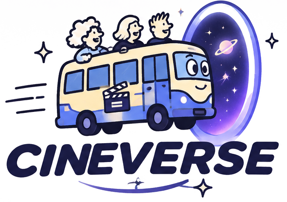
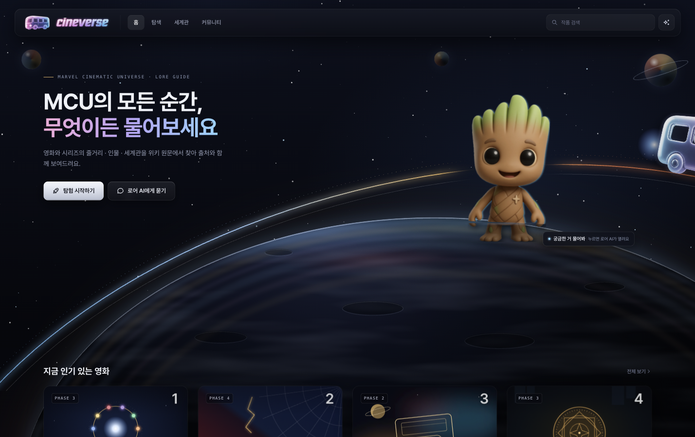
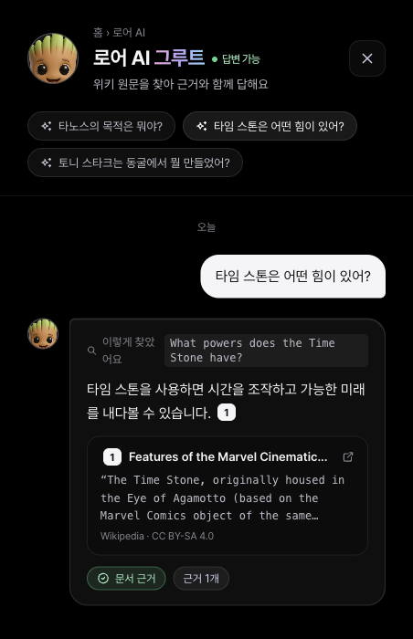
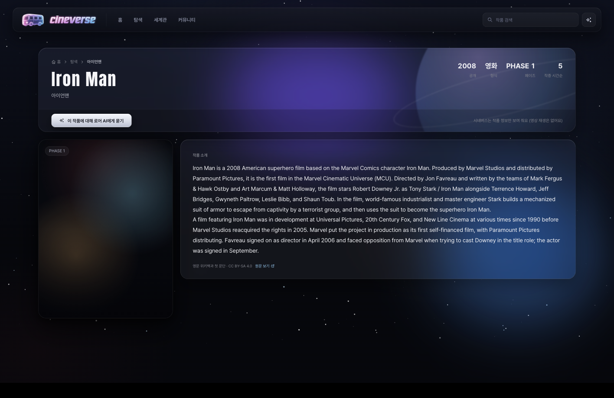
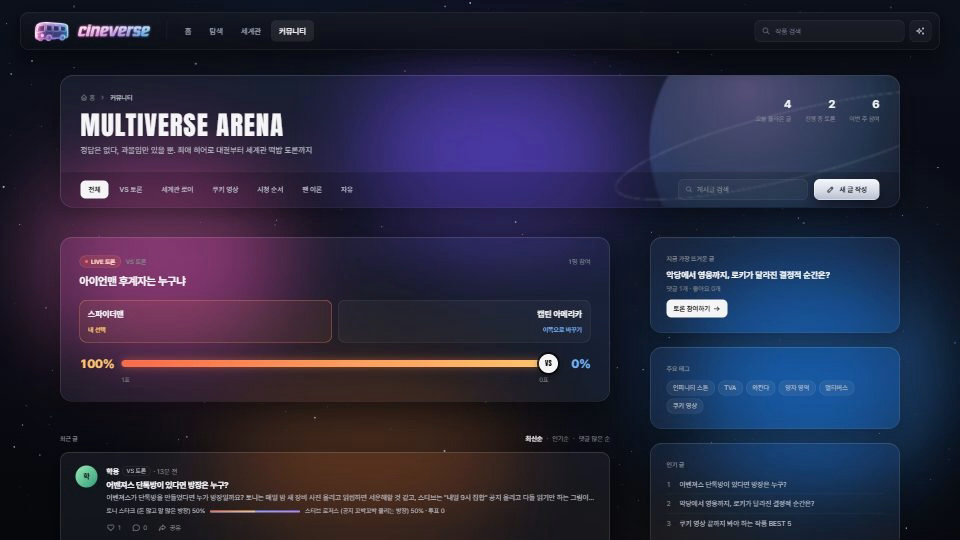

<!--
  README (2026-11-27). 남은 자리는 시연 영상 · 스크린샷 · 팀 로고다 (TODO 주석 참고).
  - 이미지는 docs/readme/images/ 에 넣는다.
  - 실행 방법 · 폴더 구조 · 결과 요약의 본문은 docs/project-guide.md 에 그대로 있다.
-->

<!-- ───────────── 1. 로고와 제목 ───────────── -->
<h1 align="center">
  <!-- TODO: 팀 로고 파일을 docs/readme/images/team-logo.png 로 넣고 src 를 바꾼다 (지금은 화면에 쓰는 로고를 임시로 건다) -->
  <br />
  Cineverse
</h1>

<p align="center"><i>영화 속 세계를, 근거와 함께.</i></p>

<!-- 기술 스택 배지 -->
<p align="center">
  
  
  
  
  
  
  
  
  
</p>

<!-- 핵심 키워드 -->
<p align="center">
  <code>RAG</code> <code>Hybrid Search</code> <code>BM25 + RRF</code> <code>Re-ranking</code> <code>Query Rewrite</code> <code>Parent Context</code> <code>Citation</code>
</p>

<!-- 한 문단 소개 -->
<p align="center">
  팀 <b>랙랙무비</b>가 만든 MCU 세계관 Knowledge Agent 입니다.<br />
  한국어로 물으면 영어 Wikipedia 문서에서 근거를 찾아 <b>출처와 함께</b> 답하고, 문서에 없는 내용은 지어내지 않고 <b>근거가 없다</b>고 안내합니다.<br />
  벡터 · BM25 · 재정렬 구성을 같은 평가셋으로 비교하고, 실행마다 원본 기록을 남겼습니다.
</p>

<br />

<!-- ───────────── 2. 프로젝트 기간 ───────────── -->
| 📅 프로젝트 기간 | 📝 과제 | 👥 팀 |
|---|---|---|
| 2026.11.23 ~ 2026.11.27 | KANT AX 1기 팀 프로젝트 3 · RAG Agent | 랙랙무비 (5명) |

<br />

<!-- ───────────── 3. 팀원 — 이름표를 누르면 회고로 간다 ───────────── -->
## 👥 팀원

<div align="center">
<table>
  <tr>
    <td align="center" valign="top" width="170">
      <br />
      <a href="https://github.com/growthandy"></a>
      <br /><br />
      <a href="./docs/retrospective/%EC%98%81%EB%AF%BC.md"></a>
      <br />
      <sub><a href="https://github.com/growthandy">@growthandy</a></sub>
      <br />
      <sub>공통 데이터셋 · 작품 카드<br />증분 적재 · 실험 취합 · 문서</sub>
      <br /><br />
    </td>
    <td align="center" valign="top" width="170">
      <br />
      <a href="https://github.com/766min"></a>
      <br /><br />
      <a href="./docs/retrospective/%EB%AF%BC%EC%A7%80.md"></a>
      <br />
      <sub><a href="https://github.com/766min">@766min</a></sub>
      <br />
      <sub>공통 부품 · 청킹과 부모 문맥<br />API 서버 · 화면 · 배포</sub>
      <br /><br />
    </td>
    <td align="center" valign="top" width="170">
      <br />
      <a href="https://github.com/bsis09872-ux"></a>
      <br /><br />
      <a href="./docs/retrospective/%EC%84%9C%EC%9D%B8.md"></a>
      <br />
      <sub><a href="https://github.com/bsis09872-ux">@bsis09872-ux</a></sub>
      <br />
      <sub>검색 파이프라인 · 서비스 경로<br />통합 테스트 · 설치 환경</sub>
      <br /><br />
    </td>
    <td align="center" valign="top" width="170">
      <br />
      <a href="https://github.com/aiagentohms"></a>
      <br /><br />
      <a href="./docs/retrospective/%EB%AA%85%EC%84%9D.md"></a>
      <br />
      <sub><a href="https://github.com/aiagentohms">@aiagentohms</a></sub>
      <br />
      <sub>평가셋 · 검색 부품<br />평가 실행 · 리라이트 · 검색 설정</sub>
      <br /><br />
    </td>
    <td align="center" valign="top" width="170">
      <br />
      <a href="https://github.com/gkrdyd97-sudo"></a>
      <br /><br />
      <a href="./docs/retrospective/%ED%95%99%EC%9A%A9.md"></a>
      <br />
      <sub><a href="https://github.com/gkrdyd97-sudo">@gkrdyd97-sudo</a></sub>
      <br />
      <sub>재정렬 · 답변 생성과 캐시<br />채점기 · 발표 화면</sub>
      <br /><br />
    </td>
  </tr>
</table>
</div>

<p align="center"><sub>이름표를 누르면 각자의 회고로 이동합니다.</sub></p>

<br />

<!-- ───────────── 4. 시연 영상 ───────────── -->
## 🎬 시연 영상

<!--
  TODO: 영상 넣는 법
  영상 파일은 저장소 폴더에 넣지 않는다 (저장소 안의 mp4 는 README 에서 재생되지 않는다).
  1) GitHub 의 이슈나 PR 댓글 입력창에 영상 파일(mp4 · mov, 무료 계정 10MB · 유료 100MB 이하)을 끌어다 놓는다
  2) 생긴 주소(https://github.com/user-attachments/assets/…)를 아래에 "그 주소만 한 줄" 로 붙인다
  3) 댓글은 올리지 않아도 주소는 남는다
-->

> 🎞️ 시연 영상 자리 — 작성 예정

<!-- TODO: 영상 아래 한 줄 설명. 예: 2배속 · 0분 00초. 질문 → 답과 출처 → 근거 없음 안내 → 영화 정보 → 게시판 순서입니다. -->

<br />

<!-- ───────────── 5. 주요 기능 ───────────── -->
## ✨ 주요 기능

| 기능 | 설명 |
|---|---|
| 💬 로어 AI 챗봇 | 한국어로 물으면 위키 원문을 찾아 근거와 함께 답합니다. 어느 화면에서든 오른쪽 패널로 열리고, 영화 화면에서 열면 그 작품을 맥락으로 붙여 묻습니다 |
| 📎 출처와 근거 | 답의 문장마다 출처 번호가 붙습니다. 번호마다 문서 제목 · 절 · 원문 발췌 · 원문 열기 · 라이선스를 보이고, 실제로 쓴 검색어는 "이렇게 찾았어요"로 보여 줍니다 |
| 🙅 근거 없음 안내 | 문서에 없는 내용은 지어내지 않고 "확인 가능한 근거를 찾지 못했습니다"로 답합니다. 질문의 일부만 확인되면 "일부만 확인됨"으로 표시하고, 검색 · 생성 장애는 근거 없음과 구분해 오류로 알립니다 |
| 🎬 영화 정보 · 탐색 | MCU 정식 영화 · 시리즈를 공개 연도순 카드로 모았습니다. 한국어 제목이나 원제로 검색하고 페이즈로 거르며, 카드를 누르면 작품 소개 · 형식 · 공개 연도 · 페이즈 · 작중 시간순을 봅니다 (보기 전용) |
| 🌌 세계관 타임라인 | 개봉 순서가 아니라 이야기 속 시간 순서대로 작품을 따라갑니다 |
| 🗣️ 커뮤니티 게시판 | 글 · 댓글 · 좋아요와, 두 선택지에 한 표씩 던지는 VS 토론이 있습니다. 최신순 · 인기순 · 댓글 많은 순 정렬과 검색, 로그인 없이 비밀번호로 삭제. 게시판 글은 챗봇의 근거로 쓰지 않습니다 |
| 📊 구성 비교 (발표 화면) | Streamlit 화면에서 평가셋 31문항을 눌러 바로 검색하고, 검색 구성 A · B · C 의 답을 나란히 비교하며, 후보 순위와 재정렬 점수 같은 검색 과정을 확인합니다 |

<br />

<!-- ───────────── 6. 핵심 구현 포인트 ───────────── -->
## 🛠️ 핵심 구현 포인트

| 구분 | 내용 |
|---|---|
| ✂️ 청킹과 부모 문맥 | 문단을 모아 최대 800자로 묶고 긴 문단만 문장 경계에서 자릅니다 (`Dr.` · `S.H.I.E.L.D.` 같은 약어에서 끊지 않음). 청크마다 원문의 시작 · 끝 위치를 남겨, **검색은 작은 청크로 하고 생성에는 그 청크가 속한 절을 원문에서 최대 3,000자 잘라** 넘깁니다 |
| 🔎 하이브리드 검색 | 벡터 검색(pgvector)과 BM25 에서 40개씩 가져와 RRF 로 결합합니다. 두 검색의 점수 척도가 달라 점수가 아니라 순위로 합치고, 합친 목록은 자르지 않습니다 |
| 🥇 재정렬 | Cross-Encoder 가 질문과 청크를 한 쌍으로 다시 읽어 순위를 고치고 상위 8개를 생성에 넘깁니다. 장치는 `cuda → mps → cpu` 순으로 자동 선택하고, 재정렬 라이브러리는 선택 설치 그룹이라 기본 설치와 CI 에는 들어가지 않습니다 |
| 🌐 영문 리라이트 | 문서가 영어라 이름 사전으로 영어 정식 이름을 덧붙이고 질문 전체를 영어 검색어로 바꿉니다 (모든 구성 기본). 작품 · 인물 이름은 번역 전에 표시로 가렸다가 사전의 글자로 되돌리고, 실험에서는 저장한 검색어 파일로 검색어를 고정합니다 |
| 🧾 근거 제한 생성과 인용 검증 | 근거만으로 영어 초안을 쓰게 하고 주장마다 청크 ID 를 인용하게 합니다. 근거에 없는 인용은 버리고, 남은 인용이 없으면 근거 없음으로 답한 뒤 한국어로 번역합니다. 근거 없음과 검색 · 생성 장애는 상태를 따로 둡니다 |
| 🧪 평가 체계 | 정답을 청크 번호가 아니라 **원문 발췌**로 적어 청킹을 바꿔도 같은 문항을 씁니다. 정답 키의 색인 버전이 다르면 평가가 시작되지 않고, Hit@k · 실패 단계 다섯 가지 · LLM 채점(채점기 검사 먼저)을 실행마다 원본 기록으로 남깁니다 |
| ♻️ 증분 적재 | 청크마다 내용 해시를 두어 바뀐 청크만 다시 임베딩하고, 전체 해시를 색인 버전으로 씁니다. 평가한 색인이 조용히 바뀌지 않도록 기존 행 변경 · 다른 컬렉션과의 ID 충돌 · 임베딩 모델 섞임을 적재 전에 막습니다 |

> 👉 설계와 바뀐 이유는 [설계 문서](./docs/architecture.md)에서 확인할 수 있습니다.

<br />

<!-- ───────────── 7. 평가 결과 ───────────── -->
## 📊 평가 결과

<!--
  개발용 11문항(답변 가능 10) 기준. 값은 docs/test_comparison/ 의 세 문서에서 옮긴 것이다.
  TODO: 최종 20문항(eval/test.json)을 돌리면 그 표를 이 아래에 더하고 report.md 로 연결한다.
-->

| 실행 | 설정 (생성 수 · 후보 · 문맥) | 재정렬 장치 | Hit@5 | 답 정답 (자동 채점) | 응답 중앙값 |
|---|---|---|---|---|---|
| 리라이트 없음 | 5 · 20 · 청크 | CPU | A 2 · B 1 · C 2 | 1 · 0 · 1 | 1.9 · 2.5 · 13.8초 |
| 리라이트 기본 | 5 · 20 · 청크 | CPU | A+ 6 · B+ 5 · C+ 5 | 4 · 2 · 3 | 3.7 · 3.7 · 15.9초 |
| 〃 | 5 · 20 · 청크 | Apple M2 (mps) | A+ 6 · B+ 5 · C+ 5 | 4 · 3 · 3 | 3.0 · 3.4 · 6.7초 |
| 설정 조정 뒤 (지금 기본값) | 8 · 40 · 부모 문맥 | NVIDIA (cuda) | A+ 6 · B+ 5 · **C+ 7** | 4 · 3 · **5** | 3.4 · 4.1 · 4.8초 |

<sub>A 벡터 · B +BM25 · RRF · C +재정렬, `+` 는 영문 리라이트. 분모는 답변 가능 10문항.</sub>

- 문서가 영어라 한국어 질문 그대로는 정답이 후보에도 잘 오르지 않았다. 영문 리라이트를 모든 구성의 기본으로 했다.
- 컴퓨터 성능을 타는 단계는 재정렬뿐이다 (후보 20 기준 CPU 12.1초 · mps 2.4초, cuda 는 후보 58~76개에 1.5초).
- 11문항이라 1문항이 10%p 이고 같은 조건에서도 답 정답이 ±1문항 흔들린다. **결론이 아니라 방향**으로 읽는다. 최종 20문항은 아직 돌리지 않았다.

> 👉 문항별 순위 · 단계별 시간은 [평가 결과 문서](./docs/test_comparison/), 평가셋은 [eval/README](./eval/README.md)에서 확인할 수 있습니다.

<br />

<!-- ───────────── 8. 스크린샷 ───────────── -->
## 📸 스크린샷

<!--
  TODO: 파일을 docs/readme/images/ 에 아래 이름으로 넣고, 각 칸의 주석을 풀어 "자리" 글자와 바꾼다
  screen-home.png · screen-chat.png · screen-movie.png · screen-board.png · screen-streamlit.png
-->

<table>
  <tr>
    <th>홈</th>
    <th>로어 AI 챗봇</th>
  </tr>
  <tr>
    <td align="center" valign="top" width="420">
      <!--  -->
      🖼️ 스크린샷 자리
    </td>
    <td align="center" valign="top" width="420">
      <!--  -->
      🖼️ 스크린샷 자리
    </td>
  </tr>
  <tr>
    <th>영화 정보</th>
    <th>커뮤니티</th>
  </tr>
  <tr>
    <td align="center" valign="top" width="420">
      <!--  -->
      🖼️ 스크린샷 자리
    </td>
    <td align="center" valign="top" width="420">
      <!--  -->
      🖼️ 스크린샷 자리
    </td>
  </tr>
  <tr>
    <th colspan="2">발표 화면 (Streamlit) — 구성 비교와 검색 과정</th>
  </tr>
  <tr>
    <td align="center" valign="top" colspan="2">
      <!--  -->
      🖼️ 스크린샷 자리
    </td>
  </tr>
</table>

<br />

<!-- ───────────── 9. 실행 방법 ───────────── -->
## 🚀 실행 방법

모든 명령은 저장소 루트에서 실행합니다. Python 3.13 · [uv](https://docs.astral.sh/uv/) · Docker · Node.js 20.9 이상이 필요합니다.

```bash
# 1. 받기와 .env
git clone https://github.com/766min/ax-rag-cinema.git
cd ax-rag-cinema
cp .env.example .env                      # 키를 채웁니다 (커밋 금지)

# 2. 의존성 (재정렬까지 쓰려면 --group rerank, NVIDIA GPU 는 --group rerank-cu128)
uv sync --locked --group rerank

# 3. DB 와 데이터셋 (팀에서 받은 폴더를 data/cineverse-dataset-schema/ 에 풉니다)
docker compose up -d

# 4. 색인 만들기 (OpenAI 임베딩 1회, 2,493행)
PYTHONPATH=src uv run --locked python scripts/build_index.py --recipe s800

# 5. 실행 — API 서버와 화면
uv run --locked --group rerank uvicorn api.main:app --app-dir src --port 8000
cd web && npm install && npm run dev      # http://localhost:3000
```

| 단계 | 내용 |
|---|---|
| 1. 받기와 `.env` | 필수 키는 `OPENAI_API_KEY` · `EMBEDDING_MODEL` · `LLM_PROVIDER` · `LLM_MODEL` · `REASONING_EFFORT` · `LLM_TIMEOUT` · `DATABASE_URL` · `MOVIE_COLLECTION` 입니다. 로컬 DB 주소는 `127.0.0.1` 로 적습니다 |
| 2. 의존성 설치 | 기본 설치(`uv sync --locked`)에는 재정렬 모델이 없습니다. 기본 설치로 갈 때는 `.env` 에 `ASK_MODE=B+` 를 두면 재정렬 없이 챗봇이 뜹니다 |
| 3. DB 와 데이터셋 | pgvector 컨테이너(`ax-rag-db`)가 `127.0.0.1:5432` 에 뜹니다. 데이터셋은 저장소에 없어 팀에서 받아야 합니다 (IMDb 에서 온 값이 들어 있어 재배포할 수 없습니다) |
| 4. 색인 만들기 | 적재가 끝나면 2,493행 · `index_version 13c955090983a2f9` 가 나와야 평가 결과와 같은 색인입니다. 다시 돌리면 전부 건너뜁니다 |
| 5. 실행 (API · 화면) | 서버가 켜지면 색인과 재정렬 모델을 미리 읽습니다. 그동안의 질문은 "잠시 후 다시" 로 답합니다. 화면은 `localhost:3000`, API 는 `localhost:8000/api/*` 입니다 |

**더 짧은 길**

- **화면만 보기** — 키 · DB · 색인 없이 가짜 답으로 화면을 띄웁니다. 영화 목록에는 데이터셋이 필요합니다.
  ```bash
  FAKE_ASK=true uv run --locked uvicorn api.main:app --app-dir src --port 8000
  ```
- **터미널에서 질문 한 건** — 화면 없이 검색 후보 → 모델이 읽은 범위 → 인용까지 찍습니다 (`--mode A` 는 재정렬 그룹 없이도 됩니다).
  ```bash
  PYTHONPATH=src uv run --locked python scripts/ask.py "타임 스톤이 뭐야?" --mode A
  ```

> 👉 재정렬 설치 그룹 고르기 · 일괄 평가와 채점 · 발표용 Streamlit · 배포는 [프로젝트 가이드](./docs/project-guide.md#시작하기)와 [배포 문서](./docs/deploy.md)에 있습니다.

<br />

<!-- ───────────── 10. 더 알아보기 ───────────── -->
## 📚 더 알아보기

<div align="center">
<table>
  <tr>
    <td align="center" valign="top" width="260">
      <br />
      <a href="./docs/problem.md"><b>🎯 문제 정의</b></a>
      <br />
      <sub>사용자 · 범위 · 성공 기준 · 한계</sub>
      <br />
      <br />
    </td>
    <td align="center" valign="top" width="260">
      <br />
      <a href="./docs/architecture.md"><b>🏗️ 설계</b></a>
      <br />
      <sub>데이터 · 색인 · 검색 · 답변 · 평가</sub>
      <br />
      <br />
    </td>
    <td align="center" valign="top" width="260">
      <br />
      <a href="./docs/test_comparison/"><b>📊 평가 결과</b></a>
      <br />
      <sub>세 컴퓨터의 개발 11문항 비교</sub>
      <br />
      <br />
    </td>
  </tr>
  <tr>
    <td align="center" valign="top" width="260">
      <br />
      <a href="./docs/project-guide.md"><b>🧭 프로젝트 가이드</b></a>
      <br />
      <sub>실행 방법 · 폴더 구조 · 작업 규칙</sub>
      <br />
      <br />
    </td>
    <td align="center" valign="top" width="260">
      <br />
      <a href="./docs/shared-insights.md"><b>🧩 취합 기록</b></a>
      <br />
      <sub>다섯 실험에서 가져온 것 · 버린 것 · 실패 사례</sub>
      <br />
      <br />
    </td>
    <td align="center" valign="top" width="260">
      <br />
      <a href="./docs/retrospective/"><b>💭 회고</b></a>
      <br />
      <sub>팀원별 회고</sub>
      <br />
      <br />
    </td>
  </tr>
  <tr>
    <td align="center" valign="top" width="260">
      <br />
      <a href="./eval/README.md"><b>🧪 평가셋</b></a>
      <br />
      <sub>31문항을 만든 방법 · 한계</sub>
      <br />
      <br />
    </td>
    <td align="center" valign="top" width="260">
      <br />
      <a href="./docs/deploy.md"><b>🚢 배포</b></a>
      <br />
      <sub>서버 한 대 · Docker · HTTPS</sub>
      <br />
      <br />
    </td>
    <td align="center" valign="top" width="260">
      <br />
      <a href="./docs/translation_tool.md"><b>🈯 번역 도구</b></a>
      <br />
      <sub>이름 사전 · 리라이트 · 답변 번역</sub>
      <br />
      <br />
    </td>
  </tr>
</table>
</div>

<br />

<!-- ───────────── 11. 출처 · 안내 ───────────── -->
## 📎 데이터 출처와 안내

- 색인한 본문은 영어 Wikipedia 의 텍스트이며 CC BY-SA 4.0 조건에 따라 문서마다 출처 주소와 판 번호를 남기고, 답변의 출처에 주소와 라이선스를 표기합니다.
- 데이터셋은 저장소에 없습니다 (IMDb 에서 온 값이 들어 있어 재배포할 수 없습니다).
- 이 프로젝트는 수업 과제로 만든 비공식 프로젝트이며, 영화·캐릭터·제작사 등 특정 권리자나 동일한 이름의 기업·서비스와 무관합니다.
