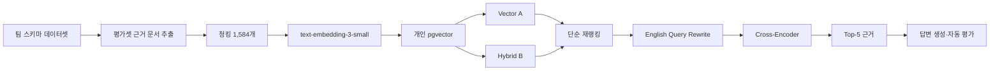

# CINEVERSE | 개인 RAG 실험 보고서

**랙랙무비 · 2026.11.25 · 팀 공통 RAG 설정 결정을 위한 독립 실험**

> 목적은 팀 공통 RAG 설정(Vector·Hybrid·Rewrite·Re-ranking·청킹)을 결정하기 위한 실험 근거를 제공하는 것이다. 실행은 `exp/hakyongchunk` 브랜치와 팀 DB와 분리된 개인 PostgreSQL 컬렉션에서 수행했으며, 커밋·푸시는 하지 않았다.

## 1. 목적 및 핵심 결론

영어 MCU 위키 문서에 한국어 질문을 검색할 때 임베딩, Hybrid 검색, Query Rewrite, 재랭킹, 문맥 배치가 검색·답변 품질에 미치는 영향을 비교했다.

- Query Rewrite가 한국어 질문과 영어 문서 사이의 언어 차이를 줄였다.
- 단순 키워드 겹침 재랭킹은 성능을 낮출 수 있었다.
- 실제 Cross-Encoder 재랭킹은 단순 재랭킹보다 개선됐다.
- Overlap은 많이 넣는다고 좋아지지 않았고 문서 유형별 정책이 필요했다.
- Context 앞·중간·뒤 배치는 이번 짧은 Top-K 조건에서 뚜렷한 우위를 보이지 않았다.

## 2. 공통 실험 조건

| 항목 | 조건 |
|---|---|
| 데이터 | 팀 스키마 데이터셋에서 평가셋 근거 문서 추출 |
| 문서 범위 | 영화·인물·세계관 문서 |
| 질문 | 20개 |
| 청크 수 | 1,584개 |
| 임베딩 | `text-embedding-3-small` |
| 검색 | Vector / BM25 + Vector RRF |
| 재랭킹 | 단순 키워드 겹침 / Cross-Encoder |
| 최종 후보 | Top 5 |
| DB | 팀 DB와 분리된 개인 pgvector 컬렉션 |

팀원 보고서와 데이터 범위·청킹·평가 문항이 완전히 같지 않으므로 점수를 직접 합산하지 않고 설정 선택용 근거로 해석한다.

## 3. 실험 흐름

## 4. 단계별 실험과 판단

| 단계 | 실험 | 결과 | 판단 |
|---|---|---|---|
| EXP-01 | 영화 38편·309청크 Vector baseline | Hit@5 4/13 | 영화 문서만으로는 인물·세계관 질문 평가가 부족함 |
| EXP-02 | Vector·Hybrid·단순 재랭킹 | 단순 재랭킹 0/13 | 재랭킹 점수 함수 개선 필요 |
| EXP-03 | 별칭·영문명 확장 | 2/13 | 이름 추가만으로는 제한적 |
| EXP-04 | English Query Rewrite | 10/13 | 검색어 변환 효과 확인 |
| EXP-05 | Overlap 0·150·300자 | 4/13 → 3/13 → 2/13 | 일괄 overlap 증가를 기본값으로 채택하지 않음 |
| EXP-06 | 전체 gold 문서 1,584청크 | 20문항 연결 | 영화·인물·세계관을 함께 평가해야 함 |
| EXP-07 | 실제 Cross-Encoder | Hit@5 13/20 | 단순 재랭킹보다 유효 |
| EXP-08 | 답변 자동 평가 | 20개 생성 | 수동 검증·RAGAS 추가 필요 |

## 5. 검색 결과

| 방식 | Hit@5 | MRR |
|---|---:|---:|
| Vector A | 3/20 | 0.070 |
| Hybrid B | 3/20 | 0.070 |
| 단순 키워드 재랭킹 C | 1/20 | 0.010 |
| English Rewrite + 단순 재랭킹 | 9/20 | 0.228 |
| **English Rewrite + Cross-Encoder** | **13/20** | **0.471** |

Vector와 Hybrid는 동일한 기준선을 보였다. BM25 추가만으로는 자동 개선되지 않았고, Rewrite와 Cross-Encoder 조합이 가장 좋은 결과를 냈다.

## 6. Overlap과 Context 평가

| Overlap | 청크 수 | Hit@5 | MRR |
|---|---:|---:|---:|
| 0자 | 309 | 4/13 | 0.135 |
| 150자 | 309 | 3/13 | 0.077 |
| 300자 | 309 | 2/13 | 0.064 |

| Context 배치 | 답변 생성 | 충족 사실 | 부분 | 미충족 | 평균 지연 |
|---|---:|---:|---:|---:|---:|
| 앞 | 19/20 | 23 | 9 | 32 | 6,193ms |
| 중간 | 20/20 | 19 | 15 | 33 | 6,300ms |
| 뒤 | 20/20 | 22 | 13 | 34 | 6,068ms |

전체 gold Rewrite 답변 자동 평가에서는 답변 20/20, 충족 사실 24, 부분 19, 미충족 24, 평균 5,999ms였다. LLM 자동 판정이므로 비교용 기준선이다.

## 7. 핵심 인사이트

### 인사이트 1. 검색 언어가 핵심 병목이다

한국어 질문을 영어 위키에 그대로 검색하기보다 영어 검색어로 변환하는 Query Rewrite를 기본 검색 파이프라인 후보로 둬야 한다.

### 인사이트 2. 검색기를 복잡하게 만든다고 품질이 보장되지 않는다

Hybrid와 단순 재랭킹은 Vector보다 자동으로 좋아지지 않았다. 후보 수·RRF·BM25 토큰화를 독립적으로 검증해야 한다.

### 인사이트 3. C는 Cross-Encoder 후보로 비교해야 한다

단어가 많이 겹치는 문서가 가장 관련 있는 문서는 아니다. 질문과 문서를 함께 읽는 Cross-Encoder가 더 적합했다.

### 인사이트 4. Overlap은 문서 유형별 정책이 필요하다

plot·biography·lore를 동일하게 처리하지 말고 근거 보존과 중복 비용을 비교해야 한다.

### 인사이트 5. Context 순서는 아직 확정할 수 없다

짧은 Top-5 문맥에서는 앞·중간·뒤 배치의 우위가 확정되지 않았다. 현재는 검색 순서를 유지한다.

## 8. 한계

- 팀원 실험과 데이터·청킹·질문 세트가 달라 점수를 직접 합산할 수 없다.
- 답변 평가는 LLM 자동 판정이며 수동 교차 검토가 없다.
- RAGAS 평가를 아직 수행하지 않았다.
- Cross-Encoder는 영어 MS MARCO 모델이므로 한국어용 모델과 비교하지 않았다.
- Overlap은 문자 기준이며 팀원의 문장·절별 차등 레시피와 동일하지 않다.
- Guardrail·Streamlit UI·팀 서비스 통합은 범위에 포함하지 않았다.

## 9. 팀에 전달할 제안과 다음 작업

1. 공식 평가셋을 20문항으로 할지 30문항으로 할지 확정한다.
2. CK05와 CK09를 동일 평가셋으로 비교한다.
3. Query Rewrite를 공통 검색 전처리 후보로 포함한다.
4. C는 단순 키워드가 아닌 Cross-Encoder 후보로 비교한다.
5. 같은 질문·gold chunk·Top-K·생성 모델로 A/B/C 공식 평가를 실행한다.
6. 최종 설정을 팀 DB에 적재한다.
7. 검색 누락·순위 실패·재랭킹 실패·생성 실패로 실패를 분류한다.
8. RAGAS·수동 채점·Guardrail·UI를 팀 프로젝트에 통합한다.

## 10. 산출물

- `results/openai-gold-chunks.jsonl`
- `results/openai-gold-full-experiment.json`
- `results/openai-gold-cross-encoder.json`
- `results/openai-gold-answer-evaluation.json`
- `scripts/index_openai_team_movies.py`
- `scripts/run_openai_full_experiment.py`
- `scripts/evaluate_cross_encoder.py`
- `scripts/evaluate_openai_answers.py`

**상태:** 개인 실험 완료, 팀 최종 설정 확정 전. 커밋·푸시는 하지 않았다.
