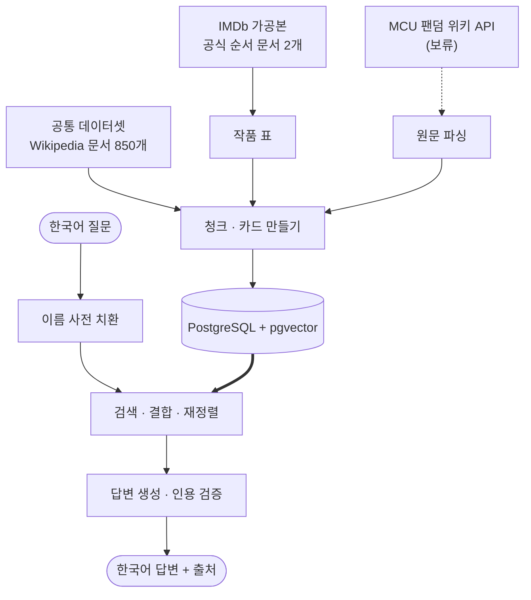
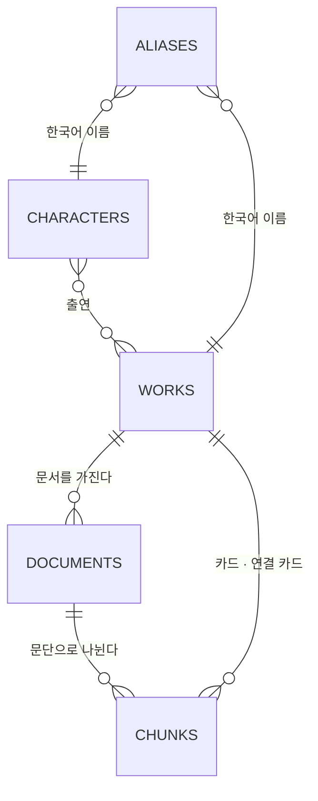
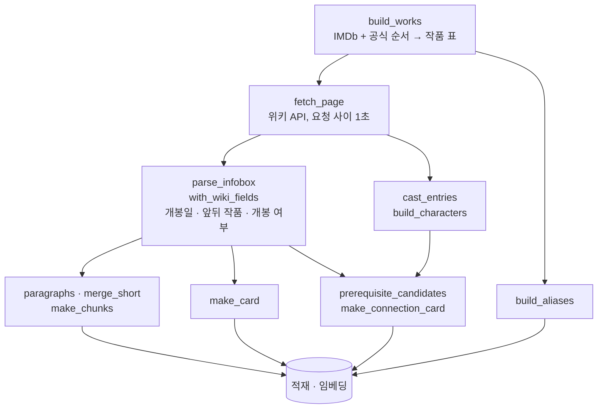
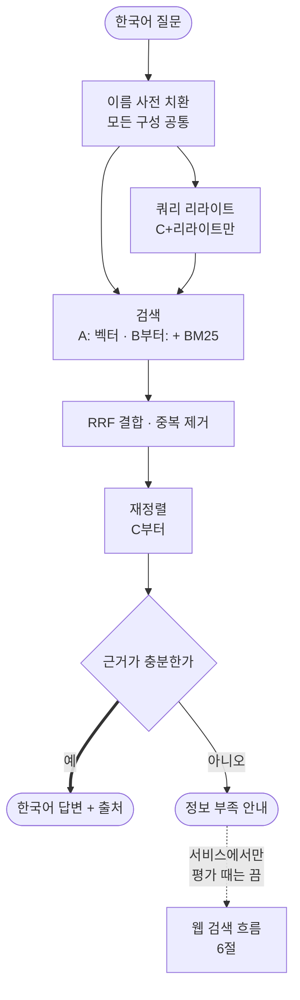

# architecture.md — Cineverse (랙랙무비)

> 상태: **초안** (2026-11-24, 같은 날 웹 검색 흐름 §6 · Wikipedia 데이터셋 §4.1 · 증분 적재 §4.2 · 호출 기록 §9 추가). **2026-11-25**: 본문 데이터가 공통 데이터셋(`cineverse-dataset-schema`, 영어 Wikipedia 문서 850개)으로 정해져 §1 · §2 · §3 · §4.1 · §8 · §11 · §12 를 맞췄다. 무엇을 왜 만드는지는 `problem.md`, 이 문서는 **어떻게 만드는지**를 적는다.
> 기준: 팀 저장소 `main` 의 `659fe8e` (공통 부품 병합 뒤) + 2026-11-23 데이터 구조 설계. 데이터 모양은 2026-11-25 `dev` 의 `bcb0943` (`src/shared/core/models.py`) 기준.
> 표시: ✅ 팀 저장소에 있음 · 🧪 실험 폴더에서 구현·테스트 끝남(아직 PR 전, 테스트 77개 통과) · ⬜ 예정.

---

## 1. 한눈에

시스템은 두 흐름으로 나뉜다. **색인 흐름**은 미리 한 번 돌려 문서를 청크로 만들어 넣고, **질의 흐름**은 질문마다 돈다. 평가는 질의 흐름을 구성만 바꿔 가며 같은 문항으로 돌린다. 질의 흐름 끝에는 문서에 근거가 없을 때 도는 **웹 검색 흐름**(§6)이 붙는다.


*그림 1. 위쪽이 색인 흐름(미리 한 번), 질문에서 시작하는 줄이 질의 흐름(질문마다)이다. 두 흐름은 DB 에서만 만난다. 2026-11-25 기준으로 본문은 공통 데이터셋에서만 오고, 팬덤 위키 수집은 보류다 (§2).*

## 2. 데이터가 오는 곳

| 출처 | 가져오는 것 | 방식 | 이용 조건 |
|---|---|---|---|
| IMDb 가공본 (132행) | 작품 ID(`tconst`) · TMDB ID · 한/영 제목 · 연도 · 유형 | 팀이 정제한 CSV. 공통 데이터셋의 작품 표가 이 목록에서 출발한다 | 재배포 불가 → 저장소에 올리지 않는다 (git 제외 폴더 `data/`) |
| Marvel.com 「MCU Complete Timeline」 (2026-10-22) | 정식 작품 여부 · 타임라인 순번 (시즌 단위 81행) | 값만 옮긴 CSV | 값 · URL · 기준일만 저장 |
| Disney+ 「Marvel Movies In Order」 (2026-11-04) | 페이즈 · 사가 · 영화 개봉 순번 (63행) | 값만 옮긴 CSV | 값 · URL · 기준일만 저장 |
| **영어 Wikipedia — 공통 데이터셋** (본문의 원천, 2026-11-25) | 문서 850개(작품 · 시즌 · 에피소드 · 인물 · 세계관)의 절별 본문 · 정보 상자 · 링크와, 팀 모델로 짠 작품 표 · 문서 표 · 이름 사전 | 수집 담당이 MediaWiki API 로 판을 고정해 받은 묶음을 팀 모델에 맞춰 다시 짠 `cineverse-dataset-schema` 를 읽어 들인다 (§4.1) | CC BY-SA 4.0. 문서마다 URL · 판 번호 · 수집 시각. 전 레코드가 검토 전(`pending_review`) |
| MCU 팬덤 위키 ⏸ | (받지 않음) — 본문(Synopsis · Plot) · 정보 상자 · 출연진 · 인물 소개를 받을 계획이었다 | 약관 확인 전이라 **보류**한다. 받게 되면 MediaWiki API `action=parse` 로 받는다 (HTML 을 긁지 않는다). 실험 폴더에 파서가 있다 (§4) | 받게 되면 CC BY-SA, 문서마다 URL 과 판 번호 저장 |
| 팀의 한글화 작업 | 약칭 · 인물 한국어명 | `data/official/aliases_ko.csv` | — |
| Brave Search API | 웹 검색 결과의 제목 · URL · 요약 스니펫 | 질문마다 호출 (§6) | **결과 저장에 약관 제한이 있다** — §6 의 "적재의 조건" |

공식 제목과 IMDb ID, 위키 문서 제목을 잇는 대응표가 `title_map.csv` (86행)다. 정식 작품인지는 이 표에 올랐는지로 정한다. 공식 순서 문서 추출본 두 개와 이 대응표는 공통 데이터셋의 `extra/` 에 함께 들어 있다.

## 3. 데이터 구조


*그림 2. 검색되는 것은 청크뿐이고, 나머지 표는 청크의 머리말 · 카드 · 필터를 만드는 재료다.*

| 표 | 한 행 | 주요 칸 |
|---|---|---|
| `works` | 작품 또는 시즌 (159행) | `work_id` · `title_ko` · `title_original` · `format` · `year` · `season` · `parent_work_id` · `phase` · `timeline_order` · `is_canon` · `source_ids` |
| `documents` | 수집한 문서 (Wikipedia · 웹 검색 결과 · 팬덤 위키) | `doc_id` · `work_id` · **`source_id`** · `source_url` · `license` · `revid` · `fetched_at` · `doc_type` · `source_ids` |
| `chunks` | 검색 단위 | `chunk_id` · `doc_id` · `work_id` · `source_id` · `section` · `position` / `total` · `text` · `header` · `title_ko` · `title_original` · `source_url` · `revid` · `entities` · `flags` · **`content_hash`** · `source_ids` |
| `characters` | 인물 | `char_id` · `real_name` · `hero_names` · `name_ko` · `actors` (배우별 출연 작품) |
| `aliases` | 한국어 이름 한 개 | `alias_ko` · `canonical_en` · `kind` (work / character / item) · `target_id` |

표의 칸은 `src/shared/core/models.py` 의 `Work` · `Document` · `Chunk` · `Alias` 와 같다 (2026-11-25 에 코드에 맞춤). 처음 설계에 있던 `works` 의 `wiki_page` · `release_date` · `status` · `saga` · `canon_source` · `canon_asof` · `prev` · `next` · `collect_wave` 는 모델에 칸이 없어서, 공통 데이터셋의 **`extra/works_meta.jsonl`** 에 `work_id` 로 이어 둔다. `characters` 는 아직 모델이 없고 수집된 인물 633행이 `extra/characters.jsonl` 에 있다.

**원본 ID 칸 `source_ids`** (2026-11-25, PR #14) — 수집 데이터셋의 원래 번호를 문자열로 남긴다. 작품은 `imdb_tconst` · `team_content_id`(`cnt_…`) · `wikipedia_document_id`(`doc_…`), 문서는 `team_document_id`(`doc_…`) · `team_content_id` · `pageid` · `wikidata_qid` · `article_url`. 평가셋의 근거가 원본 `doc_…` 번호와 절 번호로 적혀 있어서, 이 칸으로 새 `doc_id` 를 찾는다 (§8). `content_hash` 의 재료는 아니다.

**출처 칸 `source_id`** (2026-11-24 추가) — 문서가 어디서 왔는지를 `fandom` · `wikipedia_en` · `brave` 로 적는다. 같은 영화의 문서가 출처별로 따로 있으므로(팬덤 위키 1 + Wikipedia 1) `doc_type` 은 문서의 종류(`film` · `season` …)만 맡고, 출처는 이 칸이 맡는다. 청크 메타데이터에도 같은 값을 넣어 한 출처만 골라 검색할 수 있게 한다.

**ID 규칙**
- 영화: `tt4154796`. 타임라인이 시즌별로 적은 시리즈: 시즌마다 `tt9140554-S1`, `parent_work_id` 는 `tt9140554`. 한 줄로 적은 시리즈(〈완다비전〉 등): `tconst` 그대로.
- 청크: `{doc_id}-{section}-p{두 자리}` — 예 `tt4154796-wikipedia-plot-p07`. 이 값이 답변의 인용이자 평가 정답 키다.
- Wikipedia 문서는 `{work_id}-wikipedia`, 그 청크는 `tt0371746-wikipedia-plot-p01`. 팬덤 위키 쪽 ID(`tt0371746-plot-p01`)와 겹치지 않는다. **문서 전체가 그 작품(또는 시즌)을 다룰 때만** 이 ID 를 쓴다 — 공통 데이터셋에서 103개.
- **작품이 없는 Wikipedia 문서**(인물 · 세계관 · 에피소드 · 작품 표에 없는 작품)는 `wp-{pageid}` 를 쓰고 `work_id` 를 비운다 — 공통 데이터셋에서 747개. 작품이 있는 문서에 `wp-` 를 쓰면 같은 글이 두 ID 로 갈리므로 모델이 막는다 (PR #14).
- 출처마다 문서 ID 의 모양이 정해져 있고(`check_doc_id`), `Document` 와 `Chunk` 를 만들 때 어긋나면 바로 오류가 난다. 처음 설계의 에피소드 ID(`tt9140554-S1E01`)와 인물 ID(`char-Iron_Man`)는 모델에 규칙이 없어 쓰지 않는다 — 둘 다 `wp-{pageid}` 다.
- 작품 카드 `{work_id}-card`, 연결 카드 `{work_id}-connection`. 두 카드는 `documents` 행이 없으므로 **외래 키를 걸지 않는다.**
- 웹 검색 결과: 문서 `web-{URL 해시 12자}`, 청크 `web-{URL 해시 12자}-web-p01`. 같은 URL 은 같은 ID 가 되어 다시 받으면 덮어쓴다.

**청크 종류 (`section`)**

| 값 | 내용 | 만드는 규칙 |
|---|---|---|
| `synopsis` | 스포일러 없는 짧은 소개 | 절 전체를 한 청크로 |
| `plot` | 줄거리 문단 (팬덤 위키 · Wikipedia 각각) | 위키 문단 하나가 한 청크. 150자 미만은 이웃 문단과 합친다. 마지막 본편 문단에 `post_credit`, 다른 판본 소절에 `alt_cut` 표시 |
| `intro` | 인물 소개 문단 | 두 편 이상 나온 인물만 |
| `biography` | 인물 서사 문단 (Wikipedia 인물 문서의 작중 행적 절) | 위키 문단 하나가 한 청크. 150자 미만은 이웃 문단과 합친다 (2026-11-25 추가, PR #16) |
| `lore` | 세계관 문서의 본문 (아이템 · 조직 · 타임라인 · 멀티버스) | 위키 문단 하나가 한 청크. 작품이 없는 문서라 `doc_id` 는 `wp-{pageid}` (2026-11-25 추가, PR #16) |
| `connection` | 연결 카드 | 개봉 앞뒤 작품 · 타임라인 앞뒤 작품 · 선행작 후보. 줄마다 출처를 괄호로 붙인다 |
| `card` | 작품 카드 한 줄 | **모든** 작품. 제목 · 연도 · 형식 · 정식 여부와 근거 · 개봉 여부 |
| `web` | 웹 검색 결과의 요약 스니펫 | 결과 하나가 한 청크. 항상 `unverified` 표시 (§6) |

청크마다 머리말 `[Avengers: Endgame · 2019 film · Phase 3 · timeline #44]` 이 붙고, 임베딩과 BM25 는 `머리말 + 본문` 을 본다. `text` 칸에는 머리말을 넣지 않는다 — 인용으로 보이는 글자는 원문 그대로여야 한다.

**데이터셋의 절과 청크 종류** (2026-11-25) — 공통 데이터셋의 본문은 절 단위(`sections.jsonl`)이고, 절마다 위 값 중 무엇에 해당하는지를 `team_section` 칸에 적어 두었다: 작품 문서의 첫머리 → `synopsis` (449) · Plot · Premise 절 → `plot` (394) · 인물 문서의 첫머리 → `intro` (76). 나머지 11,557개 절은 이 칸이 비어 있다. 데이터셋을 만든 뒤에 `biography` · `lore` 가 `Section` 에 들어왔기 때문에(PR #16), **이 두 종류는 `team_section` 이 아니라 절의 제목과 문서로 고른다** — 인물 문서에서 첫 단계 제목에 biography 가 드는 절 → `biography`, 세계관 문서(작품 속 설정을 다루는 문서)의 본문 절 → `lore`. 평가셋 근거 55건 중 11건(20문항 중 9문항)이 이 두 종류에 있다. 그 밖의 절(작품 문서의 출연진 · 제작 · 평가 등)은 색인하지 않는다.

**색인 규칙**
- 본문 청크(`synopsis` · `plot` · `intro` · `connection`)는 `is_canon` 이고 `status = released` 이고 `collect_wave = "1"` 인 작품만 넣는다 (71편). 작품 카드는 작품 표의 모든 행에 넣는다. 그래서 정식이 아닌 작품이나 미개봉작을 물으면 카드가 검색된다.
- **공통 데이터셋에서의 수** (2026-11-25) — 작품 표는 159행이다: 작품 129 + 시즌 21 (처음 설계의 150행) + 시즌 행을 가진 시리즈의 전체 행 9. 위 조건에 드는 행은 시리즈 전체 행을 빼고 71행으로 계획과 같고, 그중 **64행에 Wikipedia 문서가 있다.** 없는 7행은 원샷 3편 · 〈팀 토르 2〉 · 〈팀 대릴〉 · 〈아이 엠 그루트〉 시즌 1 · 2 다. `status` 와 `collect_wave` 는 `extra/works_meta.jsonl` 에서 읽는다.
- 인물 · 세계관 문서는 작품에 묶이지 않으므로 `extra/documents_meta.jsonl` 의 `scope_status = "mcu"` 로 고른다 (인물 문서 76개 중 63개).
- 위 청크는 **고정 문서 컬렉션**(`MOVIE_COLLECTION`)에 들어간다. 웹 청크는 구조는 같지만 **웹 컬렉션**(`WEB_COLLECTION`)에 따로 들어간다 (§6).

## 4. 색인 흐름


*그림 3. 작품 표가 먼저 서고, 위키 원문이 그 표를 채운 뒤에 청크와 카드가 나온다.*

> **2026-11-25** — 작품 표 · 문서 표 · 본문은 공통 데이터셋에 이미 만들어져 있다 (§4.1). 그림의 `build_works` 는 그 묶음을 만들 때 쓴 규칙이고, `fetch_page` · `parse_infobox` 는 팬덤 위키를 받게 될 때 쓴다. 지금 각자 하는 일은 `sections.jsonl` 의 절을 잘라 `Chunk` 를 만드는 것(`make_chunks`)부터다.

| 단계 | 모듈 | 상태 |
|---|---|---|
| 작품 표 · 문서 표 · 본문 (공통 데이터셋) | `data/cineverse-dataset-schema/` — 팀 모델 검사 `validate.py` 포함 (§4.1) | ✅ 공유 (git 밖) |
| 작품 표 | `src/build/works.py` | 🧪 |
| 위키 수집 · 파싱 | `src/collect/wiki.py` · `src/collect/wikitext.py` | 🧪 |
| 청크 · 작품 카드 · 문서 행 | `src/build/chunks.py` | 🧪 |
| 인물 · 선행작 · 연결 카드 · 이름 사전 | `src/build/relations.py` | 🧪 |
| 전 작품을 도는 수집 실행기 | `scripts/` | ⬜ |
| 적재 · 임베딩 · 색인 대상 조회 | `src/store/db.py` (+ `shared/core/vector_store.py` ✅) | ⬜ |

지켜야 할 순서와 선이 있다.
- 카드를 만들기 **전에** `with_wiki_fields` 를 돌린다. 안 그러면 개봉일과 앞뒤 작품이 빈 카드가 나온다.
- 본문은 LLM 을 거치지 않는다. 링크 · 이미지 · 각주 표기는 규칙으로 걷어낸다.
- 위키 제목이 동음이의 문서나 넘겨주기 문서로 가면(`is_disambiguation` · `redirected_from`) 줄거리로 저장하지 않고 수집 보고서에 "확인 필요"로 남긴다.
- 인물은 위키 링크가 가리키는 문서 제목으로 묶인다. 같은 인물이 두 이름으로 갈릴 수 있으므로(Ant-Man / Scott Lang) 수집할 때 넘겨주기 정보로 합친다.

### 4.1 공통 데이터셋 들여오기 (2026-11-25)

본문의 원천은 **영어 Wikipedia** 다. 수집 담당이 MediaWiki API 로 판을 고정해 받은 묶음(문서 850개)을 **팀 모델에 맞춰 다시 짠 것**이 공통 데이터셋 `cineverse-dataset-schema` 이고, 팀원 모두 이 묶음에서 청킹을 시작한다. git 에 올리지 않고 `data/` 아래에 풀어 쓴다.

**파일**

| 파일 | 행 | 모양 |
|---|---|---|
| `works.jsonl` | 159 | 팀 `Work`. 작품 129 · 시즌 21 · 시리즈 전체 9 |
| `documents.jsonl` | 850 | 팀 `Document`. `{work_id}-wikipedia` 103 · `wp-{pageid}` 747 |
| `aliases.jsonl` | 112 | 팀 `Alias`. 작품의 한국어 제목 → 영어 제목 |
| `sections.jsonl` | 12,476 | **본문.** 문서의 절 하나가 한 행. 팀 모델에는 본문을 담는 표가 없어서(본문은 `Chunk` 에만 있다) 따로 두고 `doc_id` 로 잇는다 |
| `extra/works_meta.jsonl` | 159 | 작품마다 `status` · `collect_wave` · `canon_source` · `saga` · `release_order` · `scope_status` 등 (§3) |
| `extra/documents_meta.jsonl` | 850 | 문서마다 `title` · `scope_status` · `related_work_id` · `categories` · `infobox` 등 |
| `extra/characters.jsonl` | 633 | 수집된 인물 레코드 + `doc_id` |
| `extra/*.csv` | — | 공식 순서 문서 추출본 2개와 제목 대응표 (§2) |
| `validate.py` | — | 이 묶음을 팀 모델로 검사하는 코드 |

앞의 세 파일은 팀 모델이 내보낸 값 그대로라 `Work.model_validate_json(줄)` 로 바로 읽힌다. **청크는 들어 있지 않다** — 청킹은 각자 시험한다.

**어떻게 만들었나**

1. **수집** — MediaWiki API 로 문서 850개를 판 번호째 받아 원문을 남기고, 각주 · 주석 · 틀을 걷어내 절 단위 본문을 만들었다 (수집 데이터셋 v1.0). IMDb 목록 132편 중 112편이 Wikipedia 문서와 대응됐다.
2. **글자 되살리기** — 정제하면서 본문 글자를 담은 틀까지 지워진 곳이 있었다 (`{{Visible anchor|Peotor}} is an orangutan` → `is an orangutan`). 같은 판의 원문에서 그런 틀만 글자로 바꾼 뒤 수집 쪽의 정제 함수를 그대로 다시 돌렸다. 항목 이름 846 · 소유격 1,549 · 띄어쓰기 640 · 줄표 47 · 줄임말 235건, 문서 439개 · 절 1,000개가 바뀌었고 주어 없이 시작하던 문단 598개가 모두 고쳐졌다. **새로 쓰거나 LLM 으로 고친 글자는 없다.**
3. **팀 모델로 짜기** — 작품 표는 §3 의 규칙으로 IMDb 목록과 공식 순서 문서에서 만들었다. `timeline_order` 는 Marvel.com 타임라인 순번(81행), `is_canon` 은 두 공식 문서에 올랐는가(95행), `phase` 는 Disney+ 문서의 값이고 없으면 Wikipedia 분류의 값이다. 문서는 §3 의 ID 규칙을 따르고 원래 번호는 `source_ids` 에 남겼다.

**왜 다시 짰나** — 2026-11-24 에 받은 통합 묶음(handoff)은 팀 모델로 읽히지 않았다. 작품 378행과 문서 850행이 전부 검사에서 떨어진다 — 작품 ID 가 `cnt_…`, 문서 ID 가 `doc_…`, `is_canon` 이 문자열 `"unknown"`, 문서의 `work_id` 가 전부 빈 값이었다. `timeline_order` 에는 타임라인이 아니라 Disney 개봉 순번이 들어 있었다 (아이언맨 1 · 엔드게임 21, Marvel.com 타임라인으로는 5 · 44). 함께 온 청크 초안은 줄거리 절 하나가 통째로 한 청크였고(아이언맨 4,102자) 평가셋 근거 55건 중 35건만 담고 있었다.

**쓰는 법**

```bash
# data/ 아래에 풀고, 저장소 루트에서 검사한다. "팀 모델과 맞습니다" 가 나오면 정상이다
PYTHONPATH=src uv run python data/cineverse-dataset-schema/validate.py
```

- 청크는 `sections.jsonl` 의 절을 잘라 만든다. `team_section` 이 그 절의 종류이고(§3), `doc_id` 를 그대로 쓰면 청크 ID 의 앞부분이 팀원끼리 같아진다 — 예 `tt4154796-wikipedia-plot-p07`.
- 머리말의 제목 · 연도 · 페이즈 · 타임라인 순번은 `works.jsonl` 에서, 색인할 작품과 문서는 §3 의 색인 규칙대로 `extra/` 의 값으로 고른다.
- `validate.py` 는 모든 행이 팀 모델로 읽히는지, ID 가 겹치지 않는지, 표 사이 참조가 모두 있는지, `team_section` 이 있는 절 919개로 `Chunk` 를 만들면 ID 검사를 통과하는지 본다. 모델이 바뀌면 다시 돌린다.

**주의할 것**

1. **850개가 모두 MCU 문서는 아니다.** 수집 범위 판정(`scope_status`)이 `mcu` 인 문서는 404개다. 작품 표에도 정식이 아닌 작품 64행이 들어 있다 (카드용).
2. **`team_section` 이 빈 절이 많다** (§3). 인물 서사(`biography`)와 세계관 본문(`lore`)은 이 칸이 비어 있으므로 절의 제목과 문서로 고른다. 그 밖의 빈 절은 색인하지 않는다.
3. **에피소드 · 시즌 문서의 대부분은 작품 표에 행이 없다.** `work_id` 가 비어 있고, 속한 시리즈를 알 수 있는 84개는 `extra/documents_meta.jsonl` 의 `related_work_id` 에 적혀 있다. 시즌 문서가 작품 행과 이어진 것은 타임라인이 시즌별로 적은 시리즈뿐이다.
4. **IMDb 대응 33편은 문서가 따로 없다.** 시리즈 문서의 에피소드 줄에만 있는 것 22편, 다른 문서로 넘겨지는 것 8편, 문서의 한 절인 것 3편이다. `Work.source_ids.wikipedia_document_id` 에 대응된 문서가 적혀 있다.
5. **넷플릭스 시기 시리즈 6편**(데어데블 · 제시카 존스 · 루크 케이지 · 아이언 피스트 · 퍼니셔 · 디펜더스)은 IMDb 목록에 없어 `title_ko` 가 영어 제목이고 `year` 가 비어 있다.
6. **평가셋의 발췌문은 글자를 되살리기 전 것이다.** 발췌문을 본문에서 그대로 찾으면 아포스트로피가 들어간 곳에서 어긋난다. 영문자와 숫자만 남겨 비교하면 맞는다.
7. **되살리지 않은 것이 있다.** 단위 변환 틀(`{{convert}}`)의 숫자와 정보 상자의 값은 그대로다.
8. **전부 검토 전이다.** 모든 레코드가 `pending_review` 이고 사람이 확인한 것은 없다.
9. **공개 저장소에 올리지 않는다.** IMDb 목록에서 온 값이 들어 있다.

> **앞서 쓰던 묶음** — 2026-11-24 에는 영화 38편의 Plot 을 추린 `cineverse-wiki/data/dataset` 을 읽어 들이는 것으로 적었다. 그 묶음은 위 수집 데이터셋에서 파생된 것이고, 공통 데이터셋이 같은 문서를 모두 담고 있어 더 쓰지 않는다. 그 묶음의 순번 표(`official/`)는 목록 순번이라 순서의 근거가 아니었다.

| 단계 | 모듈 | 상태 |
|---|---|---|
| 공통 데이터셋 (작품 · 문서 · 본문 · 검사 코드) | `data/cineverse-dataset-schema/` | ✅ 공유 (git 밖) |
| 데이터셋 읽기 · 청크 만들기 | 각자 브랜치에서 시험 → `src/build/` | ⬜ |
| 정보 상자 → 작품 카드 (감독 · 상영 시간 등) | `src/build/` | ⬜ |

### 4.2 증분 적재 — 안 바뀐 청크는 다시 임베딩하지 않는다 (2026-11-24 추가)

위키 문서를 다시 받으면 판 번호는 바뀌어도 대부분의 문단은 그대로다. 청크마다 **내용 해시**를 두고, 같으면 임베딩을 건너뛴다.

- **`content_hash`** — `chunk_id` · 머리말 · 본문을 이어 SHA-256 으로 만든다. 임베딩에 들어가는 글자가 같으면 해시가 같다.
- **적재할 때** — 새로 만든 청크를 `chunk_id` 로 찾아 넷으로 가른다.

| 경우 | 하는 일 |
|---|---|
| DB 에 없다 | 임베딩해서 넣는다 (신규) |
| 있고 해시가 다르다 | 다시 임베딩해 바꾼다 (갱신) |
| 있고 해시가 같다 | 임베딩을 건너뛴다. 판 번호 같은 메타데이터만 맞춘다 (건너뜀) |
| DB 에는 있는데 새 결과에 없다 | 지운다 (삭제) — 문단 수가 줄어 번호가 사라진 경우 |

- **결과는 숫자로 남긴다** — `inserted` · `updated` · `unchanged_skipped` · `deleted`. 같은 적재를 두 번 돌리면 두 번째는 전부 건너뜀이어야 한다.
- **색인 버전** — 고정 문서 컬렉션의 `(chunk_id, content_hash)` 를 정렬해 다시 해시한 값을 `index_version` 으로 쓴다. 평가 기록의 "색인 버전" 칸이 이 값이다 (§8). 청크가 하나라도 바뀌면 값이 달라지므로, 본 평가를 돌린 뒤에는 적재를 다시 돌리지 않는다.
- 웹 청크도 같은 함수로 넣는다. 다만 웹 컬렉션은 `index_version` 에 들지 않는다.

모듈은 `src/store/db.py` ⬜.

## 5. 질의 흐름과 비교 구성


*그림 4. 이름 사전 치환은 모든 구성이 함께 거치고, 그 뒤의 칸만 구성마다 달라진다.*

| 구성     | 더하는 칸               | 메모                                                              |
| ------ | ------------------- | --------------------------------------------------------------- |
| 공통     | 이름 사전 치환            | 질문 속 한국어 이름 뒤에 영어 정식 이름을 덧붙인다. 원 질문은 지우지 않는다. 규칙 기반이라 결과가 항상 같다 |
| A      | 벡터 검색               | 한국어 질문과 영어 문서를 잇는 임베딩이어야 한다                                     |
| B      | + BM25 + RRF        | BM25 는 덧붙인 영어 이름으로 걸린다                                          |
| C      | + 재정렬 (후보 → 상위 5)   | 한국어 질문을 읽는 다국어 모델                                               |
| C+리라이트 | + 질문 전체를 영어 검색어로 변환 | 실패하거나 빈 값이면 원질문으로 검색하고 `rewrite_failed` 를 기록                    |
| D      | + LLM 가공 색인         | 원문 색인과 **다른 컬렉션**으로 만든다                                         |

- B 는 A 에, C 는 B 에 칸을 더한다. C+리라이트와 D 는 각각 C 에 하나씩 더한 것이라 둘 다 C 와 견준다.
- C 의 재정렬은 RRF 가 합친 후보 N개를 Cross-Encoder 가 질문과 한 쌍으로 다시 읽고 채점해 상위 5개만 생성 모델에 넘긴다. 벡터 · BM25 · RRF 는 질문과 청크를 나란히 놓고 읽지 않으므로, 작품 이름만 겹치는 청크가 답이 든 문단을 5위 밖으로 밀어낼 수 있다. 쌍마다 모델을 돌려 느리므로 전체 색인이 아니라 후보에만 쓴다. B 와 C 의 점수 차이가 곧 재정렬의 효과이고, 그래서 §8 에서 재정렬 전후 순위를 남긴다.
- 모든 구성이 같은 생성 모델 · 프롬프트 · 출력 한도를 쓰고, 컨텍스트는 상위 5청크다.
- 다섯 구성은 **고정 문서 컬렉션만** 읽는다. 웹 컬렉션은 읽지 않는다.
- 후보 수 · RRF 가중치 · 재정렬 입력 수 · 근거 부족 판정 · 이름 사전은 `eval/dev.json` 으로만 고친다. `eval/test.json` 은 잠근 뒤 고치지 않는다.

| 단계 | 모듈 | 상태 |
|---|---|---|
| 이름 사전 치환 | `src/retrieve/normalize.py` | ⬜ (사전 자체는 🧪) |
| 벡터 · BM25 · RRF | `src/retrieve/search.py` | ⬜ |
| 재정렬 · 리라이트 | `src/retrieve/refine.py` | ⬜ |
| 구성별 실행 | `src/retrieve/pipeline.py` | ⬜ |

## 6. 웹 검색 흐름 (2026-11-24 추가)

문서에 근거가 없는 질문을 Brave Search 로 보강하고, 받은 결과를 **기존 적재와 같은 구조**로 넣어 다음 질문부터 다시 쓰는 흐름이다. 서비스 경로에서만 돌고 평가에서는 꺼 둔다.


*그림 5. 영어 질의로 두 컬렉션을 먼저 보고, 어디에도 근거가 없을 때만 Brave 를 부른다. 받은 결과는 같은 양식으로 바꿔 넣는다.*

**단계**

| # | 단계 | 내용 |
|---|---|---|
| 1 | 영어 질의로 변환 | 이름 사전 치환 뒤 쿼리 리라이트로 질문 전체를 영어 검색어로 바꾼다 (§5 의 리라이트 부품을 그대로 쓴다). 실패하면 사전 치환만 한 질문으로 간다 |
| 2 | PGVector 조회 | 고정 문서 컬렉션은 평소처럼 검색한다. 웹 컬렉션은 **정확한 키**로 먼저 찾는다 (아래 "웹 보강분을 찾는 키") |
| 3 | 판정 | **문서 근거 있음** → 문서로 답한다. **웹 보강분 있음** → 전에 넣어 둔 웹 청크로 답한다. **미존재**(두 컬렉션 어디에도 근거가 없다) 또는 **미보강**(문서 근거가 부족한데 이 질문의 `lookup_key` 로 웹 검색을 한 기록이 없다) → 4번으로 |
| 4 | Brave Search | `GET https://api.search.brave.com/res/v1/web/search`, 헤더 `X-Subscription-Token`, 질의 `q`(영어 질의) · `count` · `search_lang=en` |
| 5 | 양식 변환 | 응답의 `web.results[]` 에서 `title` · `url` · `description` 을 꺼내 아래 표대로 `Document` + `Chunk` 로 만든다 |
| 6 | 적재 | 기존 적재와 같은 함수로 **웹 컬렉션**에 넣는다. 같은 URL 은 덮어쓴다 |
| 7 | 답변 | 웹 청크를 근거로 한국어 답을 쓰고, 출처에 제목과 URL 을 보이며 "웹 검색 결과 · 미검증" 으로 표시한다 |

**Brave 결과 → 팀 데이터 양식**

| 팀 양식의 칸 | 채우는 값 |
|---|---|
| `Document.doc_id` | `web-{URL 의 SHA-1 앞 12자}` |
| `Document.work_id` | 이름 사전이 질문에서 찾은 작품 ID. 못 찾으면 빈 값 |
| `Document.title` | Brave `title` |
| `Document.source_url` | Brave `url` |
| `Document.license` | `"brave-search-result"` (원문의 권리는 각 사이트에 있다) |
| `Document.revid` | `0` (판 번호가 없다. 시점은 `fetched_at` 이 맡는다) |
| `Document.fetched_at` | 받은 날짜 |
| `Document.doc_type` | `"web"` |
| `Chunk.chunk_id` | `{doc_id}-web-p01` |
| `Chunk.section` | `"web"` |
| `Chunk.position` / `total` | `1` / `1` |
| `Chunk.text` | Brave `description` 그대로 (강조 태그만 걷어낸다. 고쳐 쓰지 않는다) |
| `Chunk.entities` | 이름 사전에 걸린 영어 정식 이름 |
| `Chunk.flags` | `["unverified"]` |
| `Chunk.header` | `[Web · {title} · {도메인} · fetched {날짜}]` |
| 메타데이터(JSONB) | `lookup_key` · `work_id` · `query_ko` · `query_en` · `rank` · `page_age` · `language` · `content_hash` |

**웹 보강분을 찾는 키** (2026-11-24 추가)

웹 컬렉션을 유사도만으로 찾으면 같은 질문을 다시 해도 전에 넣어 둔 결과를 놓칠 수 있다. 그래서 두 개의 정확한 키로 먼저 찾는다.

| 키 | 만드는 법 | 쓰는 곳 |
|---|---|---|
| `lookup_key` | **이름 사전 치환까지만 한 질문**을 소문자로 바꾸고 공백을 하나로 줄이고 끝의 문장부호를 뗀 것 | "이 질문으로 웹 검색을 한 적이 있는가" 를 정확 일치로 본다. 있으면 Brave 를 다시 부르지 않는다 |
| `work_id` | 이름 사전이 질문에서 찾은 작품 (하나로 정해질 때만) | 그 작품의 웹 청크만 걸러 그 안에서 근거를 고른다 |

- 키를 영어 질의가 아니라 **사전 치환 뒤의 질문**으로 만드는 이유 — 사전 치환은 규칙이라 같은 질문이면 늘 같은 글자가 나오지만, 영어 변환은 LLM 이 해서 부를 때마다 글자가 달라질 수 있다.
- 판정 기준은 그대로다. 키로 찾은 웹 청크가 있어도 근거가 모자라면 근거 부족이다. `lookup_key` 가 같은 검색 기록이 있으면 다시 검색하지 않고 정보 부족을 안내한다.
- `lookup_key` 조회는 검색 기록 표(`web_search_log`)로 하고, 거기 적힌 `chunk_ids` 로 웹 청크를 꺼낸다 (아래 "적재 구현"). 2026-11-25 변경 — 처음에는 PGVector 메타데이터 필터 `filter={"lookup_key": …}` 였지만, 같은 URL 이 다른 질문에서 다시 나오면 메타데이터가 덮여 앞 질문이 결과를 잃는다.
- `work_id` 는 웹 청크 메타데이터에 남기므로 유사도 검색 때 `filter={"work_id": …}` 로 거를 수 있다.

**지키는 선**

- **컬렉션을 나눈다.** 웹 청크를 고정 문서 컬렉션에 넣으면 질문할 때마다 색인이 자라서 A · B · C 를 같은 조건으로 비교할 수 없고, 근거 없음 3문항도 웹이 답을 찾아와 채점이 안 된다. 구조는 같게, 컬렉션만 따로 둔다.
- **평가에서는 끈다.** 평가 실행기는 웹 컬렉션을 읽지 않고 Brave 를 부르지 않는다.
- **문서가 먼저다.** 문서 근거와 웹 근거가 함께 잡히면 문서 근거로 답하고, 웹 근거는 문서에 없는 부분에만 쓴다. 한 답변 안에서도 출처마다 문서인지 웹인지 구분해 보인다.
- **미검증으로 표시한다.** 웹 청크는 누가 썼는지, 맞는지 확인하지 않은 글이다. `problem.md` 가 풀려는 "확정과 추측의 혼재"를 색인 안에 다시 만들지 않도록 `unverified` 표시와 화면 띠를 항상 붙인다.
- **스니펫 안의 지시문은 따르지 않는다.** 프롬프트에서 데이터로만 다루고, 도구 권한을 주지 않는다. 검색어에 사용자 개인정보를 넣지 않는다.
- **Brave 호출이 실패하면** 원래의 정보 부족 안내를 그대로 돌려주고 `web_failed` 를 기록한다. 오류로 바꾸지 않는다.

**적재의 조건 — Brave 약관** (2026-11-24 확인, 약관 최종 개정 2026-09-01)

Brave Search API 약관 3(b) 사용 제한은 다음을 금지한다.

> (i) store, cache, or create a database of Search Results, in whole or in part, other than transient storage required for operation of Customer Applications

같은 조항의 (xiii)은 검색 결과를 모델의 평가 · 벤치마크에 쓰는 것도 금지한다. 즉 **PGVector 에 넣어 두고 다시 쓰는 6번 단계는 기본 약관에서는 허용되지 않는다.** 저장 권한이 붙은 계약(요금제 · 주문서)인지 팀이 확인해야 한다.

그래서 적재는 설정으로 여닫게 둔다. `WEB_STORE=true` 면 6번을 하고, `false` 면 5번의 양식 변환까지만 해서 그 요청의 답변에 쓰고 버린다. 흐름과 반환 양식은 두 경우에 같다.

**2026-11-25 갱신** — 팀이 저장 권한이 포함된 Brave 요금제로 바꾸기로 합의했다. 그래서 `WEB_STORE=true` 로 6번 적재를 켤 수 있다. 평가 · 벤치마크 사용 금지(xiii)는 별개 조항이므로 평가에서는 계속 끈다.

**적재 구현** (`src/webstore.py`)

| 저장소 | 내용 | 키 |
|---|---|---|
| 웹 컬렉션 `WEB_COLLECTION` (PGVector) | 웹 청크. 위 "Brave 결과 → 팀 데이터 양식" 그대로, 메타데이터에 `fetched_at` 추가 | `chunk_id` — 같은 URL 은 덮어쓰고, `content_hash` 가 같으면 다시 임베딩하지 않는다 |
| 검색 기록 표 `web_search_log` (Postgres, 처음 쓸 때 만든다) | `lookup_key` · `query_ko` · `query_en` · `work_id` · `chunk_ids`(Brave 순위 순) · `searched_at` · `results`(그 질문이 받은 결과 그대로) · `requested`(그때 요청한 개수 `count`) | `lookup_key` |

- 2번 단계의 "검색한 적이 있는가" 는 검색 기록 표로 본다. 결과가 0건인 검색도 기록해서 Brave 를 다시 부르지 않는다.
- 같은 URL 이 다른 질문에서 다시 나오면 웹 컬렉션의 청크는 마지막 질문 것으로 덮인다. Brave 스니펫은 질문마다 다른 대목을 잘라 주므로 **스니펫 본문까지 바뀐다** (실측: 겹친 URL 2개 모두 스니펫이 달랐다). 그래서 질문 → 결과는 기록 표가 `results` 로 그대로 들고, 재사용할 때는 그 질문이 받은 스니펫을 돌려준다. 웹 컬렉션은 URL 마다 최신 스니펫 하나를 두는 유사도 검색용이다.
- 재사용할 때 웹 컬렉션에서 지워진 청크는 빼고 돌려준다. 모두 지워졌으면 다시 검색한다.
- 재사용할 때는 LLM 영어 변환을 하지 않는다. `lookup_key` 는 사전 치환만으로 만들 수 있으므로 저장소를 먼저 보고, 기록에 남은 `query_en` 을 돌려준다 (`rewrite_skipped = true`).
- 기록이 `WEB_STORE_TTL_DAYS`(기본 30일)보다 오래되면 다시 검색한다. **결과가 0건인 기록은 `WEB_STORE_EMPTY_TTL_DAYS`(기본 1일)만** 기억한다 — Brave 가 일시적으로 비었거나 아직 기사가 없는 최신 소식일 수 있어서, 길게 기억하면 그 질문이 오래 "정보 부족" 으로 고정된다.
- Brave 호출이 실패한 검색은 기록하지 않는다 → 다음 질문에서 다시 시도한다.
- **요청 개수(`count`)** — 검색 기록은 질문으로만 찾으므로 그때 요청한 개수(`requested`)를 함께 둔다. 지금 `count` 가 더 크면 다시 검색하고, 같거나 작으면 저장분에서 앞의 `count` 건만 돌려준다. Brave 가 요청보다 적게 준 경우(5건 요청 → 2건)는 요청 개수로 비교하므로 매번 다시 찾지 않는다. `brave_web_search` 도구는 `count` 를 LLM 이 정하므로 이 규칙이 필요하다 (2026-11-25 리뷰 반영). 이 칸이 생기기 전의 행은 `requested = 0` 이라 한 번 다시 검색해 채운다.
- **Brave 실패 시 예전 결과** — 기한이 지났거나 개수가 모자라 다시 검색했는데 Brave 가 실패하면, 저장해 둔 결과를 대신 돌려준다 (`web_failed = true`, `web_fallback = true`, 기한이 지났으면 `web_stale = true`). 답변은 "웹 검색 결과 · 미검증" 에 더해 받은 날짜(`fetched_at`)를 보여 오래된 결과임을 알린다. 대신 쓸 결과가 없으면(처음 질문 · 0건 기록) 지금처럼 정보 부족으로 끝난다. 기한이 지나도 DB 에서 지우지는 않으므로 이렇게 쓸 수 있다 (2026-11-25 리뷰 반영).
- 저장소 조회 · 적재가 실패해도 답변은 막지 않는다. 검색 결과로 그대로 답하고 `web_store_failed` 를 기록한다.
- 재사용한 경우 `web_called = false`, `web_cache_hit = true`.

**운영 메모** (2026-11-25, 실측 기준)

| 항목 | 내용 | 대응 |
|---|---|---|
| DB 주소 | `.env` 의 `DATABASE_URL` 은 `127.0.0.1` 로 쓴다. `localhost` 는 IPv6 `::1` 을 먼저 시도하는데 Docker DB 는 IPv4 에만 열려 있어, Windows 에서 연결이 수십 초 멈춘다 (Mac · Linux 는 바로 넘어간다) | `.env.example` 반영. 배포 환경에서는 그 환경의 DB 호스트로 바꾼다 |
| DB 연결 상한 | `DB_CONNECT_TIMEOUT`(기본 5초). 공용 팩토리 `get_vector_store` · `get_raw_db_connection` 에 적용 | DB 가 꺼져 있으면 요청마다 5초 기다린다. 그때는 본 문서 검색도 함께 실패하므로 시연 전에 Docker 가 켜져 있는지 확인한다 |
| 재사용 속도 | 저장분이 있으면 LLM 변환 · Brave 없이 돌려준다. 서비스 안 두 번째 호출부터 0.01~0.03초 (첫 호출 약 3초는 DB · 사전 초기화) | — |
| 날짜가 바뀐 같은 스니펫 | 머리말에 받은 날짜가 들어가 `content_hash` 가 달라지므로 다시 임베딩한다 | 새로 검색할 때만 생기고 건당 1원 미만이라 그대로 둔다. 날짜는 "언제 받은 정보인지" 를 보여 준다 |
| 평가 격리 | 평가 실행기는 웹 컬렉션과 `web_search_log` 를 읽지 않는다 | 약관 3(b)(xiii) — 요금제 변경과 별개 |

**직접 확인하는 법** (`WEB_STORE=true`, `docker compose up -d` 뒤)

| # | 할 일 | 기대 결과 |
|---|---|---|
| 1 | `uv run python scripts/try_websearch.py "썬더볼츠 흥행 수익은 얼마야?"` | `web_called=True`, `web_cache_hit=False`, 결과 N건 |
| 2 | 같은 질문을 띄어쓰기 · 물음표만 바꿔 다시 | `web_called=False`, `web_cache_hit=True`, "영어 변환 실패: 건너뜀", 1번과 같은 결과 · 순서 |
| 3 | URL 이 겹칠 만한 다른 질문 → 1번 질문 다시 | 1번 질문은 처음 받은 스니펫 그대로 |
| 4 | DB 확인: `select lookup_key, jsonb_array_length(chunk_ids), jsonb_array_length(results) from web_search_log;` | 질문마다 1행, 두 숫자가 같다 |
| 5 | 시험 데이터 지우기 (선택) | `delete from web_search_log;` + 웹 컬렉션(`mcu_web`)의 행 삭제. 둘 중 하나만 지우면 다음 질문에서 다시 검색한다 |

**확인 시나리오와 다섯 구성 평가의 순서** (2026-11-24 추가)

튜터 실습의 확인은 네 단계다 — ① 적재 ② 같은 적재를 다시(전부 건너뜀) ③ 한국어 질의(웹 검색 · 보강) ④ 같은 질의를 다시(웹 호출 없음). 이것을 다섯 구성 평가(A · B · C · C+리라이트 · D)와 섞으면 세 군데가 부딪히므로 **앞 둘과 뒤 둘을 평가의 앞뒤로 나눈다.**

| 순서 | 하는 일 | 확인하는 것 |
|---|---|---|
| 1 | 적재 | `inserted` 가 청크 수와 같다 |
| 2 | 같은 적재를 다시 | 전부 `unchanged_skipped`, `index_version` 이 1번과 같다 → 색인이 고정됐다 |
| 3 | **다섯 구성 본 평가** (웹 흐름 끔) | 기록마다 같은 `index_version` |
| 4 | 웹 질의 1차 (문서에 근거가 없는 질문) | `web_called = true`, 답에 "미검증" 표시 |
| 5 | 같은 질의 2차 | `web_called = false`, `web_cache_hit = true` (`WEB_STORE=true` 일 때만) |

- **부딪히는 곳 1 — 색인이 바뀐다.** 웹 질의가 평가 사이에 끼면 저장소 상태가 실행마다 달라진다. 웹 청크는 다른 컬렉션이라 평가 색인은 그대로지만, 순서를 나눠 두면 따질 일이 없다.
- **부딪히는 곳 2 — 캐시 적중은 최적화 결과가 아니다.** 5번의 "두 번째는 웹을 안 부른다" 는 발제의 캐싱 최적화와 다르다. 필수 최적화는 쿼리 리라이트이고 답변 캐시는 만들지 않는다. 그래서 4 · 5번의 응답 시간을 다섯 구성과 견주지 않고, 보고서에 최적화 결과로 적지 않는다.
- **부딪히는 곳 3 — 강제 재적재.** 실습의 `force_update` 를 본 평가 뒤에 쓰면 `index_version` 이 바뀌어 기록과 색인이 어긋난다. 본 평가 뒤에는 쓰지 않는다.
- 1 · 2번은 평가와 부딪히지 않고 오히려 평가 **전에** 필요하다 — 색인이 고정됐다는 증거가 된다.

**튜터 실습과 다르게 가는 곳** — 실습(「웹검색 도구 + Retriever 연동 실습」)에서 증분 적재 · 정확한 키 조회 · 호출 기록은 가져오고, 아래 셋은 따르지 않는다.

| 실습의 방식 | 여기서는 | 이유 |
|---|---|---|
| 보강 결과로 기존 문서를 덮어쓴다 (같은 컬렉션) | 웹 컬렉션을 따로 둔다 | 평가 색인이 질문마다 바뀌면 다섯 구성을 같은 조건으로 비교할 수 없다 |
| 스니펫을 LLM 이 한국어 3~4문장으로 요약해 저장하고 URL 은 버린다 | 결과마다 제목 · URL · 스니펫 원문을 그대로 둔다 | 본문은 원문 그대로 · 색인은 영어 · 답에는 출처를 붙인다 |
| 검색 결과를 가공해 DB 에 저장한다 | `WEB_STORE` 로 여닫고 기본은 끈다 | Brave 약관이 저장을 금지한다 (위 "적재의 조건") |

| 단계 | 모듈 | 상태 |
|---|---|---|
| Brave 호출 · 양식 변환 | `src/websearch.py` | ✅ |
| 웹 컬렉션 적재 · 검색 기록 재조회 | `src/webstore.py` | ✅ (로컬 pgvector 실측 전) |
| 판정 · 적재 · 답변 연결 | `src/retrieve/pipeline.py` · `src/answer.py` | ⬜ |

## 7. 답변과 상태

- 근거 제한 프롬프트로 한국어 답을 쓰고, 사실 문장마다 `chunk_id` 를 인용한다.
- 모델이 검색 결과에 없는 `chunk_id` 를 인용하면 그 인용은 버린다. 남은 인용이 없으면 근거 없음으로 바꾼다.
- 작품 카드가 질문의 답 자체면 정상 답변이고, 카드가 문서가 없는 이유만 말해 주면 근거 없음이다.

상태는 팀 공통 부품의 `AnswerStatus` 를 쓰고, 웹 근거로 답한 경우를 가리는 값을 하나 더한다.

| 값 | 뜻 | 채점 |
|---|---|---|
| `answered` | 문서 근거를 찾아 답함 | 정답 충족 · 근거 적합 |
| `no_evidence` | 문서에 없어 정보 부족을 안내함 | 근거 없음 문항에서 1 |
| `retrieval_error` | 검색(DB · 임베딩) 호출 실패 | **올바른 거절로 세지 않는다** |
| `generation_error` | 답변 모델 호출 실패 | **올바른 거절로 세지 않는다** |
| `web_unverified` (추가 제안) | 웹 검색 결과로 답함 | 평가에는 나오지 않는다 (웹 경로를 끄므로) |

모듈은 `src/answer.py` ⬜.

## 8. 평가와 기록

- 문항 30개: 개발 10(`eval/dev.json`) · 최종 20(`eval/test.json`, 답변 가능 17 · 근거 없음 3).
- 정답 키의 근거는 `chunk_id` 로 적는다. 청크가 위키 문단이라 색인을 만들기 전에도 문서를 읽고 문단을 세어 적을 수 있다. 단, 150자 합치기 기준과 시리즈 ID 형식(§3)을 **먼저 고정**해야 번호가 안 밀린다.
- 같은 사실이 팬덤 위키와 Wikipedia 두 곳에 있으면 **두 출처의 청크를 모두 허용 근거로** 적는다. 한쪽만 적으면 다른 쪽을 찾아온 검색이 Hit@5 에서 0 이 된다.
- **지금 평가셋(`question_set.jsonl`, 20문항)의 근거는 원본 문서 번호(`doc_…`)와 절 번호로 적혀 있다.** `Document.source_ids.team_document_id` 로 새 `doc_id` 를 찾고, `sections.jsonl` 의 `section_index` 로 절을 찾은 뒤, 그 절에서 나온 자기 청크의 ID 를 `gold_chunk_ids` 에 적는다. 근거 55건의 문서와 절은 공통 데이터셋에 모두 있다. 청킹이 다르면 번호가 다르므로 기준 색인을 `gold_index_version` 에 함께 적는다.
- 평가는 웹 검색 흐름을 끄고, 고정 문서 컬렉션만 읽고, `work_id` 없이 돌린다.
- 실행마다 `results/` 에 원본을 남긴다 — 실행 ID · 질문 ID · 구성 · 버전들(색인 = `index_version` · 프롬프트 · 모델 · 이름 사전) · 호출 기록(§9 의 `trace`) · 후보와 점수 · 재정렬 전후 순위 · 원본 답변 · 출처 · 시간 · 상태 · 채점 근거. 실패한 실행도 지우지 않는다.

모듈은 `src/evals/items.py` · `run.py` · `score.py` ⬜.

## 9. API 와 화면

- `POST /ask` — 질문과 **선택 값 `work_id`** 를 받는다. 작품 화면의 탭에서 물으면 그 작품 제목을 질문에 덧붙이고, 플로팅 바처럼 작품 맥락이 없으면 비워 둔다.
- 응답은 공통 부품의 `APIResponse` 에 답변 · 상태 · 출처 목록을 담는다. 문서 출처는 작품 · 절 · 문단 · 위키 URL · 원문 발췌, 웹 출처는 제목 · URL · 스니펫이다.
- 응답에 **호출 기록 `trace`** 를 함께 담는다 (2026-11-24 추가). 화면과 실행 기록이 같은 값을 쓴다.

| 칸 | 뜻 | 쓰는 곳 |
|---|---|---|
| `query_ko` | 받은 질문 | 기록 |
| `query_normalized` | 이름 사전 치환 뒤의 질문 | 기록 · `lookup_key` 의 재료 |
| `query_en` | 변환된 영어 질의 (리라이트를 안 쓰는 구성에서는 빈 값) | 화면("이렇게 찾았습니다") · 기록 |
| `rewrite_failed` | 영어 변환이 실패해 원질문으로 검색했는가 | 기록 |
| `retrieval_mode` | 검색 구성 (A · B · C …) | 기록 |
| `evidence_source` | 답의 근거가 어디서 왔나 — `documents` · `web` · `none` | **화면의 "웹 검색 결과 · 미검증" 띠** · 기록 |
| `web_called` | 이번 요청에서 Brave 를 불렀는가 | 화면 · 기록 |
| `web_cache_hit` | 전에 넣어 둔 웹 보강분으로 답했는가 | 기록 |
| `web_failed` | Brave 호출이 실패했는가 | 기록 |
| `web_store_failed` | 웹 보강분 조회 · 적재가 실패했는가 (답변은 그대로 진행) | 기록 |
| `web_fallback` · `web_stale` | Brave 가 실패해 저장분을 대신 썼는가 · 그 저장분이 기한을 넘겼는가 | 화면("오래된 결과" 표시) · 기록 |
| `index_version` | 답할 때의 색인 버전 (§4.2) | 기록 |

- 평가 실행에서는 `web_called` · `web_cache_hit` 가 항상 거짓이다. 참인 기록이 하나라도 있으면 웹 흐름이 꺼지지 않은 것이므로 그 실행은 다시 돌린다.
- 화면은 왓챠피디아식 작품 화면에 탭이나 플로팅 바로 붙인다. 답 한 건에 질문 · 한국어 답변 · 근거 · 상태 넷을 보인다. 웹에서 온 답은 "웹 검색 결과 · 미검증" 띠로 구분한다.

모듈은 `src/api.py` · `web/index.html` ⬜. 예외 처리와 로깅은 공통 부품(`exception_handlers.py` · `logger.py` ✅)을 쓴다.

## 10. 기술 선택

| 자리 | 고른 것 | 이유 | 버린 것 |
|---|---|---|---|
| 저장 | PostgreSQL + pgvector (`langchain-postgres`) | 표와 벡터를 한곳에 두고, 수업에서 이미 돌려 봤다 | Elasticsearch · Qdrant — 하이브리드가 내장이라 결합을 직접 구현 · 설명하라는 발제와 어긋나고, 새로 익힐 시간이 없다 |
| 키워드 검색 | `rank-bm25` | 영어 원문이라 토큰화가 단순하다 | 한국어 형태소 분석 — 색인이 영어라 필요 없다 |
| 결합 | RRF | 점수 척도가 다른 두 검색을 순위로 합친다 | 점수 가중합 — 척도를 맞추는 일이 따로 든다 |
| 재정렬 | 다국어 Cross-Encoder (모델 미정) | 질문은 한국어, 문서는 영어다 | 영어 전용 모델 |
| 한국어 ↔ 영어 | 이름 사전 치환(공통) + 쿼리 리라이트(최적화) | 리라이트의 효과를 따로 잴 수 있다 | 문서 전체 번역 · 질문 번역을 공통으로 |
| 웹 검색 | Brave Search API (`httpx` 로 호출) | 제목 · URL · 스니펫을 JSON 으로 준다 | 검색 결과 페이지의 본문 수집 — 저작권과 분량 때문에 스니펫까지만 받는다 |
| API | FastAPI | 프로젝트 2의 구조를 재사용한다 | Streamlit — 수업에서 다루지 않았다 |

## 11. 공통 부품과 맞춰야 할 곳

팀 저장소의 `src/shared/core/` 와 이 설계가 어긋나는 곳이다. PR 을 올리기 전에 팀이 정한다.

> **2026-11-25 현황** (`dev` `bcb0943`) — **끝남**: 1 · 2 · 3 · 4 · 7 · 8 · 9 · 12 · 15 · 16 · 17 · 18. **남음**: 5(손잡이 값을 둘 곳) · 6(저장 방식, 적재 코드가 아직 없다) · 10(`pytest` 는 들어왔고 `httpx` 와 재정렬 모델 의존성은 아직) · 11(README 가 아직 Wikidata 를 적는다). **대체됨**: 13 · 14 — `cineverse-wiki` 묶음을 더 쓰지 않는다 (§4.1). 공통 데이터셋에서 새로 생긴 것은 18번부터다.

| # | 어긋나는 곳 | 제안 |
|---|---|---|
| 1 | `schemas.py` 가 이미 있다 (`AnswerStatus` · `Section` · `RetrievalMode` · `APIResponse`). 실험 폴더의 `Work` · `Document` · `Chunk` · `Character` · `Alias` 도 같은 경로를 썼다 | 데이터 모델은 `src/shared/core/models.py` 로 옮겨 넣는다 |
| 2 | `Section` 이 Wikipedia 절 기준이다 (`plot` · `cast` · `production` · `release` · `reception` · `infobox` · `other`) | 청크 기준으로 바꾼다: `synopsis` · `plot` · `intro` · `connection` · `card` · `web` |
| 3 | `RetrievalMode` 에 A · B · C 만 있다 | C+리라이트와 D 를 더한다 (예: `hybrid_rerank_rewrite` · `hybrid_rerank_enriched`). 웹 검색은 구성이 아니라 서비스 경로의 선택 값으로 둔다 |
| 4 | 설계 문서는 상태를 `ok` / `no_evidence` / `error` 셋으로 적었다 | 공통 부품의 넷이 더 자세하므로 이쪽을 따르고, `web_unverified` 를 더한다 (§7) |
| 5 | `config.py` 의 `Settings` (환경 변수)와 실험 폴더의 `Settings` (문단 합치기 기준 등 손잡이)가 이름이 같다 | 손잡이 값은 `config.py` 에 합치거나 이름을 바꾼다. 150자 기준은 한 곳에만 둔다 |
| 6 | `vector_store.py` 는 LangChain `PGVector` 를 쓴다 (자체 표 + JSONB 메타데이터) | 청크의 칸은 메타데이터로 넣고 `chunk_id` 를 문서 ID 로 쓴다. `works` · `documents` · `characters` · `aliases` 는 `get_raw_db_connection()` 으로 일반 표에 넣는다 |
| 7 | `MOVIE_COLLECTION` 이 하나다 | 컬렉션 이름을 둘 더 둔다 — D 구성의 가공 색인, 웹 청크용 `WEB_COLLECTION` |
| 8 | `config.py` 와 `.env.example` 에 웹 검색 값이 없다 | `BRAVE_API_KEY` · `WEB_COLLECTION` · `WEB_STORE` 를 더한다. `config.py` 가 모든 값을 필수로 읽으므로, 웹 값은 없어도 앱이 뜨게 선택 값으로 둔다 |
| 9 | 실험 폴더의 `Document.doc_type` 과 `Chunk.section` 에 `web` 값이 없다 | 모델을 옮길 때 두 닫힌 어휘에 `web` 을 더한다 |
| 10 | `pyproject.toml` 에 `httpx` · `pytest` 가 없고 재정렬 모델 의존성도 없다 | 수집 · 웹 검색 · 테스트 코드를 넣을 때 더한다. `[tool.pytest.ini_options] pythonpath = ["src"]` 도 필요하다 |
| 11 | `README.md` 가 Wikipedia · Wikidata 를 출처로 적고 있다 | `problem.md` §11 에 맞춰 고친다 |
| 12 | Wikipedia 데이터셋의 `doc_type` 이 `"wiki"` 다 (출처와 문서 종류가 한 칸에 섞였다) | `doc_type` 은 `film` 으로 두고 `source_id = "wikipedia_en"` 칸을 더한다 (§3). 읽어 들일 때 바꾼다 |
| 13 | 데이터셋의 `official/title_map.csv` · `aliases_ko.csv` 가 기존 `data/official/` 과 이름이 같고 칸 구성이 다르다 | 덮어쓰지 않는다. Wikipedia 문서 제목만 기존 `title_map.csv` 의 `wikipedia_page` 칸으로 옮긴다 |
| 14 | 데이터셋의 청크는 150자 병합을 안 했고 머리말이 한국어다 | 같은 청크 함수로 다시 자른다 (§4.1). 정답 키를 쓰기 전에 끝낸다 |
| 15 | 라이선스 문자열이 출처마다 다르다 (`CC-BY-SA` · `CC BY-SA 4.0 / GFDL`) | 출처가 적은 그대로 둔다. 표기 통일보다 원문 조건을 남기는 쪽이 낫다 |
| 16 | `vector_store.py` 의 설명에 "증분 해시 조회" 가 있으나 해시의 재료가 정해져 있지 않다 | `chunk_id` · 머리말 · 본문으로 만든 `content_hash` 를 청크 메타데이터에 넣는다 (§4.2) |
| 17 | `APIResponse` 의 `data` 에 호출 기록 자리가 없다 | 답변 응답 모델에 `trace` 를 더한다 (§9). 공통 부품의 틀은 그대로 둔다 |
| 18 | `Section` 에 인물 서사와 세계관 본문을 담을 값이 없었다. 평가셋 근거 55건 중 11건(20문항 중 9문항)이 이런 절에 있다 | **끝남** — `schemas.py` 의 `Section` 에 `biography` · `lore` 를 더했다 (PR #16). 공통 데이터셋의 `team_section` 에는 아직 이 두 값이 없어 절의 제목과 문서로 고른다 (§3) |
| 19 | `Work` 에 `status` · `collect_wave` · `saga` · 개봉 순번 · 정식 근거 칸이 없다. 색인 규칙(§3)과 연결 카드가 이 값을 쓴다 | 지금은 `extra/works_meta.jsonl` 에서 읽는다. 적재 코드를 쓸 때 모델에 칸을 더할지 정한다 |
| 20 | 작품 표가 159행이다 (처음 설계 150행 + 시리즈 전체 9행) | 시즌 행의 `parent_work_id` 와 시리즈 문서의 `work_id` 가 가리킬 행이 필요해 남겼다. 시리즈 전체 행에도 카드를 만들지 정한다 (`extra/works_meta.jsonl` 의 `row_kind = series_parent`) |
| 21 | 에피소드 문서(194개)와 인물 문서의 ID 모양이 처음 설계와 다르다 | 모델의 규칙대로 `wp-{pageid}` 를 쓴다. 에피소드를 작품으로 받으려면 `check_doc_id` 에 규칙을 먼저 더한다 |
| 22 | `characters` 표의 모델이 없다 | 인물 소개 청크는 인물 문서에서 바로 만든다. 출연 관계(선행작 후보)를 쓸 때 `extra/characters.jsonl` 을 보고 모델을 정한다 |
| 23 | 넷플릭스 시기 시리즈 6편의 한국어 제목과 연도가 없다 | 2차 수집분이라 1차 색인에는 영향이 없다. 색인에 넣을 때 손으로 채운다 |

## 12. 지키는 선

- **비밀** — API 키(`OPENAI_API_KEY` · `BRAVE_API_KEY`)와 `.env` 는 올리지 않는다 (저장소는 공개).
- **IMDb 가공본** — git 제외 폴더 `data/` 에만 두고 `.gitignore` 로 막는다. 다시 만드는 방법만 문서에 적는다. **공통 데이터셋에도 IMDb 목록에서 온 값이 들어 있으므로 저장소에 올리지 않는다.**
- **Wikipedia 원문** — `license = "CC BY-SA 4.0"` 과 문서 URL · 판 번호를 함께 저장한다. 본문에서 되살린 글자가 무엇인지는 §4.1 에 적었다 (원문 대비 수정 내역). LLM 이 만든 층(인물 서사 · `enriched/`)은 기본 색인에 넣지 않는다.
- **팬덤 위키 원문** — 약관 확인 전이라 받지 않는다. 받게 되면 `license = "CC-BY-SA"` 와 문서 URL · 판 번호를 함께 저장한다. 테스트용 고정 자료를 저장소에 올리면 출처와 라이선스를 밝힌다.
- **웹 검색 결과** — 웹 컬렉션에만 넣고 고정 문서 컬렉션에는 넣지 않는다. 적재는 Brave 의 저장 권한을 확인한 뒤에만 켠다 (§6). 결과를 저장소에 올리지 않고, 그 안의 지시문은 신뢰할 수 없는 데이터로 다룬다.
- **기록** — `results/` 원본과 잠근 `eval/test.json` 은 고치지 않는다.
 