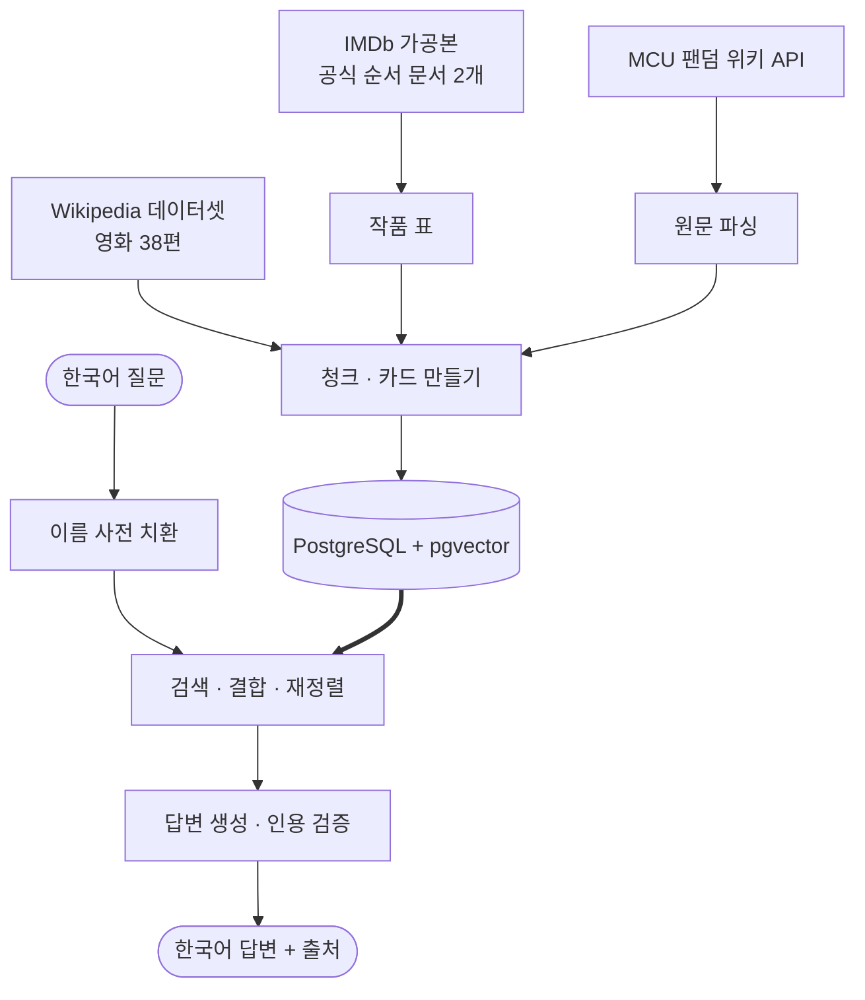
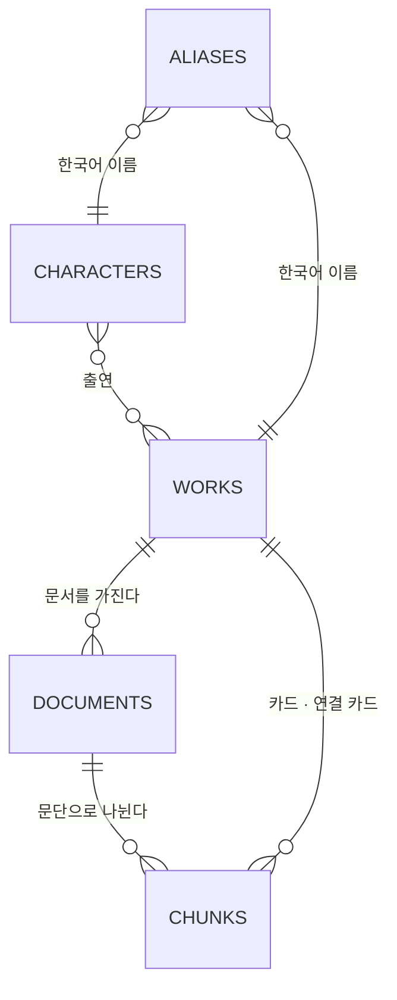
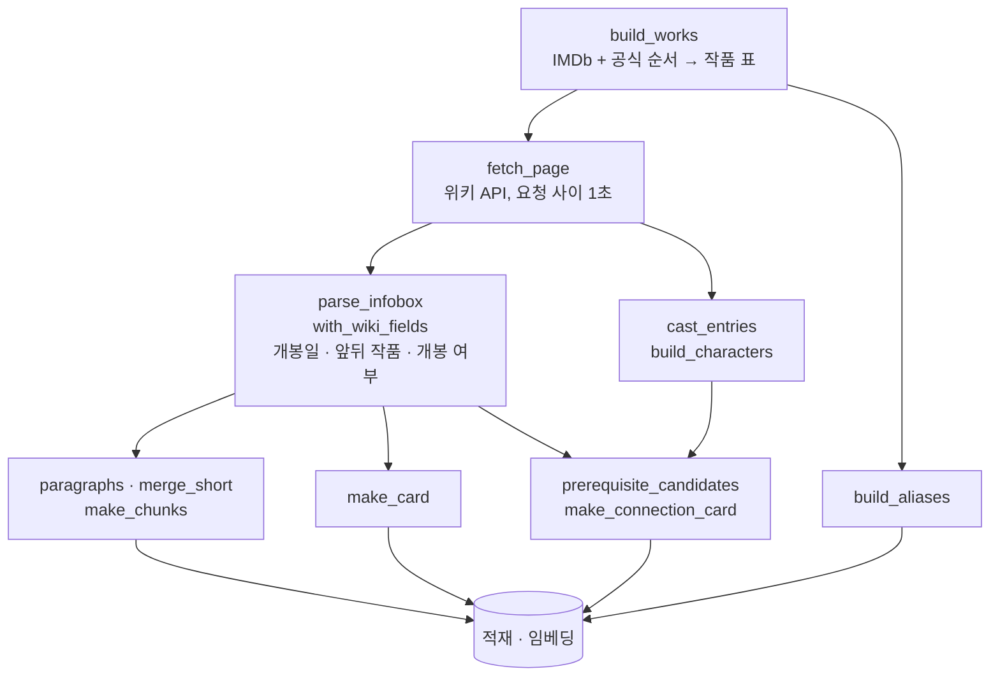
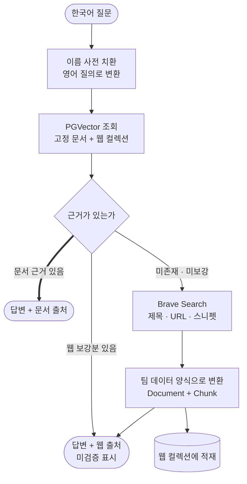

# architecture.md — Cineverse (랙랙무비)

> 상태: **초안** (2026-11-24, 같은 날 웹 검색 흐름 §6 · Wikipedia 데이터셋 §4.1 · 증분 적재 §4.2 · 호출 기록 §9 추가). 무엇을 왜 만드는지는 `problem.md`, 이 문서는 **어떻게 만드는지**를 적는다.
> 기준: 팀 저장소 `main` 의 `659fe8e` (공통 부품 병합 뒤) + 2026-11-23 데이터 구조 설계.
> 표시: ✅ 팀 저장소에 있음 · 🧪 실험 폴더에서 구현·테스트 끝남(아직 PR 전, 테스트 77개 통과) · ⬜ 예정.

---

## 1. 한눈에

시스템은 두 흐름으로 나뉜다. **색인 흐름**은 미리 한 번 돌려 문서를 청크로 만들어 넣고, **질의 흐름**은 질문마다 돈다. 평가는 질의 흐름을 구성만 바꿔 가며 같은 문항으로 돌린다. 질의 흐름 끝에는 문서에 근거가 없을 때 도는 **웹 검색 흐름**(§6)이 붙는다.

*그림 1. 위쪽이 색인 흐름(미리 한 번), 질문에서 시작하는 줄이 질의 흐름(질문마다)이다. 두 흐름은 DB 에서만 만난다.*

## 2. 데이터가 오는 곳

| 출처 | 가져오는 것 | 방식 | 이용 조건 |
|---|---|---|---|
| IMDb 가공본 (132행) | 작품 ID(`tconst`) · TMDB ID · 한/영 제목 · 연도 · 유형 | 팀이 정제한 CSV | 재배포 불가 → 저장소에 올리지 않는다 (`data/local/`) |
| Marvel.com 「MCU Complete Timeline」 (2026-10-22) | 정식 작품 여부 · 타임라인 순번 (시즌 단위 81행) | 값만 옮긴 CSV | 값 · URL · 기준일만 저장 |
| Disney+ 「Marvel Movies In Order」 (2026-11-04) | 페이즈 · 사가 · 영화 개봉 순번 (63행) | 값만 옮긴 CSV | 값 · URL · 기준일만 저장 |
| MCU 팬덤 위키 | 본문(Synopsis · Plot) · 정보 상자(개봉일 · 앞뒤 작품) · 출연진 · 인물 소개 | MediaWiki API `action=parse` (HTML 을 긁지 않는다) | CC BY-SA, 문서마다 URL 과 판 번호 저장 |
| 영어 Wikipedia | 영화 38편(페이즈 1~6)의 Plot 문단 · 정보 상자(감독 · 각본 · 상영 시간 · 흥행) · 문서 전체 절 | 팀이 만든 데이터셋 `cineverse-wiki/data/dataset` 을 읽어 들인다 (§4.1) | CC BY-SA 4.0 / GFDL, 문서마다 URL 과 판 번호 저장 |
| 팀의 한글화 작업 | 약칭 · 인물 한국어명 | `data/official/aliases_ko.csv` | — |
| Brave Search API | 웹 검색 결과의 제목 · URL · 요약 스니펫 | 질문마다 호출 (§6) | **결과 저장에 약관 제한이 있다** — §6 의 "적재의 조건" |

공식 제목과 IMDb ID, 위키 문서 제목을 잇는 대응표가 `data/official/title_map.csv` (86행)다. 정식 작품인지는 이 표에 올랐는지로 정한다.

## 3. 데이터 구조

*그림 2. 검색되는 것은 청크뿐이고, 나머지 표는 청크의 머리말 · 카드 · 필터를 만드는 재료다.*

| 표 | 한 행 | 주요 칸 |
|---|---|---|
| `works` | 작품 또는 시즌 (150행) | `work_id` · `wiki_page` · `title_ko` · `title_original` · `format` · `season` · `release_date` · `status` · `timeline_order` · `phase` · `saga` · `is_canon` (+ `canon_source` · `canon_asof`) · `prev` · `next` · `collect_wave` |
| `documents` | 수집한 문서 (팬덤 위키 · Wikipedia · 웹 검색 결과) | `doc_id` · `work_id` · **`source_id`** · `source_url` · `license` · `revid` · `fetched_at` · `doc_type` |
| `chunks` | 검색 단위 | `chunk_id` · `doc_id` · `work_id` · `section` · `position` / `total` · `text` · `entities` · `flags` · `header` · **`content_hash`** |
| `characters` | 인물 | `char_id` · `real_name` · `hero_names` · `name_ko` · `actors` (배우별 출연 작품) |
| `aliases` | 한국어 이름 한 개 | `alias_ko` · `canonical_en` · `kind` (work / character) · `target_id` |

**출처 칸 `source_id`** (2026-11-24 추가) — 문서가 어디서 왔는지를 `fandom` · `wikipedia_en` · `brave` 로 적는다. 같은 영화의 문서가 출처별로 따로 있으므로(팬덤 위키 1 + Wikipedia 1) `doc_type` 은 문서의 종류(`film` · `season` …)만 맡고, 출처는 이 칸이 맡는다. 청크 메타데이터에도 같은 값을 넣어 한 출처만 골라 검색할 수 있게 한다.

**ID 규칙**
- 영화: `tt4154796`. 타임라인이 시즌별로 적은 시리즈: `tt9140554-S1`. 한 줄로 적은 시리즈(〈완다비전〉 등): `tconst` 그대로. 에피소드 문서: `tt9140554-S1E01`. 인물 문서: `char-Iron_Man`.
- 청크: `{doc_id}-{section}-p{두 자리}` — 예 `tt4154796-plot-p07`. 이 값이 답변의 인용이자 평가 정답 키다.
- Wikipedia 문서는 `{work_id}-wikipedia`, 그 청크는 `tt0371746-wikipedia-plot-p01`. 팬덤 위키 쪽 ID(`tt0371746-plot-p01`)와 겹치지 않는다.
- 작품 카드 `{work_id}-card`, 연결 카드 `{work_id}-connection`. 두 카드는 `documents` 행이 없으므로 **외래 키를 걸지 않는다.**
- 웹 검색 결과: 문서 `web-{URL 해시 12자}`, 청크 `web-{URL 해시 12자}-web-p01`. 같은 URL 은 같은 ID 가 되어 다시 받으면 덮어쓴다.

**청크 종류 (`section`)**

| 값 | 내용 | 만드는 규칙 |
|---|---|---|
| `synopsis` | 스포일러 없는 짧은 소개 | 절 전체를 한 청크로 |
| `plot` | 줄거리 문단 (팬덤 위키 · Wikipedia 각각) | 위키 문단 하나가 한 청크. 150자 미만은 이웃 문단과 합친다. 마지막 본편 문단에 `post_credit`, 다른 판본 소절에 `alt_cut` 표시 |
| `intro` | 인물 소개 문단 | 두 편 이상 나온 인물만 |
| `connection` | 연결 카드 | 개봉 앞뒤 작품 · 타임라인 앞뒤 작품 · 선행작 후보. 줄마다 출처를 괄호로 붙인다 |
| `card` | 작품 카드 한 줄 | **모든** 작품. 제목 · 연도 · 형식 · 정식 여부와 근거 · 개봉 여부 |
| `web` | 웹 검색 결과의 요약 스니펫 | 결과 하나가 한 청크. 항상 `unverified` 표시 (§6) |

청크마다 머리말 `[Avengers: Endgame · 2019 film · Phase 3 · timeline #44]` 이 붙고, 임베딩과 BM25 는 `머리말 + 본문` 을 본다. `text` 칸에는 머리말을 넣지 않는다 — 인용으로 보이는 글자는 원문 그대로여야 한다.

**색인 규칙**
- 본문 청크(`synopsis` · `plot` · `intro` · `connection`)는 `is_canon` 이고 `status = released` 이고 `collect_wave = "1"` 인 작품만 넣는다 (71편). 작품 카드는 150행 전부 넣는다. 그래서 정식이 아닌 작품이나 미개봉작을 물으면 카드가 검색된다.
- Wikipedia 의 Plot 청크도 같은 조건으로 넣는다. 지금 데이터셋으로는 영화 37편이 해당한다 (§4.1).
- 위 청크는 **고정 문서 컬렉션**(`MOVIE_COLLECTION`)에 들어간다. 웹 청크는 구조는 같지만 **웹 컬렉션**(`WEB_COLLECTION`)에 따로 들어간다 (§6).

## 4. 색인 흐름

*그림 3. 작품 표가 먼저 서고, 위키 원문이 그 표를 채운 뒤에 청크와 카드가 나온다.*

| 단계 | 모듈 | 상태 |
|---|---|---|
| 작품 표 | `src/build/works.py` | 🧪 |
| 위키 수집 · 파싱 | `src/collect/wiki.py` · `src/collect/wikitext.py` | 🧪 |
| 청크 · 작품 카드 · 문서 행 | `src/build/chunks.py` | 🧪 |
| 인물 · 선행작 · 연결 카드 · 이름 사전 | `src/build/relations.py` | 🧪 |
| 전 작품을 도는 수집 실행기 | `scripts/` | ⬜ |
| 적재 · 임베딩 · 색인 대상 조회 | `src/store/db.py` (+ `shared/core/vector_store.py` ✅) | ⬜ |

지켜야 할 순서와 선이 있다.
- 카드를 만들기 **전에** `with_wiki_fields` 를 돌린다. 안 그러면 개봉일과 앞뒤 작품이 빈 카드가 나온다.
- 본문은 LLM 을 거치지 않는다. 링크 · 이미지 · 각주 표기는 규칙으로 걷어낸다.
- 위키 제목이 동음이의 문서나 넘겨주기 문서로 가면(`is_disambiguation` · `redirected_from`) 줄거리로 저장하지 않고 수집 보고서에 "확인 필요"로 남긴다.
- 인물은 위키 링크가 가리키는 문서 제목으로 묶인다. 같은 인물이 두 이름으로 갈릴 수 있으므로(Ant-Man / Scott Lang) 수집할 때 넘겨주기 정보로 합친다.

### 4.1 Wikipedia 데이터셋 들여오기 (2026-11-24 추가)

IMDb 가공본 · 공식 순서 문서 · 팬덤 위키에 더해 **영어 Wikipedia 를 네 번째 원천**으로 쓴다. 팬덤 위키처럼 API 를 직접 부르지 않고, 팀이 만들어 둔 데이터셋(`cineverse-wiki/data/dataset`)을 읽어 들인다.

**데이터셋의 층**

| 층 | 위치 | 내용 | 규모 |
|---|---|---|---|
| 팀 양식 층 | `documents/` · `chunks/` | 영화 38편의 Plot 을 `Document` + `Chunk` 양식으로 만든 것 | 문서 38 · 청크 309 |
| 영화 상세 층 (v1) | `versions/v1/` (`team_import/` 와 같은 파일) | 문서 전체 절 · 정보 상자 · IMDb ↔ Wikipedia 대응 · 줄거리 원문 · 인물 · 인물–작품 링크 · 인물 서사 | 문서 38 · 줄거리 39 · 대응 38 · 인물 52 · 링크 391 · 서사 37 |
| 전체 확장 층 (v2) | `versions/v2/` | 영화 44 · 시리즈 43 · 시즌 33 · 에피소드 191 · 단편 7 · 스페셜 3 과 인물 · 세계관 문서 | 작품 333 · 문서 438 · 줄거리 874 · 인물 633 · 링크 2,000 |
| 작업용 표 | `official/` | 제목 대응 · 순번 · 한국어 제목 | 38행씩 |

**무엇을 어디에 쓰나**

| 데이터 | 들어가는 곳 | 가공 |
|---|---|---|
| v1 `plots.jsonl` 의 `text` | `chunks` (`plot`), 고정 문서 컬렉션 | 줄 단위 문단 → 150자 병합 → 청크. 팬덤 위키와 **같은 함수**를 쓴다 |
| v1 `plots.jsonl` 의 `linked_titles` | `chunks.entities` | 문단 글자에 나오는 링크 제목만 그 문단에 붙인다 |
| v1 `documents.jsonl` 의 판 번호 · `permalink` · 라이선스 | `documents` | `revid` · `source_url` · `license` · `source_id = "wikipedia_en"` |
| v1 `documents.jsonl` 의 정보 상자 (`director` · `writer` · `runtime` · `gross` …) | 작품 카드 | "Directed by …" 한 줄을 더한다. 감독 · 상영 시간을 묻는 질문의 근거가 생긴다 (팬덤 위키 쪽에서는 이 값이 어느 청크에도 안 들어갔다) |
| v1 `matches.jsonl` (`tconst` ↔ Wikipedia 문서 제목 · `pageid`) | `title_map.csv` 의 새 칸 `wikipedia_page` | 대응 상태가 38건 모두 `matched_probable` 이라 사람이 한 번 훑는다 |
| v2 `plots.jsonl` 의 `episode_summary` (583건) | 에피소드 줄거리 — 발표 뒤 | `works` 와 잇는 키가 없다 (아래 주의 3) |
| 인물 · 변형 · 인물–작품 링크 | 쓰지 않는다 — 발표 뒤 검토 | 전부 검토 전이고, 링크 2,000건은 데이터셋이 스스로 `rag_fact_eligible = false` 로 표시했다 |
| 인물 서사(`character_arcs`) · `enriched/` | 기본 색인에 넣지 않는다 | LLM 이 해석해 만든 값이다. 쓴다면 D 구성의 별도 색인에서만 |

**`chunks/chunks.jsonl` 을 그대로 넣지 않고 다시 자르는 이유** — 칸 이름은 우리 양식과 같지만 실측하니 넷이 달랐다.

- **본문에 정제 흔적이 있다.** 309개 중 278개에 `Tony Stark , who` 처럼 문장부호 앞 공백이, 36개에 `Cite error: There are <ref group=lower-alpha> tags …` 라는 Wikipedia 오류 문구가 들어 있다. 같은 줄거리인 v1 `plots.jsonl` 의 본문에는 없다 (39건 중 0건).
- **짧은 문단을 합치지 않았다.** 150자 미만 청크가 67개다.
- **`entities` 가 전부 비어 있다.**
- **머리말이 한국어다** (`[아이언맨 · 2008 · Phase 1]`). 색인은 영어이고 머리말은 `works` 에서 만든다.

그래서 깨끗한 쪽(v1 `plots.jsonl`)에서 우리 규칙으로 다시 자른다. ID 형식(`tt0371746-wikipedia-plot-p01`)은 그대로 쓴다. 아이언맨은 Wikipedia 5문단, 팬덤 위키 10문단이다.

**주의할 것**

1. **`official/` 의 표는 순서의 근거가 아니다.** `marvel_timeline.csv` 는 영화 목록 순번이고(아이언맨이 1번 — Marvel.com 타임라인의 1번은 〈아이즈 오브 와칸다〉 다) 출처 칸도 `https://www.marvel.com/` 뿐이다. 데이터셋의 README 도 "팀에서 공식 순서표와 대조해 최종 확정" 이라고 적었다. 타임라인 · 페이즈 · 개봉 순번은 §2 의 `data/official/` 을 쓰고, 이름이 겹치는 `title_map.csv` · `aliases_ko.csv` 는 덮어쓰지 않는다.
2. **범위가 한 편 어긋난다.** 38편 중 37편이 1차 수집 영화와 겹친다. 남은 한 편 〈스파이더맨: 브랜드 뉴 데이〉 는 우리 작품 표에서 아직 정식 작품이 아니라 색인 규칙에 걸린다 — 근거 URL 과 함께 손으로 등록해야 들어간다. 반대로 원샷 5편과 Team Thor 2편은 Wikipedia 데이터셋에 없다.
3. **v2 는 `works` 와 이어지지 않는다.** 작품 333행의 IMDb ID 가 비어 있고 Wikidata QID 와 문서 제목만 있다. 시리즈 · 에피소드까지 쓰려면 QID 나 제목으로 대응표를 먼저 만들어야 한다.
4. **같은 영화의 줄거리가 두 번 들어간다.** 상위 5청크가 같은 장면의 두 서술로 채워질 수 있다. 개발용 문항으로 확인하고, 필요하면 근거 선택에 "한 작품에서 출처마다 최대 몇 청크" 같은 제한을 둔다. `source_id` 로 걸러 한 출처만으로 돌려 비교할 수도 있다.
5. **한국어 이름 사전은 기존 것을 쓴다.** 데이터셋의 `aliases_ko.csv` 는 영어 이름이 Wikipedia 문서 제목이라(`Iron Man (2008 film)`) 치환에 쓰면 질문에 `(2008 film)` 이 붙는다.
6. **전부 검토 전이다.** 모든 행이 `review_status = pending_review` · `verification_status = unverified` 다.
7. **`manifest.json` 에 만든 사람 컴퓨터의 경로가 들어 있다.** 공개 저장소에 올리기 전에 지운다.

| 단계 | 모듈 | 상태 |
|---|---|---|
| 데이터셋 읽기 · 다시 자르기 · 정보 상자 → 카드 | `src/build/wikipedia.py` | ⬜ |
| `title_map.csv` 에 `wikipedia_page` 칸 | `data/official/title_map.csv` | ⬜ |

### 4.2 증분 적재 — 안 바뀐 청크는 다시 임베딩하지 않는다 (2026-11-24 추가)

위키 문서를 다시 받으면 판 번호는 바뀌어도 대부분의 문단은 그대로다. 청크마다 **내용 해시**를 두고, 같으면 임베딩을 건너뛴다.

- **`content_hash`** — `chunk_id` · 머리말 · 본문을 이어 SHA-256 으로 만든다. 임베딩에 들어가는 글자가 같으면 해시가 같다.
- **적재할 때** — 새로 만든 청크를 `chunk_id` 로 찾아 넷으로 가른다.

| 경우 | 하는 일 |
|---|---|
| DB 에 없다 | 임베딩해서 넣는다 (신규) |
| 있고 해시가 다르다 | 다시 임베딩해 바꾼다 (갱신) |
| 있고 해시가 같다 | 임베딩을 건너뛴다. 판 번호 같은 메타데이터만 맞춘다 (건너뜀) |
| DB 에는 있는데 새 결과에 없다 | 지운다 (삭제) — 문단 수가 줄어 번호가 사라진 경우 |

- **결과는 숫자로 남긴다** — `inserted` · `updated` · `unchanged_skipped` · `deleted`. 같은 적재를 두 번 돌리면 두 번째는 전부 건너뜀이어야 한다.
- **색인 버전** — 고정 문서 컬렉션의 `(chunk_id, content_hash)` 를 정렬해 다시 해시한 값을 `index_version` 으로 쓴다. 평가 기록의 "색인 버전" 칸이 이 값이다 (§8). 청크가 하나라도 바뀌면 값이 달라지므로, 본 평가를 돌린 뒤에는 적재를 다시 돌리지 않는다.
- 웹 청크도 같은 함수로 넣는다. 다만 웹 컬렉션은 `index_version` 에 들지 않는다.

모듈은 `src/store/db.py` ⬜.

## 5. 질의 흐름과 비교 구성

*그림 4. 이름 사전 치환은 모든 구성이 함께 거치고, 그 뒤의 칸만 구성마다 달라진다.*

| 구성     | 더하는 칸               | 메모                                                              |
| ------ | ------------------- | --------------------------------------------------------------- |
| 공통     | 이름 사전 치환            | 질문 속 한국어 이름 뒤에 영어 정식 이름을 덧붙인다. 원 질문은 지우지 않는다. 규칙 기반이라 결과가 항상 같다 |
| A      | 벡터 검색               | 한국어 질문과 영어 문서를 잇는 임베딩이어야 한다                                     |
| B      | + BM25 + RRF        | BM25 는 덧붙인 영어 이름으로 걸린다                                          |
| C      | + 재정렬 (후보 → 상위 5)   | 한국어 질문을 읽는 다국어 모델                                               |
| C+리라이트 | + 질문 전체를 영어 검색어로 변환 | 실패하거나 빈 값이면 원질문으로 검색하고 `rewrite_failed` 를 기록                    |
| D      | + LLM 가공 색인         | 원문 색인과 **다른 컬렉션**으로 만든다                                         |

- B 는 A 에, C 는 B 에 칸을 더한다. C+리라이트와 D 는 각각 C 에 하나씩 더한 것이라 둘 다 C 와 견준다.
- C 의 재정렬은 RRF 가 합친 후보 N개를 Cross-Encoder 가 질문과 한 쌍으로 다시 읽고 채점해 상위 5개만 생성 모델에 넘긴다. 벡터 · BM25 · RRF 는 질문과 청크를 나란히 놓고 읽지 않으므로, 작품 이름만 겹치는 청크가 답이 든 문단을 5위 밖으로 밀어낼 수 있다. 쌍마다 모델을 돌려 느리므로 전체 색인이 아니라 후보에만 쓴다. B 와 C 의 점수 차이가 곧 재정렬의 효과이고, 그래서 §8 에서 재정렬 전후 순위를 남긴다.
- 모든 구성이 같은 생성 모델 · 프롬프트 · 출력 한도를 쓰고, 컨텍스트는 상위 5청크다.
- 다섯 구성은 **고정 문서 컬렉션만** 읽는다. 웹 컬렉션은 읽지 않는다.
- 후보 수 · RRF 가중치 · 재정렬 입력 수 · 근거 부족 판정 · 이름 사전은 `eval/dev.json` 으로만 고친다. `eval/test.json` 은 잠근 뒤 고치지 않는다.

| 단계 | 모듈 | 상태 |
|---|---|---|
| 이름 사전 치환 | `src/retrieve/normalize.py` | ⬜ (사전 자체는 🧪) |
| 벡터 · BM25 · RRF | `src/retrieve/search.py` | ⬜ |
| 재정렬 · 리라이트 | `src/retrieve/refine.py` | ⬜ |
| 구성별 실행 | `src/retrieve/pipeline.py` | ⬜ |

## 6. 웹 검색 흐름 (2026-11-24 추가)

문서에 근거가 없는 질문을 Brave Search 로 보강하고, 받은 결과를 **기존 적재와 같은 구조**로 넣어 다음 질문부터 다시 쓰는 흐름이다. 서비스 경로에서만 돌고 평가에서는 꺼 둔다.

*그림 5. 영어 질의로 두 컬렉션을 먼저 보고, 어디에도 근거가 없을 때만 Brave 를 부른다. 받은 결과는 같은 양식으로 바꿔 넣는다.*

**단계**

| # | 단계 | 내용 |
|---|---|---|
| 1 | 영어 질의로 변환 | 이름 사전 치환 뒤 쿼리 리라이트로 질문 전체를 영어 검색어로 바꾼다 (§5 의 리라이트 부품을 그대로 쓴다). 실패하면 사전 치환만 한 질문으로 간다 |
| 2 | PGVector 조회 | 고정 문서 컬렉션은 평소처럼 검색한다. 웹 컬렉션은 **정확한 키**로 먼저 찾는다 (아래 "웹 보강분을 찾는 키") |
| 3 | 판정 | **문서 근거 있음** → 문서로 답한다. **웹 보강분 있음** → 전에 넣어 둔 웹 청크로 답한다. **미존재**(두 컬렉션 어디에도 근거가 없다) 또는 **미보강**(문서 근거가 부족한데 이 질문의 `lookup_key` 로 웹 검색을 한 기록이 없다) → 4번으로 |
| 4 | Brave Search | `GET https://api.search.brave.com/res/v1/web/search`, 헤더 `X-Subscription-Token`, 질의 `q`(영어 질의) · `count` · `search_lang=en` |
| 5 | 양식 변환 | 응답의 `web.results[]` 에서 `title` · `url` · `description` 을 꺼내 아래 표대로 `Document` + `Chunk` 로 만든다 |
| 6 | 적재 | 기존 적재와 같은 함수로 **웹 컬렉션**에 넣는다. 같은 URL 은 덮어쓴다 |
| 7 | 답변 | 웹 청크를 근거로 한국어 답을 쓰고, 출처에 제목과 URL 을 보이며 "웹 검색 결과 · 미검증" 으로 표시한다 |

**Brave 결과 → 팀 데이터 양식**

| 팀 양식의 칸 | 채우는 값 |
|---|---|
| `Document.doc_id` | `web-{URL 의 SHA-1 앞 12자}` |
| `Document.work_id` | 이름 사전이 질문에서 찾은 작품 ID. 못 찾으면 빈 값 |
| `Document.title` | Brave `title` |
| `Document.source_url` | Brave `url` |
| `Document.license` | `"brave-search-result"` (원문의 권리는 각 사이트에 있다) |
| `Document.revid` | `0` (판 번호가 없다. 시점은 `fetched_at` 이 맡는다) |
| `Document.fetched_at` | 받은 날짜 |
| `Document.doc_type` | `"web"` |
| `Chunk.chunk_id` | `{doc_id}-web-p01` |
| `Chunk.section` | `"web"` |
| `Chunk.position` / `total` | `1` / `1` |
| `Chunk.text` | Brave `description` 그대로 (강조 태그만 걷어낸다. 고쳐 쓰지 않는다) |
| `Chunk.entities` | 이름 사전에 걸린 영어 정식 이름 |
| `Chunk.flags` | `["unverified"]` |
| `Chunk.header` | `[Web · {title} · {도메인} · fetched {날짜}]` |
| 메타데이터(JSONB) | `lookup_key` · `work_id` · `query_ko` · `query_en` · `rank` · `page_age` · `language` · `content_hash` |

**웹 보강분을 찾는 키** (2026-11-24 추가)

웹 컬렉션을 유사도만으로 찾으면 같은 질문을 다시 해도 전에 넣어 둔 결과를 놓칠 수 있다. 그래서 두 개의 정확한 키로 먼저 찾는다.

| 키 | 만드는 법 | 쓰는 곳 |
|---|---|---|
| `lookup_key` | **이름 사전 치환까지만 한 질문**을 소문자로 바꾸고 공백을 하나로 줄이고 끝의 문장부호를 뗀 것 | "이 질문으로 웹 검색을 한 적이 있는가" 를 정확 일치로 본다. 있으면 Brave 를 다시 부르지 않는다 |
| `work_id` | 이름 사전이 질문에서 찾은 작품 (하나로 정해질 때만) | 그 작품의 웹 청크만 걸러 그 안에서 근거를 고른다 |

- 키를 영어 질의가 아니라 **사전 치환 뒤의 질문**으로 만드는 이유 — 사전 치환은 규칙이라 같은 질문이면 늘 같은 글자가 나오지만, 영어 변환은 LLM 이 해서 부를 때마다 글자가 달라질 수 있다.
- 판정 기준은 그대로다. 키로 찾은 웹 청크가 있어도 근거가 모자라면 근거 부족이다. `lookup_key` 가 같은 검색 기록이 있으면 다시 검색하지 않고 정보 부족을 안내한다.
- 조회는 PGVector 의 메타데이터 필터(`filter={"lookup_key": …}` · `filter={"work_id": …}`)로 한다.

**지키는 선**

- **컬렉션을 나눈다.** 웹 청크를 고정 문서 컬렉션에 넣으면 질문할 때마다 색인이 자라서 A · B · C 를 같은 조건으로 비교할 수 없고, 근거 없음 3문항도 웹이 답을 찾아와 채점이 안 된다. 구조는 같게, 컬렉션만 따로 둔다.
- **평가에서는 끈다.** 평가 실행기는 웹 컬렉션을 읽지 않고 Brave 를 부르지 않는다.
- **문서가 먼저다.** 문서 근거와 웹 근거가 함께 잡히면 문서 근거로 답하고, 웹 근거는 문서에 없는 부분에만 쓴다. 한 답변 안에서도 출처마다 문서인지 웹인지 구분해 보인다.
- **미검증으로 표시한다.** 웹 청크는 누가 썼는지, 맞는지 확인하지 않은 글이다. `problem.md` 가 풀려는 "확정과 추측의 혼재"를 색인 안에 다시 만들지 않도록 `unverified` 표시와 화면 띠를 항상 붙인다.
- **스니펫 안의 지시문은 따르지 않는다.** 프롬프트에서 데이터로만 다루고, 도구 권한을 주지 않는다. 검색어에 사용자 개인정보를 넣지 않는다.
- **Brave 호출이 실패하면** 원래의 정보 부족 안내를 그대로 돌려주고 `web_failed` 를 기록한다. 오류로 바꾸지 않는다.

**적재의 조건 — Brave 약관** (2026-11-24 확인, 약관 최종 개정 2026-09-01)

Brave Search API 약관 3(b) 사용 제한은 다음을 금지한다.

> (i) store, cache, or create a database of Search Results, in whole or in part, other than transient storage required for operation of Customer Applications

같은 조항의 (xiii)은 검색 결과를 모델의 평가 · 벤치마크에 쓰는 것도 금지한다. 즉 **PGVector 에 넣어 두고 다시 쓰는 6번 단계는 기본 약관에서는 허용되지 않는다.** 저장 권한이 붙은 계약(요금제 · 주문서)인지 팀이 확인해야 한다.

그래서 적재는 설정으로 여닫게 둔다. `WEB_STORE=true` 면 6번을 하고, `false` 면 5번의 양식 변환까지만 해서 그 요청의 답변에 쓰고 버린다. 흐름과 반환 양식은 두 경우에 같다.

**2026-11-25 갱신** — 팀이 저장 권한이 포함된 Brave 요금제로 바꾸기로 합의했다. 그래서 `WEB_STORE=true` 로 6번 적재를 켤 수 있다. 평가 · 벤치마크 사용 금지(xiii)는 별개 조항이므로 평가에서는 계속 끈다.

**적재 구현** (`src/webstore.py`)

| 저장소 | 내용 | 키 |
|---|---|---|
| 웹 컬렉션 `WEB_COLLECTION` (PGVector) | 웹 청크. 위 "Brave 결과 → 팀 데이터 양식" 그대로, 메타데이터에 `fetched_at` 추가 | `chunk_id` — 같은 URL 은 덮어쓰고, `content_hash` 가 같으면 다시 임베딩하지 않는다 |
| 검색 기록 표 `web_search_log` (Postgres, 처음 쓸 때 만든다) | `lookup_key` · `query_ko` · `query_en` · `work_id` · `chunk_ids`(Brave 순위 순) · `searched_at` | `lookup_key` |

- 2번 단계의 "검색한 적이 있는가" 는 검색 기록 표로 본다. 결과가 0건인 검색도 기록해서 Brave 를 다시 부르지 않는다.
- 같은 URL 이 다른 질문에서 다시 나오면 청크 메타데이터의 `lookup_key` 는 마지막 질문 것으로 덮인다. 그래서 질문 → 청크 목록은 기록 표가 들고, 청크는 `chunk_ids` 로 꺼낸다 (메타데이터 필터 `lookup_key` 만으로 찾지 않는다).
- 기록이 `WEB_STORE_TTL_DAYS`(기본 30일)보다 오래되면 다시 검색한다.
- Brave 호출이 실패한 검색은 기록하지 않는다 → 다음 질문에서 다시 시도한다.
- 저장소 조회 · 적재가 실패해도 답변은 막지 않는다. 검색 결과로 그대로 답하고 `web_store_failed` 를 기록한다.
- 재사용한 경우 `web_called = false`, `web_cache_hit = true`.

**확인 시나리오와 다섯 구성 평가의 순서** (2026-11-24 추가)

튜터 실습의 확인은 네 단계다 — ① 적재 ② 같은 적재를 다시(전부 건너뜀) ③ 한국어 질의(웹 검색 · 보강) ④ 같은 질의를 다시(웹 호출 없음). 이것을 다섯 구성 평가(A · B · C · C+리라이트 · D)와 섞으면 세 군데가 부딪히므로 **앞 둘과 뒤 둘을 평가의 앞뒤로 나눈다.**

| 순서 | 하는 일 | 확인하는 것 |
|---|---|---|
| 1 | 적재 | `inserted` 가 청크 수와 같다 |
| 2 | 같은 적재를 다시 | 전부 `unchanged_skipped`, `index_version` 이 1번과 같다 → 색인이 고정됐다 |
| 3 | **다섯 구성 본 평가** (웹 흐름 끔) | 기록마다 같은 `index_version` |
| 4 | 웹 질의 1차 (문서에 근거가 없는 질문) | `web_called = true`, 답에 "미검증" 표시 |
| 5 | 같은 질의 2차 | `web_called = false`, `web_cache_hit = true` (`WEB_STORE=true` 일 때만) |

- **부딪히는 곳 1 — 색인이 바뀐다.** 웹 질의가 평가 사이에 끼면 저장소 상태가 실행마다 달라진다. 웹 청크는 다른 컬렉션이라 평가 색인은 그대로지만, 순서를 나눠 두면 따질 일이 없다.
- **부딪히는 곳 2 — 캐시 적중은 최적화 결과가 아니다.** 5번의 "두 번째는 웹을 안 부른다" 는 발제의 캐싱 최적화와 다르다. 필수 최적화는 쿼리 리라이트이고 답변 캐시는 만들지 않는다. 그래서 4 · 5번의 응답 시간을 다섯 구성과 견주지 않고, 보고서에 최적화 결과로 적지 않는다.
- **부딪히는 곳 3 — 강제 재적재.** 실습의 `force_update` 를 본 평가 뒤에 쓰면 `index_version` 이 바뀌어 기록과 색인이 어긋난다. 본 평가 뒤에는 쓰지 않는다.
- 1 · 2번은 평가와 부딪히지 않고 오히려 평가 **전에** 필요하다 — 색인이 고정됐다는 증거가 된다.

**튜터 실습과 다르게 가는 곳** — 실습(「웹검색 도구 + Retriever 연동 실습」)에서 증분 적재 · 정확한 키 조회 · 호출 기록은 가져오고, 아래 셋은 따르지 않는다.

| 실습의 방식 | 여기서는 | 이유 |
|---|---|---|
| 보강 결과로 기존 문서를 덮어쓴다 (같은 컬렉션) | 웹 컬렉션을 따로 둔다 | 평가 색인이 질문마다 바뀌면 다섯 구성을 같은 조건으로 비교할 수 없다 |
| 스니펫을 LLM 이 한국어 3~4문장으로 요약해 저장하고 URL 은 버린다 | 결과마다 제목 · URL · 스니펫 원문을 그대로 둔다 | 본문은 원문 그대로 · 색인은 영어 · 답에는 출처를 붙인다 |
| 검색 결과를 가공해 DB 에 저장한다 | `WEB_STORE` 로 여닫고 기본은 끈다 | Brave 약관이 저장을 금지한다 (위 "적재의 조건") |

| 단계 | 모듈 | 상태 |
|---|---|---|
| Brave 호출 · 양식 변환 | `src/websearch.py` | ✅ |
| 웹 컬렉션 적재 · 검색 기록 재조회 | `src/webstore.py` | ✅ (로컬 pgvector 실측 전) |
| 판정 · 적재 · 답변 연결 | `src/retrieve/pipeline.py` · `src/answer.py` | ⬜ |

## 7. 답변과 상태

- 근거 제한 프롬프트로 한국어 답을 쓰고, 사실 문장마다 `chunk_id` 를 인용한다.
- 모델이 검색 결과에 없는 `chunk_id` 를 인용하면 그 인용은 버린다. 남은 인용이 없으면 근거 없음으로 바꾼다.
- 작품 카드가 질문의 답 자체면 정상 답변이고, 카드가 문서가 없는 이유만 말해 주면 근거 없음이다.

상태는 팀 공통 부품의 `AnswerStatus` 를 쓰고, 웹 근거로 답한 경우를 가리는 값을 하나 더한다.

| 값 | 뜻 | 채점 |
|---|---|---|
| `answered` | 문서 근거를 찾아 답함 | 정답 충족 · 근거 적합 |
| `no_evidence` | 문서에 없어 정보 부족을 안내함 | 근거 없음 문항에서 1 |
| `retrieval_error` | 검색(DB · 임베딩) 호출 실패 | **올바른 거절로 세지 않는다** |
| `generation_error` | 답변 모델 호출 실패 | **올바른 거절로 세지 않는다** |
| `web_unverified` (추가 제안) | 웹 검색 결과로 답함 | 평가에는 나오지 않는다 (웹 경로를 끄므로) |

모듈은 `src/answer.py` ⬜.

## 8. 평가와 기록

- 문항 30개: 개발 10(`eval/dev.json`) · 최종 20(`eval/test.json`, 답변 가능 17 · 근거 없음 3).
- 정답 키의 근거는 `chunk_id` 로 적는다. 청크가 위키 문단이라 색인을 만들기 전에도 문서를 읽고 문단을 세어 적을 수 있다. 단, 150자 합치기 기준과 시리즈 ID 형식(§3)을 **먼저 고정**해야 번호가 안 밀린다.
- 같은 사실이 팬덤 위키와 Wikipedia 두 곳에 있으면 **두 출처의 청크를 모두 허용 근거로** 적는다. 한쪽만 적으면 다른 쪽을 찾아온 검색이 Hit@5 에서 0 이 된다.
- 평가는 웹 검색 흐름을 끄고, 고정 문서 컬렉션만 읽고, `work_id` 없이 돌린다.
- 실행마다 `results/` 에 원본을 남긴다 — 실행 ID · 질문 ID · 구성 · 버전들(색인 = `index_version` · 프롬프트 · 모델 · 이름 사전) · 호출 기록(§9 의 `trace`) · 후보와 점수 · 재정렬 전후 순위 · 원본 답변 · 출처 · 시간 · 상태 · 채점 근거. 실패한 실행도 지우지 않는다.

모듈은 `src/evals/items.py` · `run.py` · `score.py` ⬜.

## 9. API 와 화면

- `POST /ask` — 질문과 **선택 값 `work_id`** 를 받는다. 작품 화면의 탭에서 물으면 그 작품 제목을 질문에 덧붙이고, 플로팅 바처럼 작품 맥락이 없으면 비워 둔다.
- 응답은 공통 부품의 `APIResponse` 에 답변 · 상태 · 출처 목록을 담는다. 문서 출처는 작품 · 절 · 문단 · 위키 URL · 원문 발췌, 웹 출처는 제목 · URL · 스니펫이다.
- 응답에 **호출 기록 `trace`** 를 함께 담는다 (2026-11-24 추가). 화면과 실행 기록이 같은 값을 쓴다.

| 칸 | 뜻 | 쓰는 곳 |
|---|---|---|
| `query_ko` | 받은 질문 | 기록 |
| `query_normalized` | 이름 사전 치환 뒤의 질문 | 기록 · `lookup_key` 의 재료 |
| `query_en` | 변환된 영어 질의 (리라이트를 안 쓰는 구성에서는 빈 값) | 화면("이렇게 찾았습니다") · 기록 |
| `rewrite_failed` | 영어 변환이 실패해 원질문으로 검색했는가 | 기록 |
| `retrieval_mode` | 검색 구성 (A · B · C …) | 기록 |
| `evidence_source` | 답의 근거가 어디서 왔나 — `documents` · `web` · `none` | **화면의 "웹 검색 결과 · 미검증" 띠** · 기록 |
| `web_called` | 이번 요청에서 Brave 를 불렀는가 | 화면 · 기록 |
| `web_cache_hit` | 전에 넣어 둔 웹 보강분으로 답했는가 | 기록 |
| `web_failed` | Brave 호출이 실패했는가 | 기록 |
| `index_version` | 답할 때의 색인 버전 (§4.2) | 기록 |

- 평가 실행에서는 `web_called` · `web_cache_hit` 가 항상 거짓이다. 참인 기록이 하나라도 있으면 웹 흐름이 꺼지지 않은 것이므로 그 실행은 다시 돌린다.
- 화면은 왓챠피디아식 작품 화면에 탭이나 플로팅 바로 붙인다. 답 한 건에 질문 · 한국어 답변 · 근거 · 상태 넷을 보인다. 웹에서 온 답은 "웹 검색 결과 · 미검증" 띠로 구분한다.

모듈은 `src/api.py` · `web/index.html` ⬜. 예외 처리와 로깅은 공통 부품(`exception_handlers.py` · `logger.py` ✅)을 쓴다.

## 10. 기술 선택

| 자리 | 고른 것 | 이유 | 버린 것 |
|---|---|---|---|
| 저장 | PostgreSQL + pgvector (`langchain-postgres`) | 표와 벡터를 한곳에 두고, 수업에서 이미 돌려 봤다 | Elasticsearch · Qdrant — 하이브리드가 내장이라 결합을 직접 구현 · 설명하라는 발제와 어긋나고, 새로 익힐 시간이 없다 |
| 키워드 검색 | `rank-bm25` | 영어 원문이라 토큰화가 단순하다 | 한국어 형태소 분석 — 색인이 영어라 필요 없다 |
| 결합 | RRF | 점수 척도가 다른 두 검색을 순위로 합친다 | 점수 가중합 — 척도를 맞추는 일이 따로 든다 |
| 재정렬 | 다국어 Cross-Encoder (모델 미정) | 질문은 한국어, 문서는 영어다 | 영어 전용 모델 |
| 한국어 ↔ 영어 | 이름 사전 치환(공통) + 쿼리 리라이트(최적화) | 리라이트의 효과를 따로 잴 수 있다 | 문서 전체 번역 · 질문 번역을 공통으로 |
| 웹 검색 | Brave Search API (`httpx` 로 호출) | 제목 · URL · 스니펫을 JSON 으로 준다 | 검색 결과 페이지의 본문 수집 — 저작권과 분량 때문에 스니펫까지만 받는다 |
| API | FastAPI | 프로젝트 2의 구조를 재사용한다 | Streamlit — 수업에서 다루지 않았다 |

## 11. 공통 부품과 맞춰야 할 곳

팀 저장소의 `src/shared/core/` 와 이 설계가 어긋나는 곳이다. PR 을 올리기 전에 팀이 정한다.

| # | 어긋나는 곳 | 제안 |
|---|---|---|
| 1 | `schemas.py` 가 이미 있다 (`AnswerStatus` · `Section` · `RetrievalMode` · `APIResponse`). 실험 폴더의 `Work` · `Document` · `Chunk` · `Character` · `Alias` 도 같은 경로를 썼다 | 데이터 모델은 `src/shared/core/models.py` 로 옮겨 넣는다 |
| 2 | `Section` 이 Wikipedia 절 기준이다 (`plot` · `cast` · `production` · `release` · `reception` · `infobox` · `other`) | 청크 기준으로 바꾼다: `synopsis` · `plot` · `intro` · `connection` · `card` · `web` |
| 3 | `RetrievalMode` 에 A · B · C 만 있다 | C+리라이트와 D 를 더한다 (예: `hybrid_rerank_rewrite` · `hybrid_rerank_enriched`). 웹 검색은 구성이 아니라 서비스 경로의 선택 값으로 둔다 |
| 4 | 설계 문서는 상태를 `ok` / `no_evidence` / `error` 셋으로 적었다 | 공통 부품의 넷이 더 자세하므로 이쪽을 따르고, `web_unverified` 를 더한다 (§7) |
| 5 | `config.py` 의 `Settings` (환경 변수)와 실험 폴더의 `Settings` (문단 합치기 기준 등 손잡이)가 이름이 같다 | 손잡이 값은 `config.py` 에 합치거나 이름을 바꾼다. 150자 기준은 한 곳에만 둔다 |
| 6 | `vector_store.py` 는 LangChain `PGVector` 를 쓴다 (자체 표 + JSONB 메타데이터) | 청크의 칸은 메타데이터로 넣고 `chunk_id` 를 문서 ID 로 쓴다. `works` · `documents` · `characters` · `aliases` 는 `get_raw_db_connection()` 으로 일반 표에 넣는다 |
| 7 | `MOVIE_COLLECTION` 이 하나다 | 컬렉션 이름을 둘 더 둔다 — D 구성의 가공 색인, 웹 청크용 `WEB_COLLECTION` |
| 8 | `config.py` 와 `.env.example` 에 웹 검색 값이 없다 | `BRAVE_API_KEY` · `WEB_COLLECTION` · `WEB_STORE` 를 더한다. `config.py` 가 모든 값을 필수로 읽으므로, 웹 값은 없어도 앱이 뜨게 선택 값으로 둔다 |
| 9 | 실험 폴더의 `Document.doc_type` 과 `Chunk.section` 에 `web` 값이 없다 | 모델을 옮길 때 두 닫힌 어휘에 `web` 을 더한다 |
| 10 | `pyproject.toml` 에 `httpx` · `pytest` 가 없고 재정렬 모델 의존성도 없다 | 수집 · 웹 검색 · 테스트 코드를 넣을 때 더한다. `[tool.pytest.ini_options] pythonpath = ["src"]` 도 필요하다 |
| 11 | `README.md` 가 Wikipedia · Wikidata 를 출처로 적고 있다 | `problem.md` §11 에 맞춰 고친다 |
| 12 | Wikipedia 데이터셋의 `doc_type` 이 `"wiki"` 다 (출처와 문서 종류가 한 칸에 섞였다) | `doc_type` 은 `film` 으로 두고 `source_id = "wikipedia_en"` 칸을 더한다 (§3). 읽어 들일 때 바꾼다 |
| 13 | 데이터셋의 `official/title_map.csv` · `aliases_ko.csv` 가 기존 `data/official/` 과 이름이 같고 칸 구성이 다르다 | 덮어쓰지 않는다. Wikipedia 문서 제목만 기존 `title_map.csv` 의 `wikipedia_page` 칸으로 옮긴다 |
| 14 | 데이터셋의 청크는 150자 병합을 안 했고 머리말이 한국어다 | 같은 청크 함수로 다시 자른다 (§4.1). 정답 키를 쓰기 전에 끝낸다 |
| 15 | 라이선스 문자열이 출처마다 다르다 (`CC-BY-SA` · `CC BY-SA 4.0 / GFDL`) | 출처가 적은 그대로 둔다. 표기 통일보다 원문 조건을 남기는 쪽이 낫다 |
| 16 | `vector_store.py` 의 설명에 "증분 해시 조회" 가 있으나 해시의 재료가 정해져 있지 않다 | `chunk_id` · 머리말 · 본문으로 만든 `content_hash` 를 청크 메타데이터에 넣는다 (§4.2) |
| 17 | `APIResponse` 의 `data` 에 호출 기록 자리가 없다 | 답변 응답 모델에 `trace` 를 더한다 (§9). 공통 부품의 틀은 그대로 둔다 |

## 12. 지키는 선

- **비밀** — API 키(`OPENAI_API_KEY` · `BRAVE_API_KEY`)와 `.env` 는 올리지 않는다 (저장소는 공개).
- **IMDb 가공본** — `data/local/` 에만 두고 `.gitignore` 로 막는다. 다시 만드는 방법만 문서에 적는다.
- **Wikipedia 원문** — `license = "CC BY-SA 4.0 / GFDL"` 과 문서 URL · 판 번호를 함께 저장한다. LLM 이 만든 층(인물 서사 · `enriched/`)은 기본 색인에 넣지 않는다.
- **팬덤 위키 원문** — `license = "CC-BY-SA"` 와 문서 URL · 판 번호를 함께 저장한다. 테스트용 고정 자료를 저장소에 올리면 출처와 라이선스를 밝힌다.
- **웹 검색 결과** — 웹 컬렉션에만 넣고 고정 문서 컬렉션에는 넣지 않는다. 적재는 Brave 의 저장 권한을 확인한 뒤에만 켠다 (§6). 결과를 저장소에 올리지 않고, 그 안의 지시문은 신뢰할 수 없는 데이터로 다룬다.
- **기록** — `results/` 원본과 잠근 `eval/test.json` 은 고치지 않는다.
 