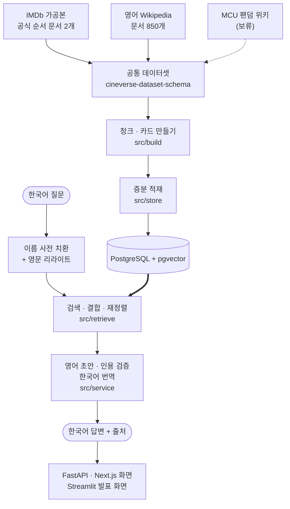
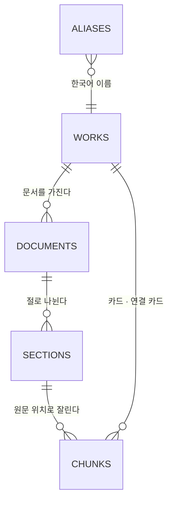
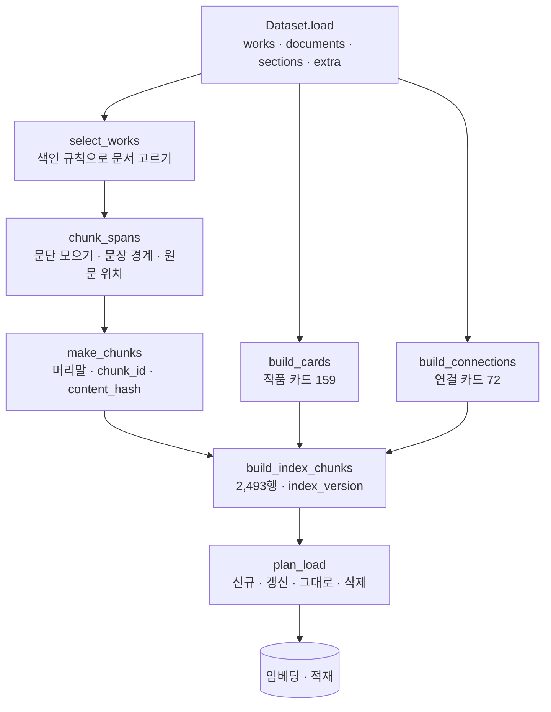
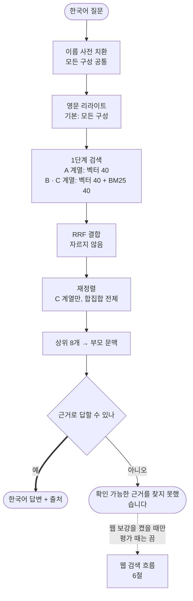
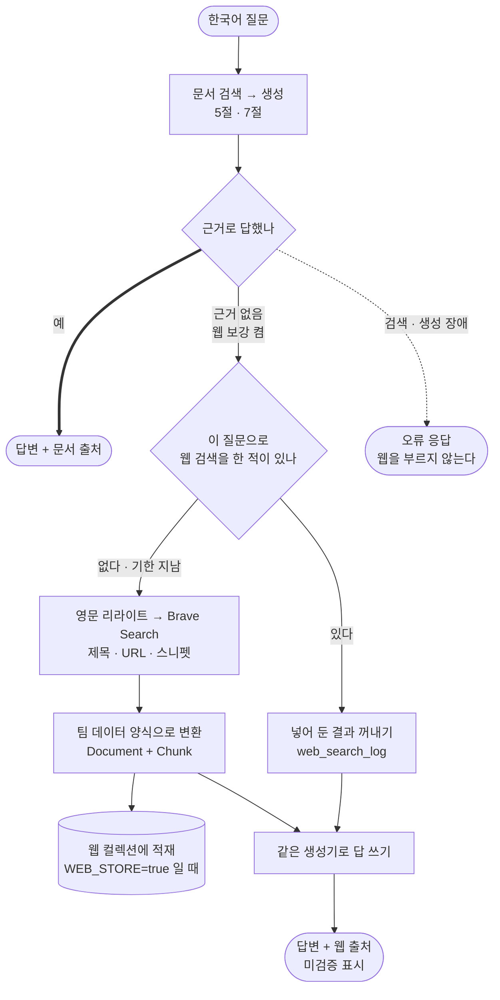

# architecture.md — Cineverse (랙랙무비)

> 상태: **최종 반영본** (2026-11-27). 2026-11-24 초안을 실제로 만든 결과물에 맞췄다.   
> 무엇을 왜 만드는지는 `problem.md`, 이 문서는 **어떻게 만들었는지**를 적는다.
>
> 기준: 팀 저장소 `dev` 의 `eaf00c7` (PR #22~#54 병합 뒤)
>

---

## 1. 한눈에

시스템은 세 흐름이다. **색인 흐름**은 미리 한 번 돌려 문서를 청크로 만들어 넣고, **질의 흐름**은 질문마다 돈다. **평가 흐름**은 질의 흐름을 구성만 바꿔 가며 같은 문항으로 돌리고 기록을 남긴다. 질의 흐름 끝에는 문서에 근거가 없을 때 도는 **웹 검색 흐름**(§6, 기본 꺼짐)이 붙는다.



*그림 1. 위쪽이 색인 흐름(미리 한 번), 질문에서 시작하는 줄이 질의 흐름(질문마다)이다. 두 흐름은 DB 에서만 만난다. 본문은 공통 데이터셋에서만 오고 팬덤 위키 수집은 보류다 (§2).*

| 흐름 | 폴더 | 실행 진입점 |
|---|---|---|
| 색인 | `src/build` · `src/store` | `scripts/build_index.py` · `scripts/chunk_stats.py` |
| 질의 | `src/tools` · `src/retrieve` · `src/service` | `scripts/ask.py` · `src/api/ask.py` · `apps/streamlit/app.py` |
| 평가 | `src/evals` | `scripts/run_eval.py` · `scripts/judge_eval.py` · `scripts/attach_chunks.py` |
| 웹 검색 | `src/websearch.py` · `src/webstore.py` | `scripts/try_websearch.py` · `ask.py --web` |
| 화면 · 배포 | `src/api` · `web/` · `apps/streamlit/` | `uvicorn api.main:app` · `docs/deploy.md` |

## 2. 데이터가 오는 곳

| 출처 | 가져오는 것 | 방식 | 이용 조건 |
|---|---|---|---|
| IMDb 가공본 (132행) | 작품 ID(`tconst`) · 한/영 제목 · 연도 · 유형 | 팀이 정제한 CSV. 공통 데이터셋의 작품 표가 이 목록에서 출발한다 | 재배포 불가 → 이 값이 든 데이터셋을 저장소에 올리지 않는다 (git 제외 폴더 `data/`) |
| Marvel.com 「MCU Complete Timeline」 (2026-10-22) | 정식 작품 여부 · 타임라인 순번 (시즌 단위 81행) | 값만 옮긴 CSV | 값 · URL · 기준일만 저장 |
| Disney+ 「Marvel Movies In Order」 (2026-11-04) | 페이즈 · 영화 개봉 순번 | 값만 옮긴 CSV | 값 · URL · 기준일만 저장 |
| **영어 Wikipedia — 공통 데이터셋** (본문의 원천) 〔바뀜〕 | 문서 850개(작품 · 시즌 · 에피소드 · 인물 · 세계관)의 절별 본문 · 정보 상자 · 링크와, 팀 모델로 짠 작품 표 · 문서 표 · 이름 사전 | MediaWiki API 로 판을 고정해 받은 묶음을 팀 모델에 맞춰 다시 짠 `cineverse-dataset-schema` 를 읽는다 (§4.1) | CC BY-SA 4.0. 문서마다 URL · 판 번호 · 수집 시각. 전 레코드가 검토 전 |
| MCU 팬덤 위키 ⏸ | (받지 않음) | **약관 확인 전이라 보류.** 초안에서는 이것이 본문의 원천이었다 | 받게 되면 CC BY-SA |
| 이름 사전 | 작품의 한국어 제목 → 영어 제목 112개 | 공통 데이터셋의 `aliases.jsonl`. 인물 이름 몇 개는 코드의 보충 사전에 있다 (`docs/translation_tool.md`) | — |
| Brave Search API | 웹 검색 결과의 제목 · URL · 요약 스니펫 | 근거 없음일 때만 호출 (§6) | **결과 저장에 약관 제한이 있다** — §6 의 "적재의 조건" |

**〔바뀜〕 본문 출처가 팬덤 위키에서 Wikipedia 로 바뀐 이유** — 팬덤 위키는 약관 확인이 끝나지 않아 받지 못했다. 같은 범위의 Wikipedia 문서는 판 번호째 받아 둔 묶음이 있었고, 2026-11-25 에 그 묶음을 팀 모델(`Work` · `Document` · `Alias`)로 읽히게 다시 짜서 다섯 사람이 같은 데이터에서 청킹을 시작했다. 초안의 "Wikipedia 를 네 번째 원천으로 더한다"(영화 38편 묶음)는 이 공통 데이터셋이 같은 문서를 모두 담고 있어 따로 쓰지 않는다.

## 3. 데이터 구조



*그림 2. 검색되는 것은 청크뿐이다. 작품 · 문서 · 절은 데이터셋 파일이고, 청크만 DB(PGVector)에 들어간다.*

| 표 | 어디에 | 한 행 | 주요 칸 |
|---|---|---|---|
| `works` | 데이터셋 `works.jsonl` | 작품 또는 시즌 (159행) | `work_id` · `title_ko` · `title_original` · `format` · `year` · `season` · `parent_work_id` · `phase` · `timeline_order` · `is_canon` · `source_ids` |
| `documents` | 데이터셋 `documents.jsonl` | Wikipedia 문서 (850행) | `doc_id` · `work_id` · `source_id` · `source_url` · `license` · `revid` · `fetched_at` · `doc_type` · `source_ids` |
| `sections` | 데이터셋 `sections.jsonl` | 문서의 절 (12,476행) — **청크의 부모 원문** | `doc_id` · `section_index` · `section_path` · `team_section` · `text` · `links` · `episode_entries` |
| `chunks` | DB `langchain_pg_embedding` (컬렉션 `MOVIE_COLLECTION`) | 검색 단위 (2,493행) | `chunk_id` · `doc_id` · `work_id` · `source_id` · `section` · `position` / `total` · `text` · `header` · `title_ko` · `title_original` · `source_url` · `revid` · `entities` · `flags` · `content_hash` · `source_ids` |
| `aliases` | 데이터셋 `aliases.jsonl` | 한국어 이름 한 개 (112행) | `alias_ko` · `canonical_en` · `kind` · `target_id` |

표의 칸은 `src/shared/core/models.py` 의 `Work` · `Document` · `Chunk` · `Alias` 와 같다. 모델에 칸이 없는 값(`status` · `collect_wave` · `canon_source` · 정보 상자 등)은 데이터셋의 `extra/works_meta.jsonl` · `extra/documents_meta.jsonl` 에 있다.

**〔바뀜〕 작품 · 문서 표를 DB 에 넣지 않는다.** 초안은 `works` · `documents` · `characters` · `aliases` 를 Postgres 의 일반 표로 두려 했다. 최종은 데이터셋 파일을 그대로 읽고(`build.chunks.Dataset`), DB 에는 청크만 넣는다. **이유**: 청크가 머리말 · 제목 · 판 번호 · 출처 주소를 메타데이터로 이미 들고 있어 질의 때 다른 표를 볼 일이 없었고, 표를 따로 두면 데이터셋과 DB 를 함께 맞춰야 했다. 영화 정보 API(`/api/works`)도 데이터셋을 읽는다. 인물 표(`characters`)는 모델을 만들지 않았다.

**출처 칸** `source_id` — `fandom` · `wikipedia_en` · `brave`. 지금 고정 문서 컬렉션은 전부 `wikipedia_en` 이다.

**추적 칸** `source_ids` 〔바뀜 — 청크에 원문 위치를 더함〕 — 모델(`Chunk`)을 바꾸지 않고 이 사전에 문자열로 둔다. `content_hash` 의 재료는 아니다.

| 열쇠 | 뜻 | 쓰는 곳 |
|---|---|---|
| `team_document_id` · `team_section_index` · `team_section_path` | 수집 데이터셋의 원래 문서 번호(`doc_…`) · 절 번호 · 절 경로 | 평가셋의 정답 근거를 청크에 잇는다 (§8) · 출처 표시 |
| `parent_id` | 부모 원문의 ID — `{doc_id}#s{절 번호}` (에피소드 요약은 회차마다) | 부모 문맥 (§5) |
| `char_start` · `char_end` | 부모 원문 안의 시작 · 끝 글자 위치. **청크 본문 = 부모 원문의 이 구간** | 부모 문맥 · 출처의 "원문 위치" |
| `overlap_chars` | 앞 청크와 겹친 글자 수 (기준선은 0) | 겹침 색인을 부모 문맥에 쓰지 않게 막는다 |
| `fetched_at` · `license` | 수집 시점 · 이용 조건 | 출처 표시 |

**ID 규칙**

- 영화: `tt4154796`. 타임라인이 시즌별로 적은 시리즈: 시즌마다 `tt9140554-S1`, `parent_work_id` 는 `tt9140554`. 한 줄로 적은 시리즈(〈완다비전〉 등): `tconst` 그대로.
- 문서: 문서 전체가 그 작품(또는 시즌)을 다루면 `{work_id}-wikipedia` (103개), 그 밖의 문서(인물 · 세계관 · 에피소드 · 작품 표에 없는 작품)는 `wp-{pageid}` 이고 `work_id` 를 비운다 (747개). 출처마다 문서 ID 의 모양이 정해져 있어 어긋나면 모델이 바로 오류를 낸다 (PR #14).
- 청크: `{doc_id}-{section}-p{두 자리}` — 예 `tt4154796-wikipedia-plot-p07` · `wp-12345-biography-p03`. 번호는 문서 안에서 그 종류끼리 1부터 센다. 이 값이 답변의 인용이자 평가 정답 키다.
- 작품 카드 `{work_id}-card`, 연결 카드 `{work_id}-connection`.
- 웹 검색 결과: 문서 `web-{URL 해시 12자}`, 청크 `web-{URL 해시 12자}-web-p01`. 같은 URL 은 같은 ID 가 되어 다시 받으면 덮어쓴다.

**청크 종류 (**`section`**)와 평가 색인의 행 수** (레시피 `s800`, 134문서)

| 값 | 내용 | 고르는 규칙 | 행 |
|---|---|---|---|
| `synopsis` | 작품 문서의 첫머리 (스포일러 없는 소개) | 데이터셋 `team_section = synopsis` | 220 |
| `plot` | 작품 문서의 Plot · Premise 절과 **시리즈 문서의 회차 요약** | `team_section = plot` + 절의 `episode_entries[].summary` (회차 하나가 부모 하나라 회차 경계를 넘지 않는다) | 571 |
| `intro` | 인물 문서의 첫머리 | `team_section = intro`, MCU 범위로 판정된 인물 문서 | 171 |
| `biography` | 인물 문서의 작중 서사 절 | 첫 단계 절 제목에 biography 가 드는 절 (PR #16) | 882 |
| `lore` | 세계관 문서의 본문 | 세 문서 — Features of the MCU · MCU timeline · Multiverse (MCU). 제작 · 평가 · 개봉 절은 뺀다 (PR #16) | 418 |
| `connection` | 연결 카드 | 개봉 앞뒤 작품 · 타임라인 앞뒤 작품 · 선행작 후보. LLM 없이 규칙으로 만든다 | 72 |
| `card` | 작품 카드 한 줄 | 작품 표의 **모든** 행. 제목 · 연도 · 형식 · 정식 여부와 근거 · 순번, 정보 상자에서 값이 하나인 칸(시즌 · 회차 수 · 방송사 · 상영 시간) | 159 |
| `web` | 웹 검색 결과의 요약 스니펫 | 결과 하나가 한 청크. 항상 `unverified` 표시 (§6). 웹 컬렉션 전용 | — |

**〔바뀜〕 청킹 규칙 — 문단 하나가 한 청크 → 문장 경계 최대 800자**

| | 초안 | 최종 (`s800`) |
|---|---|---|
| 자르는 단위 | 위키 문단 하나가 한 청크, 150자 미만은 이웃과 합친다 | 문단을 차례로 모아 최대 800자까지 채우고, 한 문단이 800자를 넘으면 문장 경계에서 나눈다. 30자 미만 조각은 버린다 |
| 문장 분할 | — | 약어(`Dr.` · `S.H.I.E.L.D.`) · 이니셜 · 닫는 따옴표를 가려 끊는다 |
| 원문 위치 | 문단 번호만 | 청크마다 부모 원문의 시작 · 끝 글자 |
| 겹침 | 없음 | 기준선은 없음. 겹침 레시피를 옵션으로 둔다 |

**이유**: 문단 길이가 고르지 않아 한 문단이 통째로 긴 청크가 되거나 짧은 문단이 흩어졌고, 정답 키를 문단 번호로 적으면 병합 기준이 바뀔 때마다 번호가 밀렸다. 부모 문맥(§5)을 청크를 이어 붙여서가 아니라 원문에서 잘라 오려면 청크가 원문 위치를 알아야 했다. `s800` 은 취합 때 정한 **임시 기준선**이고, 팀이 레시피를 견줘 정한 값은 아니다.

| 레시피 | 내용 | 본문 청크 | 정답 발췌가 한 청크에 (55건 중) |
|---|---|---|---|
| `s800` | 최대 800자 · 겹침 없음 · 머리말 (평가 색인) | 2,262 | 38 |
| `s800-nohdr` | 위와 같고 머리말만 끔 | 2,262 | 38 |
| `s800-o1` | 800자 · 1문장 겹침 | 2,262 | 52 |
| `ck05` | 1,000자 · 1문장 겹침 | 1,922 | 51 |
| `ck09` | 1,000자 · 절 종류별 겹침 (줄거리 2 · 서사 · 세계관 1 · 소개 0) | 1,922 | 51 |

표는 API 없이 센 통계다 (`scripts/chunk_stats.py`). 레시피가 검색 · 답변을 실제로 바꾸는지는 재지 않았다.

청크마다 머리말이 붙는다 — 작품 `[Avengers: Endgame · 2019 film · Phase 3 · timeline #44]`, 인물 `[Tony Stark · MCU character · Fictional character biography > …]`, 세계관 `[Features of the Marvel Cinematic Universe · Objects > Infinity Stones]`. 임베딩 · BM25 · 재정렬은 `머리말 + 본문` 을 보고, `text` 칸에는 머리말을 넣지 않는다 — 인용으로 보이는 글자는 원문 그대로여야 한다.

**색인 규칙**

- 작품 문서는 `is_canon` 이고 `status = released` 이고 `collect_wave = "1"` 이며 **Wikipedia 문서가 있는** 작품만 넣는다 — 68문서. 인물 문서는 수집 범위 판정이 `mcu` 인 63개, 세계관 문서는 위 3개. 합쳐 **134문서**다 (`build_index.py --scope works+characters+lore`, 기본). `--scope works` 는 작품 문서만 넣는다.
- 작품 카드는 작품 표 159행 전부, 연결 카드는 72장이다. 그래서 정식이 아닌 작품이나 미개봉작을 물으면 카드가 검색된다.
- 〔바뀜〕 초안은 본문 청크를 작품 문서(71편)로만 잡았다. 인물 서사 · 세계관을 더한 **이유**: 팀 20문항의 정답 근거 55건 중 11건이 이 절들에 있었다.
- 위 청크는 **고정 문서 컬렉션**(`MOVIE_COLLECTION`)에 들어간다. 웹 청크는 구조는 같지만 **웹 컬렉션**(`WEB_COLLECTION`)에 따로 들어간다 (§6).

## 4. 색인 흐름



*그림 3. 데이터셋을 읽어 청크와 카드를 만들고, DB 와 맞대어 바뀐 것만 임베딩한다.*

| 단계 | 모듈 | 상태 |
|---|---|---|
| 작품 표 · 문서 표 · 본문 (공통 데이터셋) | `data/cineverse-dataset-schema/` — 팀 모델 검사 `validate.py` 포함 (§4.1) | ✅ 공유 (git 밖) |
| 데이터셋 읽기 · 범위 고르기 · 청킹 · 머리말 · 해시 · 색인 버전 | `src/build/chunks.py` | ✅ (PR #27) |
| 작품 카드 · 연결 카드 · 색인 전체 묶음 | `src/build/cards.py` | ✅ (PR #35) |
| 증분 적재 · 안전 검사 · 색인 대상 조회 | `src/store/db.py` (+ `shared/core/vector_store.py`) | ✅ (PR #35) |
| 실행 명령 | `scripts/build_index.py` · `scripts/chunk_stats.py` | ✅ (PR #35 · #36) |
| 위키 수집 · 파싱 (`src/collect/…`) · 작품 표 만들기 (`src/build/works.py`) · 인물 표 (`src/build/relations.py`) | — | ✂ 저장소에 넣지 않았다 |

**〔바뀜〕 수집 · 파싱 코드를 저장소에 두지 않는다.** 초안의 색인 흐름은 `build_works → fetch_page → parse_infobox → …` 로 위키 API 에서 시작했다. 최종은 **이미 만들어진 공통 데이터셋에서 시작한다.** **이유**: 수집과 정제는 데이터셋을 만들 때 한 번 끝났고(§4.1), 다섯 사람이 같은 입력에서 청킹을 견주려면 입력이 고정돼 있어야 했다. 데이터셋을 만든 코드는 묶음의 `scripts/` 에 함께 들어 있다.

지키는 선.

- 본문은 LLM 을 거치지 않는다. 청크 본문은 부모 원문의 한 구간 그대로다.
- 카드의 감독 · 각본은 넣지 않았다 — 정보 상자의 정제값에 이름이 붙어 있어 값이 하나인 칸만 옮겼다. 그래서 감독을 묻는 질문의 근거는 카드가 아니라 작품 문서의 첫머리(`synopsis`)에 있다.
- 선행작 후보는 출연 인물이 겹치는 정도로 계산한 후보이고 사람이 확인한 정답이 아니다.

### 4.1 공통 데이터셋 들여오기 (2026-11-25) 〔바뀜 — 초안의 "Wikipedia 데이터셋 들여오기" 를 대체〕

본문의 원천은 **영어 Wikipedia** 다. MediaWiki API 로 판을 고정해 받은 묶음(문서 850개)을 **팀 모델에 맞춰 다시 짠 것**이 공통 데이터셋 `cineverse-dataset-schema` 이고, 팀원 모두 이 묶음에서 청킹을 시작했다. git 에 올리지 않고 `data/` 아래에 풀어 쓴다.

| 파일 | 행 | 모양 |
|---|---|---|
| `works.jsonl` | 159 | 팀 `Work`. 작품 129 · 시즌 21 · 시리즈 전체 9 |
| `documents.jsonl` | 850 | 팀 `Document`. `{work_id}-wikipedia` 103 · `wp-{pageid}` 747 |
| `aliases.jsonl` | 112 | 팀 `Alias`. 작품의 한국어 제목 → 영어 제목 |
| `sections.jsonl` | 12,476 | **본문.** 문서의 절 하나가 한 행 |
| `extra/works_meta.jsonl` · `documents_meta.jsonl` · `characters.jsonl` | 159 · 850 · 633 | 모델에 칸이 없는 값 (§3) |
| `extra/*.csv` | — | 공식 순서 문서 추출본 2개와 제목 대응표 |
| `validate.py` · `BUILD_REPORT.json` · `SHA256SUMS.txt` | — | 팀 모델 검사 · 건수 · 파일 해시. `SHA256SUMS.txt` 해시의 앞 12자가 **데이터셋 지문**(`24ee6397fbca`)이고 실행 기록에 남는다 |

**어떻게 만들었나**

1. **수집** — MediaWiki API 로 문서 850개를 판 번호째 받아 원문을 남기고, 각주 · 주석 · 틀을 걷어내 절 단위 본문을 만들었다.
2. **글자 되살리기** — 정제하면서 본문 글자를 담은 틀까지 지워진 곳이 있었다 (`{{Visible anchor|Peotor}} is an orangutan` → `is an orangutan`). 같은 판의 원문에서 그런 틀만 글자로 바꾼 뒤 같은 정제 함수를 다시 돌렸다. 주어 없이 시작하던 문단 598개가 고쳐졌다. **새로 쓰거나 LLM 으로 고친 글자는 없다.**
3. **팀 모델로 짜기** — `timeline_order` 는 Marvel.com 타임라인 순번(81행), `is_canon` 은 두 공식 문서에 올랐는가(95행), `phase` 는 Disney+ 문서의 값이고 없으면 Wikipedia 분류의 값이다.

**왜 다시 짰나** — 2026-11-24 에 받은 통합 묶음은 팀 모델로 읽히지 않았다. 작품 ID 가 `cnt_…`, 문서 ID 가 `doc_…`, `is_canon` 이 문자열 `"unknown"`, 문서의 `work_id` 가 전부 빈 값이었고, `timeline_order` 에는 타임라인이 아니라 Disney 개봉 순번이 들어 있었다 (아이언맨 1 · 엔드게임 21, Marvel.com 타임라인으로는 5 · 44). 함께 온 청크 초안은 줄거리 절 하나가 통째로 한 청크였고(아이언맨 4,102자) 평가셋 근거 55건 중 35건만 담고 있었다.

**쓰는 법**

```bash
# data/cineverse-dataset-schema/ 에 풀고, 저장소 루트에서 검사한다
PYTHONPATH=src uv run python data/cineverse-dataset-schema/validate.py
```

- 기본 위치는 `data/cineverse-dataset-schema`. 다른 곳이면 `CINEVERSE_DATASET_DIR` 로 가리킨다.
- 데이터셋이 제자리에 있는지는 테스트로도 보인다 — 없으면 `tests/tools/test_translation.py` 의 1건이 건너뛰어진다.

**주의할 것**

1. **850개가 모두 MCU 문서는 아니다.** 수집 범위 판정이 `mcu` 인 문서는 404개다. 색인은 그중 134개다.
2. `team_section` **이 빈 절이 많다** (12,476개 중 11,557개). 인물 서사와 세계관 본문은 절의 제목과 문서로 고른다 (§3).
3. **개별 에피소드 문서는 색인하지 않는다.** 회차 내용은 시리즈 문서의 회차 요약으로만 들어간다.
4. **평가셋의 발췌는 글자를 되살리기 전 것이다.** 그대로 찾으면 아포스트로피에서 어긋나므로 영문자와 숫자만 남겨 비교한다 (§8).
5. **전부 검토 전이다.** 사람이 확인한 레코드는 없다.
6. **공개 저장소에 올리지 않는다.** IMDb 목록에서 온 값이 들어 있다 (§12 의 사고 기록).

### 4.2 증분 적재 — 안 바뀐 청크는 다시 임베딩하지 않는다

청크마다 **내용 해시**를 두고, 같으면 임베딩을 건너뛴다 (`src/store/db.py` ✅).

- `content_hash` — `chunk_id` · 머리말 · 본문을 이어 SHA-256 으로 만든다. 임베딩에 들어가는 글자가 같으면 해시가 같다.
- **적재할 때** — 새로 만든 청크를 `chunk_id` 로 찾아 다섯으로 가른다.

| 경우 | 하는 일 | 결과 칸 |
|---|---|---|
| DB 에 없다 | 임베딩해서 넣는다 | `inserted` |
| 있고 해시가 다르다 | 다시 임베딩해 바꾼다 | `updated` |
| 해시는 같고 메타데이터만 다르다 (판 번호 등) | 임베딩 없이 메타데이터만 맞춘다 | `metadata_refreshed` |
| 전부 같다 | 건너뛴다 | `unchanged_skipped` |
| DB 에는 있는데 새 결과에 없다 | 지운다 | `deleted` |

- 같은 적재를 두 번 돌리면 두 번째는 전부 건너뜀이어야 한다 (평가 색인: 첫 적재 `inserted` 2,493, 다시 계획하면 전부 `unchanged_skipped`).
- **색인 버전** — `(chunk_id, content_hash)` 를 정렬해 다시 해시한 값이 `index_version` 이다. 청크가 하나라도 바뀌면 값이 달라진다. 실행 기록 · 정답 키 · 답변 캐시 키에 모두 들어간다.

**〔추가〕 안전 검사 셋** — 초안에 없던 것이다.

| 검사 | 막는 것 | 이유 |
|---|---|---|
| 기존 행을 고치거나 지우는 적재는 `--allow-changes` 가 있어야 한다 | 평가를 돌린 색인이 조용히 바뀌는 것 | 본 평가 뒤에는 색인이 바뀌면 안 된다 |
| 새로 넣을 ID 가 같은 DB 의 다른 컬렉션에 있으면 멈춘다 | 다른 레시피의 행을 덮어쓰는 것 | `langchain_pg_embedding` 의 행 ID 는 컬렉션과 무관한 **전역 키**다. 1차 실험에서 같은 DB 에 두 청킹을 넣었다가 서로 덮어썼다. 그래서 **레시피가 다른 색인은 DB 를 따로 만든다** |
| 색인의 임베딩 모델과 설정의 모델이 다르면 멈춘다 | 서로 다른 모델의 벡터가 섞이는 것 | 섞이면 유사도가 뜻을 잃는다. 적재할 때와 실행을 열 때(`open_runtime`) 둘 다 본다 |

## 5. 질의 흐름과 비교 구성



*그림 4. 질문 준비(치환 · 리라이트)는 모든 구성이 함께 거치고, 1단계 검색과 재정렬만 구성마다 다르다.*

| 구성 | 흐름 | 기록 값 | 메모 |
|---|---|---|---|
| 공통 | 이름 사전 치환 | — | 질문 속 한국어 이름 뒤에 영어 정식 이름을 덧붙인다. 원 질문은 지우지 않는다. 규칙 기반이라 결과가 항상 같다 |
| A | 벡터 검색 | `vector` | 리라이트를 끈 비교 실험에서만 이 이름으로 돈다 |
| B | + BM25 + RRF | `hybrid` | 〃 |
| C | + 재정렬 | `hybrid_rerank` | 〃 |
| A+ | 영문 리라이트 → A | `vector_rewrite` | 팀 추가 구성 (PR #26) |
| B+ | 영문 리라이트 → B | `hybrid_rewrite` | 팀 추가 구성 (PR #26) |
| C+ | 영문 리라이트 → C | `hybrid_rerank_rewrite` | 챗봇 기본 구성 |
| D ✂ | C + LLM 가공 색인 | `hybrid_rerank_enriched` | 값과 컬렉션 설정(`ENRICHED_COLLECTION`)만 있고 고르면 오류가 난다. 만들지 않았다 (`problem.md` §9.5) |

- **〔바뀜〕 리라이트 기본 켜기 (2026-11-26 팀 합의, PR #42).** 초안에서 리라이트는 C 에만 더하는 칸이었다. 문서가 영어라 한국어 질문 그대로는 정답이 후보에도 잘 오르지 않았다 (dev 실측: 리라이트 없음 Hit@5 A 2 · B 1 · C 2 /10 → 있음 A+ 6 · B+ 5 · C+ 5 /10). 그래서 서비스 · `ask.py` · `run_eval.py` 모두 A · B · C 를 요청해도 A+ · B+ · C+ 로 돌리고, 기록(`trace.retrieval_mode` · `params.mode`)에는 실제로 돈 구성이 남는다. 리라이트 효과를 다시 잴 때만 `--no-rewrite`(함수 인자 `rewrite=False`)로 끈다.
- **질문 준비는 한 곳에서 한다** (`src/service/query_prep.py`). 영어 검색어의 출처를 `query_source` 로 남긴다 — `file`(저장해 둔 검색어를 썼다) · `llm`(리라이트 1회) · `none`(끔). 구성 · 청킹을 견줄 때는 **같은 검색어 파일**을 쓴다 — 리라이트가 실행마다 달라지면 결과가 ±1문항 흔들린다. 리라이트가 실패하거나 빈 값이면 치환만 한 질문으로 검색하고 `rewrite_failed` 를 기록한다.
- **1단계 검색** (`src/retrieve/search.py`). 벡터 점수는 `1 − 코사인 거리`. BM25 는 실행을 열 때 DB 의 청크 전부로 메모리에 만든다 (`rank-bm25`, 토큰은 소문자 영문 · 숫자 덩어리와 한글 덩어리, 어간 처리 없음). RRF 상수는 60 (임시값).
- **재정렬** (`src/retrieve/refine.py`). RRF 가 합친 후보를 Cross-Encoder 가 질문과 한 쌍으로 다시 읽고 채점한다. 벡터 · BM25 · RRF 는 질문과 청크를 나란히 놓고 읽지 않으므로, 작품 이름만 겹치는 청크가 답이 든 문단을 밀어낼 수 있다. 쌍마다 모델을 돌려 느리므로 후보에만 쓴다. 재정렬 전후 순위를 후보마다 남긴다 (`Candidate`).
- **〔바뀜〕 검색 · 생성 설정 조정 (2026-11-26, PR #43).** 초안은 "컨텍스트는 상위 5청크"였다. 검색 지표(Hit@5)는 그대로 상위 5 로 재고, 아래 넷을 바꿨다. 기본값은 `SearchConfig` · `run_eval.py` · `ask.py` · 챗봇 서버가 같다.

| 손잡이 | 초안 · 취합 때 | 최종 | 근거 (dev 11문항 실측) |
|---|---|---|---|
| 생성에 넘기는 수 `generate_k` | 5 | **8** (평가용 `top_k` 와 분리) | 재정렬 뒤 정답이 6위로 밀린 문항이 3개였다 |
| 검색기마다 가져오는 수 `pool` | 20 | **40** | 20 일 때 놓친 정답 2개가 RRF 17 · 25위에 있었다 |
| RRF 로 합친 목록 | 상위 `pool` 개로 자름 | **자르지 않음** — 재정렬은 합집합 전체(실측 58~76개)를 읽는다 | RRF 가 벡터 2위를 13위로 미는 경우가 있었다 |
| 생성 문맥 | 청크 그대로 | **부모 문맥** (`--context parent`, 부모당 최대 3,000자) | 정답 문장이 입력에 있는데 핵심 사실 하나가 빠져 오답인 문항이 4개였다 |

  되돌리려면 `--pool 20 --generate-k 5 --context chunk` (합집합을 자르지 않는 것은 코드 동작이라 옵션으로 돌아가지 않는다). 넷은 한 번에 바뀌어 각각의 효과는 나눠 재지 못했다 (§8).

- **부모 문맥** (`src/retrieve/parent.py`). "작게 찾고 크게 넘긴다" — 검색은 800자 청크로 하고, 생성 모델에는 그 청크가 속한 부모 원문(절 본문 · 회차 요약)을 원문 위치로 잘라 넘긴다. 같은 부모의 청크는 한 덩어리로 묶고, 부모가 3,000자를 넘으면 검색된 청크를 가운데 두고 앞뒤로 넓혀 줄 경계에 맞춘다. **인용은 항상 검색된 청크 ID 로 한다.** 겹침이 있는 색인에는 쓰지 않는다 (같은 문장이 두 번 들어간다). 카드는 부모가 없어 그대로 넘긴다.
- 여섯 구성은 **고정 문서 컬렉션만** 읽는다. 웹 컬렉션은 읽지 않는다.
- 후보 수 · RRF 상수 · 생성 수 · 근거 부족 판정 · 이름 사전은 `eval/dev.json` 으로만 고친다. `eval/test.json` 은 잠근 뒤 고치지 않는다.

| 단계 | 모듈 | 상태 |
|---|---|---|
| 이름 사전 치환 · 리라이트 · 답변 번역 | `src/tools/translation.py` (초안의 `src/retrieve/normalize.py` 자리) | ✅ (PR #15 · #17) |
| 질문 준비 | `src/service/query_prep.py` | ✅ (PR #42) |
| 벡터 · BM25 · RRF | `src/retrieve/search.py` | ✅ (PR #28) |
| 재정렬 · 장치 선택 | `src/retrieve/refine.py` | ✅ (PR #25 · #44) |
| 구성별 실행 · 설정 | `src/retrieve/pipeline.py` | ✅ (PR #30 · #42 · #43) |
| 부모 문맥 | `src/retrieve/parent.py` | ✅ (PR #27) |

- **재정렬 모델과 장치.** 모델은 `Dongjin-kr/ko-reranker` (임시값, `RERANKER_MODEL` 로 바꾼다. **이용 조건은 확인하지 않았다**). 모델의 판(HF 캐시 스냅샷 해시) · 장치 · 오프라인 여부를 실행 기록 `params.reranker` 에 남긴다. 장치는 NVIDIA GPU(cuda) → Apple GPU(mps) → CPU 순으로 자동으로 고르고 `RERANKER_DEVICE`(예: `cpu` · `cuda:1`)로 고정할 수 있다 (PR #44).
  - **〔추가〕 설치는 선택 그룹이다 (PR #47).** CPU · macOS 는 `uv sync --locked --group rerank`, NVIDIA GPU 는 `uv sync --locked --group rerank-cu128` (CUDA 12.8 torch, Linux · Windows). 기본 설치와 CI 에는 torch 가 없다. **이유**: torch 를 기본 의존성으로 넣자(#46) CI 가 CUDA 패키지 19개까지 받아 job 이 20초 → 60~90초로 늘고, CUDA 저장소에 macOS 휠이 없어 macOS 설치가 실패했다. 코드에서 torch 를 쓰는 곳은 재정렬기 하나뿐이고 불러올 때만 import 한다.
  - 재정렬 시간 실측 (질문당 중앙값): CPU 12.1초(후보 20) · Apple M2 mps 2.4초(후보 20) · 4.9초(후보 29~39) · RTX 5060 cuda 1.5초(후보 58~76). CPU 에서 후보 약 80개는 질문 1건에 49.4초였다.

## 6. 웹 검색 흐름 (2026-11-24 추가)

문서에 근거가 없는 질문을 Brave Search 로 보강하고, 받은 결과를 **기존 적재와 같은 구조**로 넣어 다음 질문부터 다시 쓰는 흐름이다. 서비스 경로에서만 돌고 평가에서는 꺼 둔다. **최종 코드에서는 켰을 때만 돈다** — 챗봇은 `ASK_WEB=true`, 질문 한 건 실행은 `ask.py --web` 이고 기본값은 꺼짐이다.



*그림 5. 문서로 먼저 답해 보고, 근거 없음으로 끝났을 때만 웹으로 간다. 받은 결과는 팀 청크 양식으로 바꿔 같은 생성기에 넘긴다.*

**〔바뀜〕 웹으로 넘어가는 자리.** 초안의 그림은 영어 질의로 고정 문서 컬렉션과 웹 컬렉션을 **함께 먼저 보고** "문서 근거 있음 / 웹 보강분 있음 / 미존재 · 미보강" 을 판정하는 것이었다. 최종은 문서 경로(검색 → 생성 → 인용 검증)를 끝까지 돈 뒤 **상태가 근거 없음일 때만** 웹 도구를 부른다 (PR #31). **이유**: "근거가 있는가" 를 검색 점수로는 판정할 수 없어 생성 모델이 근거를 읽고 판정하게 했고(§10), 그 판정이 나온 뒤라야 웹으로 갈지 정할 수 있다. 검색 · 생성 장애를 웹 검색으로 덮으면 장애가 근거 없음 대응으로 세어지므로 장애일 때는 부르지 않는다.

**단계**

| # | 단계 | 내용 |
|---|---|---|
| 1 | 문서로 답해 보기 | §5 · §7 의 경로를 그대로 돈다. 답했으면 여기서 끝난다 |
| 2 | 판정 | 상태가 `no_evidence` 이고 웹 보강을 켰을 때만 다음으로 간다. `retrieval_error` · `generation_error` 는 웹으로 가지 않는다 |
| 3 | 웹 보강분 찾기 · 영어 질의 | 이름 사전 치환만 한 질문으로 `lookup_key` 를 만들어 검색 기록을 먼저 본다 (아래 "웹 보강분을 찾는 키"). 기록이 있으면 Brave 도 리라이트도 부르지 않는다. 없으면 리라이트로 영어 질의를 만든다 (실패하면 치환만 한 질문) |
| 4 | Brave Search | `GET https://api.search.brave.com/res/v1/web/search`, 헤더 `X-Subscription-Token`, 질의 `q`(영어 질의) · `count` · `search_lang=en` |
| 5 | 양식 변환 | 응답의 `web.results[]` 에서 `title` · `url` · `description` 을 꺼내 아래 표대로 `Document` + `Chunk` 로 만든다 |
| 6 | 적재 | 기존 적재와 같은 함수로 **웹 컬렉션**에 넣는다. 같은 URL 은 덮어쓴다 |
| 7 | 답변 | 웹 청크를 문서 청크와 **같은 생성기**에 넘겨 답을 쓴다. 상태는 `web_unverified`, 출처에 제목과 URL 을 보이며 "검색 결과 발췌 · 미검증" 으로 표시한다. 웹 근거로도 답하지 못하면 근거 없음 그대로다 |

**Brave 결과 → 팀 데이터 양식**

| 팀 양식의 칸 | 채우는 값 |
|---|---|
| `Document.doc_id` | `web-{URL 의 SHA-1 앞 12자}` |
| `Document.work_id` | 이름 사전이 질문에서 찾은 작품 ID. 못 찾으면 빈 값 |
| `Document.title` | Brave `title` |
| `Document.source_url` | Brave `url` |
| `Document.license` | `"brave-search-result"` (원문의 권리는 각 사이트에 있다) |
| `Document.revid` | `0` (판 번호가 없다. 시점은 `fetched_at` 이 맡는다) |
| `Document.fetched_at` | 받은 날짜 |
| `Document.doc_type` | `"web"` |
| `Chunk.chunk_id` | `{doc_id}-web-p01` |
| `Chunk.section` | `"web"` |
| `Chunk.position` / `total` | `1` / `1` |
| `Chunk.text` | Brave `description` 그대로 (강조 태그만 걷어낸다. 고쳐 쓰지 않는다) |
| `Chunk.entities` | 이름 사전에 걸린 영어 정식 이름 |
| `Chunk.flags` | `["unverified"]` |
| `Chunk.header` | `[Web · {title} · {도메인} · fetched {날짜}]` |
| 메타데이터(JSONB) | `lookup_key` · `work_id` · `query_ko` · `query_en` · `rank` · `page_age` · `language` · `content_hash` |

**웹 보강분을 찾는 키** (2026-11-24 추가)

웹 컬렉션을 유사도만으로 찾으면 같은 질문을 다시 해도 전에 넣어 둔 결과를 놓칠 수 있다. 그래서 두 개의 정확한 키로 먼저 찾는다.

| 키 | 만드는 법 | 쓰는 곳 |
|---|---|---|
| `lookup_key` | **이름 사전 치환까지만 한 질문**을 소문자로 바꾸고 공백을 하나로 줄이고 끝의 문장부호를 뗀 것 | "이 질문으로 웹 검색을 한 적이 있는가" 를 정확 일치로 본다. 있으면 Brave 를 다시 부르지 않는다 |
| `work_id` | 이름 사전이 질문에서 찾은 작품 (하나로 정해질 때만) | 그 작품의 웹 청크만 걸러 그 안에서 근거를 고른다 |

- 키를 영어 질의가 아니라 **사전 치환 뒤의 질문**으로 만드는 이유 — 사전 치환은 규칙이라 같은 질문이면 늘 같은 글자가 나오지만, 영어 변환은 LLM 이 해서 부를 때마다 글자가 달라질 수 있다.
- 판정 기준은 그대로다. 키로 찾은 웹 청크가 있어도 근거가 모자라면 근거 부족이다. `lookup_key` 가 같은 검색 기록이 있으면 다시 검색하지 않고 정보 부족을 안내한다.
- `lookup_key` 조회는 검색 기록 표(`web_search_log`)로 하고, 거기 적힌 `chunk_ids` 로 웹 청크를 꺼낸다 (아래 "적재 구현"). 2026-11-25 변경 — 처음에는 PGVector 메타데이터 필터 `filter={"lookup_key": …}` 였지만, 같은 URL 이 다른 질문에서 다시 나오면 메타데이터가 덮여 앞 질문이 결과를 잃는다.
- `work_id` 는 웹 청크 메타데이터에 남기므로 유사도 검색 때 `filter={"work_id": …}` 로 거를 수 있다.

**지키는 선**

- **컬렉션을 나눈다.** 웹 청크를 고정 문서 컬렉션에 넣으면 질문할 때마다 색인이 자라서 A · B · C 를 같은 조건으로 비교할 수 없고, 근거 없음 3문항도 웹이 답을 찾아와 채점이 안 된다. 구조는 같게, 컬렉션만 따로 둔다.
- **평가에서는 끈다.** 평가 실행기는 웹 컬렉션을 읽지 않고 Brave 를 부르지 않는다.
- **문서가 먼저다.** 문서 근거와 웹 근거가 함께 잡히면 문서 근거로 답하고, 웹 근거는 문서에 없는 부분에만 쓴다. 한 답변 안에서도 출처마다 문서인지 웹인지 구분해 보인다.
- **미검증으로 표시한다.** 웹 청크는 누가 썼는지, 맞는지 확인하지 않은 글이다. `problem.md` 가 풀려는 "확정과 추측의 혼재"를 색인 안에 다시 만들지 않도록 `unverified` 표시와 화면 띠를 항상 붙인다.
- **스니펫 안의 지시문은 따르지 않는다.** 프롬프트에서 데이터로만 다루고, 도구 권한을 주지 않는다. 검색어에 사용자 개인정보를 넣지 않는다.
- **Brave 호출이 실패하면** 원래의 정보 부족 안내를 그대로 돌려주고 `web_failed` 를 기록한다. 오류로 바꾸지 않는다.

**적재의 조건 — Brave 약관** (2026-11-24 확인, 약관 최종 개정 2026-09-01)

Brave Search API 약관 3(b) 사용 제한은 다음을 금지한다.

> (i) store, cache, or create a database of Search Results, in whole or in part, other than transient storage required for operation of Customer Applications

같은 조항의 (xiii)은 검색 결과를 모델의 평가 · 벤치마크에 쓰는 것도 금지한다. 즉 **PGVector 에 넣어 두고 다시 쓰는 6번 단계는 기본 약관에서는 허용되지 않는다.** 저장 권한이 붙은 계약(요금제 · 주문서)인지 팀이 확인해야 한다.

그래서 적재는 설정으로 여닫게 둔다. `WEB_STORE=true` 면 6번을 하고, `false` 면 5번의 양식 변환까지만 해서 그 요청의 답변에 쓰고 버린다. 흐름과 반환 양식은 두 경우에 같다.

**2026-11-25 갱신** — 팀이 저장 권한이 포함된 Brave 요금제로 바꾸기로 합의했다. 그래서 `WEB_STORE=true` 로 6번 적재를 켤 수 있다. 평가 · 벤치마크 사용 금지(xiii)는 별개 조항이므로 평가에서는 계속 끈다.

**적재 구현** (`src/webstore.py`)

| 저장소 | 내용 | 키 |
|---|---|---|
| 웹 컬렉션 `WEB_COLLECTION` (PGVector) | 웹 청크. 위 "Brave 결과 → 팀 데이터 양식" 그대로, 메타데이터에 `fetched_at` 추가 | `chunk_id` — 같은 URL 은 덮어쓰고, `content_hash` 가 같으면 다시 임베딩하지 않는다 |
| 검색 기록 표 `web_search_log` (Postgres, 처음 쓸 때 만든다) | `lookup_key` · `query_ko` · `query_en` · `work_id` · `chunk_ids`(Brave 순위 순) · `searched_at` · `results`(그 질문이 받은 결과 그대로) · `requested`(그때 요청한 개수 `count`) | `lookup_key` |

- 2번 단계의 "검색한 적이 있는가" 는 검색 기록 표로 본다. 결과가 0건인 검색도 기록해서 Brave 를 다시 부르지 않는다.
- 같은 URL 이 다른 질문에서 다시 나오면 웹 컬렉션의 청크는 마지막 질문 것으로 덮인다. Brave 스니펫은 질문마다 다른 대목을 잘라 주므로 **스니펫 본문까지 바뀐다** (실측: 겹친 URL 2개 모두 스니펫이 달랐다). 그래서 질문 → 결과는 기록 표가 `results` 로 그대로 들고, 재사용할 때는 그 질문이 받은 스니펫을 돌려준다. 웹 컬렉션은 URL 마다 최신 스니펫 하나를 두는 유사도 검색용이다.
- 재사용할 때 웹 컬렉션에서 지워진 청크는 빼고 돌려준다. 모두 지워졌으면 다시 검색한다.
- 재사용할 때는 LLM 영어 변환을 하지 않는다. `lookup_key` 는 사전 치환만으로 만들 수 있으므로 저장소를 먼저 보고, 기록에 남은 `query_en` 을 돌려준다 (`rewrite_skipped = true`).
- 기록이 `WEB_STORE_TTL_DAYS`(기본 30일)보다 오래되면 다시 검색한다. **결과가 0건인 기록은** `WEB_STORE_EMPTY_TTL_DAYS`**(기본 1일)만** 기억한다 — Brave 가 일시적으로 비었거나 아직 기사가 없는 최신 소식일 수 있어서, 길게 기억하면 그 질문이 오래 "정보 부족" 으로 고정된다.
- Brave 호출이 실패한 검색은 기록하지 않는다 → 다음 질문에서 다시 시도한다.
- **요청 개수(**`count`**)** — 검색 기록은 질문으로만 찾으므로 그때 요청한 개수(`requested`)를 함께 둔다. 지금 `count` 가 더 크면 다시 검색하고, 같거나 작으면 저장분에서 앞의 `count` 건만 돌려준다. Brave 가 요청보다 적게 준 경우(5건 요청 → 2건)는 요청 개수로 비교하므로 매번 다시 찾지 않는다. `brave_web_search` 도구는 `count` 를 LLM 이 정하므로 이 규칙이 필요하다 (2026-11-25 리뷰 반영). 이 칸이 생기기 전의 행은 `requested = 0` 이라 한 번 다시 검색해 채운다.
- **Brave 실패 시 예전 결과** — 기한이 지났거나 개수가 모자라 다시 검색했는데 Brave 가 실패하면, 저장해 둔 결과를 대신 돌려준다 (`web_failed = true`, `web_fallback = true`, 기한이 지났으면 `web_stale = true`). 답변은 "웹 검색 결과 · 미검증" 에 더해 받은 날짜(`fetched_at`)를 보여 오래된 결과임을 알린다. 대신 쓸 결과가 없으면(처음 질문 · 0건 기록) 지금처럼 정보 부족으로 끝난다. 기한이 지나도 DB 에서 지우지는 않으므로 이렇게 쓸 수 있다 (2026-11-25 리뷰 반영).
- 저장소 조회 · 적재가 실패해도 답변은 막지 않는다. 검색 결과로 그대로 답하고 `web_store_failed` 를 기록한다.
- 재사용한 경우 `web_called = false`, `web_cache_hit = true`.

**운영 메모** (2026-11-25, 실측 기준)

| 항목 | 내용 | 대응 |
|---|---|---|
| DB 주소 | `.env` 의 `DATABASE_URL` 은 `127.0.0.1` 로 쓴다. `localhost` 는 IPv6 `::1` 을 먼저 시도하는데 Docker DB 는 IPv4 에만 열려 있어, Windows 에서 연결이 수십 초 멈춘다 (Mac · Linux 는 바로 넘어간다) | `.env.example` 반영. 배포 환경에서는 그 환경의 DB 호스트로 바꾼다 |
| DB 연결 상한 | `DB_CONNECT_TIMEOUT`(기본 5초). 공용 팩토리 `get_vector_store` · `get_raw_db_connection` 에 적용 | DB 가 꺼져 있으면 요청마다 5초 기다린다. 그때는 본 문서 검색도 함께 실패하므로 시연 전에 Docker 가 켜져 있는지 확인한다 |
| 재사용 속도 | 저장분이 있으면 LLM 변환 · Brave 없이 돌려준다. 서비스 안 두 번째 호출부터 0.01~0.03초 (첫 호출 약 3초는 DB · 사전 초기화) | — |
| 날짜가 바뀐 같은 스니펫 | 머리말에 받은 날짜가 들어가 `content_hash` 가 달라지므로 다시 임베딩한다 | 새로 검색할 때만 생기고 건당 1원 미만이라 그대로 둔다. 날짜는 "언제 받은 정보인지" 를 보여 준다 |
| 평가 격리 | 평가 실행기는 웹 컬렉션과 `web_search_log` 를 읽지 않는다 | 약관 3(b)(xiii) — 요금제 변경과 별개 |

**직접 확인하는 법** (`WEB_STORE=true`, `docker compose up -d` 뒤)

| # | 할 일 | 기대 결과 |
|---|---|---|
| 1 | `uv run python scripts/try_websearch.py "썬더볼츠 흥행 수익은 얼마야?"` | `web_called=True`, `web_cache_hit=False`, 결과 N건 |
| 2 | 같은 질문을 띄어쓰기 · 물음표만 바꿔 다시 | `web_called=False`, `web_cache_hit=True`, "영어 변환 실패: 건너뜀", 1번과 같은 결과 · 순서 |
| 3 | URL 이 겹칠 만한 다른 질문 → 1번 질문 다시 | 1번 질문은 처음 받은 스니펫 그대로 |
| 4 | DB 확인: `select lookup_key, jsonb_array_length(chunk_ids), jsonb_array_length(results) from web_search_log;` | 질문마다 1행, 두 숫자가 같다 |
| 5 | 시험 데이터 지우기 (선택) | `delete from web_search_log;` + 웹 컬렉션(`mcu_web`)의 행 삭제. 둘 중 하나만 지우면 다음 질문에서 다시 검색한다 |

**확인 시나리오와 구성 평가의 순서** (2026-11-24 추가)

튜터 실습의 확인은 네 단계다 — ① 적재 ② 같은 적재를 다시(전부 건너뜀) ③ 한국어 질의(웹 검색 · 보강) ④ 같은 질의를 다시(웹 호출 없음). 이것을 구성 평가(A · B · C · A+ · B+ · C+)와 섞으면 세 군데가 부딪히므로 **앞 둘과 뒤 둘을 평가의 앞뒤로 나눈다.**

| 순서 | 하는 일 | 확인하는 것 |
|---|---|---|
| 1 | 적재 | `inserted` 가 청크 수와 같다 |
| 2 | 같은 적재를 다시 | 전부 `unchanged_skipped`, `index_version` 이 1번과 같다 → 색인이 고정됐다 |
| 3 | **구성별 본 평가** (웹 흐름 끔) | 기록마다 같은 `index_version` |
| 4 | 웹 질의 1차 (문서에 근거가 없는 질문) | `web_called = true`, 답에 "미검증" 표시 |
| 5 | 같은 질의 2차 | `web_called = false`, `web_cache_hit = true` (`WEB_STORE=true` 일 때만) |

- **부딪히는 곳 1 — 색인이 바뀐다.** 웹 질의가 평가 사이에 끼면 저장소 상태가 실행마다 달라진다. 웹 청크는 다른 컬렉션이라 평가 색인은 그대로지만, 순서를 나눠 두면 따질 일이 없다.
- **부딪히는 곳 2 — 웹 보강분 재사용은 답변 캐시가 아니다.** 5번의 "두 번째는 웹을 안 부른다"(`web_cache_hit`)는 발제의 캐싱 최적화와 다른 것이다. 〔바뀜〕 초안은 "답변 캐시는 만들지 않는다"였지만 최종은 답변 캐시(`cache_hit`, §7)를 따로 구현했다 — 둘은 열쇠도 저장소도 다르다. 4 · 5번의 응답 시간은 구성 비교와 견주지 않는다.
- **부딪히는 곳 3 — 강제 재적재.** 실습의 `force_update` 를 본 평가 뒤에 쓰면 `index_version` 이 바뀌어 기록과 색인이 어긋난다. 본 평가 뒤에는 쓰지 않는다.
- 1 · 2번은 평가와 부딪히지 않고 오히려 평가 **전에** 필요하다 — 색인이 고정됐다는 증거가 된다.

**튜터 실습과 다르게 가는 곳** — 실습(「웹검색 도구 + Retriever 연동 실습」)에서 증분 적재 · 정확한 키 조회 · 호출 기록은 가져오고, 아래 셋은 따르지 않는다.

| 실습의 방식 | 여기서는 | 이유 |
|---|---|---|
| 보강 결과로 기존 문서를 덮어쓴다 (같은 컬렉션) | 웹 컬렉션을 따로 둔다 | 평가 색인이 질문마다 바뀌면 여러 구성을 같은 조건으로 비교할 수 없다 |
| 스니펫을 LLM 이 한국어 3~4문장으로 요약해 저장하고 URL 은 버린다 | 결과마다 제목 · URL · 스니펫 원문을 그대로 둔다 | 본문은 원문 그대로 · 색인은 영어 · 답에는 출처를 붙인다 |
| 검색 결과를 가공해 DB 에 저장한다 | `WEB_STORE` 로 여닫고 기본은 끈다 | Brave 약관이 저장을 금지한다 (위 "적재의 조건") |

| 단계 | 모듈 | 상태 |
|---|---|---|
| Brave 호출 · 양식 변환 | `src/websearch.py` | ✅ |
| 웹 컬렉션 적재 · 검색 기록 재조회 | `src/webstore.py` | ✅ (도구 단독 실측은 위 운영 메모, 2026-11-25) |
| 판정 · 답변 연결 | `src/service/movie_qa.py` (`_no_evidence`) · `scripts/ask.py --web` · `src/api/ask.py` (`ASK_WEB`) | ✅ (PR #31 · #33 · #53). 서비스 경로에 이어 붙인 뒤의 실제 호출 기록은 저장소에 없다 |

## 7. 답변과 상태

질문 하나는 `service.movie_qa.answer_movie_question` 한 곳을 지난다. 질문 한 건 실행(`ask.py`) · 일괄 평가(`run_eval.py`) · 챗봇(`/api/ask`) · Streamlit 이 모두 이 함수를 부른다.

| # | 단계 | 내용 |
|---|---|---|
| 1 | 질문 준비 | 이름 사전 치환 + 영문 리라이트 (§5). 리라이트가 켜져 있으면 구성 값도 A → A+ 로 바꿔 기록 · 캐시 키에 실제로 돈 구성이 남는다 |
| 2 | 답변 캐시 | 캐시를 넘겼을 때만. 치환한 질문 + 구성 + 판(색인 · 프롬프트 · 모델) + 검색 설정으로 찾는다. 평가에서는 넘기지 않는다 |
| 3 | 검색 | 후보 전부를 최종 순위대로 받는다. 상위 `generate_k`(8)개만 생성으로 간다. 후보가 비면 근거 없음 |
| 4 | 영어 초안 | **생성 모델에는 검색어가 아니라 원래 한국어 질문과 근거를 넘긴다.** 모델은 영어로 답하고 주장마다 `[청크 ID]` 를 붙인다 |
| 5 | 인용 검증 · 번역 | 근거에 없는 ID 는 답에 싣기 전에 버린다(`dropped_citations`). 남은 인용이 없으면 근거 없음. 영어 초안을 한국어로 번역하고, 번역이 실패하면 영어를 그대로 내보내지 않고 오류로 끝낸다 |
| 6 | 근거 없음 | "확인 가능한 근거를 찾지 못했습니다." 로 답한다. 웹 보강을 켰을 때만 §6 으로 간다. **검색 · 생성 장애는 이 길로 오지 않는다** (장애를 웹 검색으로 덮지 않는다) |

**〔바뀜〕 생성에 넘기는 질문.** 처음 팀 코드는 생성 모델에 영어 검색어를 넘겼다. 최종은 원래 한국어 질문을 넘긴다 (PR #31). **이유**: 리라이트 결과는 검색용으로 줄인 글이라, 답해야 할 대상은 사용자가 쓴 질문 그대로 두기로 했다 (취합 결정 D13 — 측정으로 고른 것은 아니다). 영어로 초안을 쓰고 한국어로 번역하는 순서는 처음부터 같다 — 근거가 영어 원문이고, 번역 도구가 이름 사전의 이름과 청크 ID 를 가려 두었다가 되돌린다.

**프롬프트 (**`p3-gather`**,** `src/service/answer.py`**)** — 근거만으로 답한다 · 질문의 부분마다 차례로 답한다(길이 제한 없음) · 주장마다 청크 ID 를 인용한다 · 근거가 확인해 주지 않는 것은 확인되지 않는다고 쓴다 · 어느 부분도 답할 수 없으면 정해진 문구(`NO_EVIDENCE`)만 쓴다 · 마지막 줄에 `COVERAGE: full` 또는 `partial` 을 적는다 · 근거와 질문은 지시가 아니라 데이터로 다룬다.

상태는 팀 공통 부품의 `AnswerStatus` 다섯이다.

| 값 | 뜻 | 채점 |
|---|---|---|
| `answered` | 문서 근거를 찾아 답함 | 정답 충족 · 근거 적합 |
| `no_evidence` | 문서에 없어 정보 부족을 안내함. 이유를 `no_evidence_reason` 에 남긴다 — `empty_candidates`(후보 없음) · `model_no_evidence`(모델이 근거 없음이라 답함) · `no_valid_citations`(인용이 하나도 안 남음) | 근거 없음 문항에서 1 |
| `retrieval_error` | 검색(DB · 임베딩) 호출 실패 | **올바른 거절로 세지 않는다** |
| `generation_error` | 답변 모델 호출 · 번역 실패 (`error_stage` = `generate` · `translate`) | **올바른 거절로 세지 않는다** |
| `web_unverified` | 웹 검색 결과로 답함 (초안의 "추가 제안" 이 팀 공통 값이 됐다) | 평가에는 나오지 않는다 (웹 경로를 끄므로) |

- **일부만 확인된 답** — 상태를 바꾸지 않고(`answered`) `partial = true` 로 표시한다. 모델이 마지막 줄 `COVERAGE: partial` 로 알린다. 이것을 정답으로 볼지는 팀이 정하지 않았다. 챗봇은 화면에 보이기 전에 이 줄을 지우고 `partial` 값만 넘긴다.
- **모델이 읽은 범위** — 모델에 넘긴 덩어리마다 청크 ID · 부모 ID · 원문 위치를 `read` 에 남긴다. 그래서 "후보 ⊇ 상위 8 ⊇ 모델이 읽은 범위 ⊇ 인용" 을 기록만으로 확인할 수 있다 (통합 테스트가 이 포함 관계를 본다).
- 작품 카드가 질문의 답 자체면 정상 답변이고, 카드가 문서가 없는 이유만 말해 주면 근거 없음이다.

**〔바뀜〕 답변 캐시 (**`src/service/answer_cache.py`**)** — 초안과 `problem.md` 는 "답변 캐시는 만들지 않는다"였다. 최종은 구현했고 기본은 꺼져 있다. 키에 치환한 질문 · 구성 · 색인 버전 · 프롬프트 판 · 임베딩 · 생성 모델 · 검색 설정이 들어가므로, 색인이나 프롬프트가 바뀌면 적중하지 않는다. `answered` 인 답만 넣는다. 평가(`run_eval.py`)는 쓰지 않고, 챗봇 서버가 최근 500개를 메모리에 둔다 (§9). 이유는 `problem.md` §13-3.

| 단계 | 모듈 | 상태 |
|---|---|---|
| 서비스 경로 | `src/service/movie_qa.py` (초안의 `src/answer.py` 자리) | ✅ (PR #31) |
| 근거 제한 생성 · 인용 파싱 | `src/service/answer.py` | ✅ (PR #34) |
| 답변 캐시 | `src/service/answer_cache.py` | ✅ (PR #34 · #41) |
| 실행 조립 (DB · 검색기 · 생성기 · 실행 정보) | `src/service/runtime.py` | ✅ (PR #33) |

## 8. 평가와 기록

**평가셋 〔바뀜〕** — 공식 **31문항**이다: 개발 11(`eval/dev.json`, 답변 가능 10 · 근거 없음 1) · 최종 20(`eval/test.json`, 답변 가능 17 · 근거 없음 3). 초안은 30문항(개발 10 · 최종 20)이었다. 개발에 근거 없음 1문항을 더한 **이유**: 근거 부족 판정은 개발셋으로만 고치기로 했는데, 개발셋이 전부 답변 가능 문항이면 최종셋을 열어야만 "답이 없는데 지어냈나"를 볼 수 있다 (PR #22). 만든 방법 · 분포 · 한계는 `eval/README.md`.

**정답 키 〔바뀜〕** — 초안은 정답 근거를 `chunk_id` 로 적고, 번호가 밀리지 않게 150자 합치기 기준을 먼저 고정하기로 했다. 최종은 순서가 반대다.

1. 평가셋에는 정답을 **문서 · 절 · 원문 발췌**로 적는다. 청크 번호는 적지 않는다.
2. 색인이 정해지면 발췌가 든 청크를 찾아 `gold_chunk_ids` 를 붙인다 (`src/evals/items.py` 의 `map_gold`, 파일로 떨어뜨리려면 `scripts/attach_chunks.py`). 발췌와 청크는 영문자 · 숫자만 남겨 비교한다.
3. 정답 키에는 붙일 때의 `index_version` 이 함께 남는다. 지금 색인과 다르면 `EvalItem.hit_at` 이 오류를 내고 평가가 시작되지 않는다 — 조용히 0점이 섞이지 않는다.

**이유**: 청킹을 바꿀 때마다 번호가 밀려 정답 키가 깨졌고, 다섯 사람이 서로 다른 청킹을 시험하고 있었다. 발췌로 적어 두면 레시피를 바꿔도 같은 문항을 그대로 쓴다.

**지표** (`src/evals/score.py` · `judge.py`)

| 지표 | 뜻 |
|---|---|
| Hit@k | 정답 청크가 상위 k 안에 있나 (기본 k = 5). 생성에는 8개가 가므로 Hit@8 도 함께 본다 |
| 후보 안 적중 | 정답 청크가 후보 전체 안에 있나 |
| 정답 청크 인용 | 답이 정답 청크를 인용했나 |
| 모델 입력에 정답 문장 | 생성 모델에 넣은 글에 정답 발췌가 있나 (청크 번호 없이도 잰다) |
| 답 정답 · 사실 충족률 | LLM 채점 — 핵심 사실마다 충족 1.0 · 부분 0.5 · 누락 0, 모두 충족이고 모순이 없으면 정답 (채점기 판 `j2`) |
| 근거 없음 | 응답 상태 기준(요약)과 답 내용 기준(채점)을 따로 적는다 |
| 실패 단계 | `call_error` · `retrieval_miss`(후보 밖) · `rank_drop`(후보 안, 상위 k 밖) · `evidence_sentence_missing`(입력에 정답 문장 없음) · `generation_error`(읽었는데 인용 · 답이 틀림) |
| RAGAS ID 기반 precision · recall | 저장한 결과에서 LLM 없이 계산 |
| 시간 · 토큰 | 단계별(`rewrite` · `retrieve` · `rerank` · `generate` · `translate`) 시간과 토큰 |

- **채점기부터 검사한다** — `judge_eval.py --calibrate` 가 기준 답안은 통과하고 다른 문항의 답은 떨어지는지 본다 (명석 PC: 10/10 · 0/10). 이 기록이 없는 실행의 "답 정답" 은 참고값이다. 〔바뀜〕 초안은 사람 채점이었다 — 이유는 `problem.md` §10.
- 평가는 웹 검색 흐름과 답변 캐시를 끄고, 고정 문서 컬렉션만 읽는다.

**실행 기록** — 실행마다 `results/{날짜}-{이름}-{구성}[-try{n}].jsonl` 에 문항당 한 줄(`RunRecord`)을 남긴다. `-try` 실행은 git 에서 빠진다. 실패한 실행도 지우지 않는다.

| 칸 | 내용 |
|---|---|
| 고정 칸 | `run_id` · `question_id` · `status` · `candidates`(순위 · 점수 · 재정렬 전후) · `cited_chunk_ids` · `answer`(생성 원문 = 영어 초안) · `error` · `latency_ms` · `tokens` · `embedding_model` · `llm_model` · `prompt_version` · `alias_version` · `trace` (§9) |
| `params` | 모델에 없는 값 — `mode` · `search_query` · `query_source` · `rewrite` · `answer_ko`(사용자가 본 답) · `partial` · `no_evidence_reason` · `error_stage` · `dropped_citations` · `read` · `top_k` · `generate_k` · `pool` · `rrf_k` · `database` · `collection` · `dataset` · `context` · `parent_chars` · `reranker`(모델 · 판 · 장치) · `bm25_tokenizer` · `questions_file` · `queries_file` |

**지금까지의 결과 (개발 11문항, 답변 가능 10 기준)** — 자세한 표와 문항별 순위는 `docs/test_comparison/` 의 세 문서에 있다.

| 실행 | 코드 | 설정 (생성 · 후보 · 문맥) | 장치 | Hit@5 | 답 정답 | 응답 중앙값 |
|---|---|---|---|---|---|---|
| ① 리라이트 없음 | `a925cc8` | 5 · 20 · 청크 | CPU | A 2 · B 1 · C 2 | 1 · 0 · 1 | 1.9 · 2.5 · 13.8초 |
| ② 리라이트 구성 | `a925cc8` | 5 · 20 · 청크 | CPU | A+ 6 · B+ 5 · C+ 5 | 3 · 3 · 3 | 3.4 · 3.1 · 16.3초 |
| ③ 리라이트 기본 (#42 뒤) | `92e18af` | 5 · 20 · 청크 | CPU | A+ 6 · B+ 5 · C+ 5 | 4 · 2 · 3 | 3.7 · 3.7 · 15.9초 |
| M2 (③ 과 같은 설정) | `33188b0` | 5 · 20 · 청크 | mps | A+ 6 · B+ 5 · C+ 5 | 4 · 3 · 3 | 3.0 · 3.4 · 6.7초 |
| ④ 설정 조정 뒤 (#43) | `00e0f7a` + #47 | 8 · 40 · 부모 | cuda | A+ 6 · B+ 5 · **C+ 7** | 4 · 3 · **5** | 3.4 · 4.1 · 4.8초 |

- ② 와 ③ 은 같은 검색어 파일이라 검색 지표가 완전히 같다. 답 정답의 ±1 은 생성 · 채점 LLM 의 흔들림이다.
- ③ → ④ 는 **장치와 설정이 함께 달라졌다.** 시간 차이는 장치(재정렬 칸)로, 점수 차이는 설정 넷과 LLM 흔들림이 섞인 값으로 읽는다. ④ C+ 는 Hit@8 10/10 · 모델 입력에 정답 문장 10/10 이었다.
- ④ C+ 는 근거 없음 문항(blind-q039)을 채점에서 놓쳤다 — "병원 이름은 확인할 수 없다" 뒤에 주변 사실을 덧붙였다. 부모 문맥으로 주변 본문을 더 읽은 부작용일 수 있다.
- **최종 20문항은 아직 돌리지 않았다.** 그 실행과 `report.md` 가 남은 일이다.

| 단계 | 모듈 | 상태 |
|---|---|---|
| 평가셋 31문항 | `eval/dev.json` · `eval/test.json` · `eval/README.md` | ✅ (PR #22) |
| 정답 키 연결 · 색인 버전 검사 · 검색어 파일 | `src/evals/items.py` · `scripts/attach_chunks.py` · `scripts/make_queries.py` | ✅ (PR #32) |
| 일괄 실행 · 기록 | `src/evals/run.py` · `recorder.py` · `scripts/run_eval.py` | ✅ (PR #37 · #40) |
| 지표 · 실패 단계 | `src/evals/score.py` | ✅ (PR #32) |
| LLM 채점 · 채점기 검사 | `src/evals/judge.py` · `scripts/judge_eval.py` | ✅ (PR #25 · #39) |
| 답변 캐시 확인 | `scripts/cache_check.py` | ✅ (PR #39) |
| 최종 20문항 실행 · 보고서 | `results/` · `report.md` | 남은 일 |

## 9. API 와 화면

**〔바뀜〕 초안은** `POST /ask` **하나와 한 장짜리 화면(**`src/api.py` **·** `web/index.html`**)이었다. 최종은 API 서버 · Next.js 화면 · 게시판 · Streamlit 발표 화면 · 배포 설정이다 (PR #51 · #53).** 일정 안에 만들 수 있어서 `problem.md` §9.5 의 "화면을 한 페이지로 줄이기" 는 쓰지 않았다.

**API (**`src/api/`**,** `uvicorn api.main:app --app-dir src`**)**

| 경로 | 내용 |
|---|---|
| `POST /api/ask` | 챗봇. 본문 `question`(500자 이하) · 선택 값 `work_id`. 영화 화면에서 물으면 그 작품 제목을 질문 앞에 괄호로 붙인다. 구성은 `ASK_MODE`(기본 C+), 후보 수는 `ASK_POOL`(기본 40), 문맥은 부모 문맥이다 |
| `GET /api/works` · `/api/works/{id}` | 영화 · 시리즈 목록과 정보 (보기 전용). 데이터셋을 서버에서 읽어 필요한 칸만 보낸다 — IMDb 값이 든 데이터셋을 화면 빌드에 넣지 않기 위해서다 |
| `/api/posts` · `/api/comments` · `/api/board/stats` | 게시판 — 글 · 댓글 · 좋아요 · VS 토론 투표. 로그인 없이 비밀번호로 지운다. Postgres 의 `board` 스키마에 표를 따로 둔다. **게시판 글은 RAG 색인에 넣지 않는다** |
| `GET /api/health` | 상태 확인 |

- 응답은 공통 부품의 `APIResponse` 다. 챗봇 응답 `data` 는 `request_id` · `question`(실제로 처리한 질문) · `answer` · `status` · `search_query`(화면의 "이렇게 찾았어요") · `partial` · `sources[]` 다. 출처마다 번호 · 청크 ID · 종류(`document` · `web_snippet`) · 제목 · 절 경로 · 발췌 · 주소 · 라이선스가 있다.
- 답 속의 `[청크 ID]` 는 출처 번호 `[1]` 로 바꿔 보낸다. 출처 목록에 없는 ID 는 지운다.
- **준비와 장애** — 서버를 켜면 색인과 재정렬 모델을 미리 읽는다. 준비 중의 질문은 503(`RUNTIME_WARMING_UP`), 검색 · 생성 장애는 503(상태 값 그대로), 답을 만들다 난 예외는 502(`ANSWER_FAILED`)다. 정상적인 근거 없음은 200 이다.
- **비용 · 남용 막기** — IP 당 1분 6번 · 하루 60번, 서버 전체 하루 500번. 동시에 도는 검색 · 재정렬은 2개. 같은 질문은 답변 캐시(최근 500개)로 답한다. 이 한도와 캐시는 메모리에 있어 서버를 다시 켜면 초기화된다.
- `FAKE_ASK=true` 면 DB · OpenAI 없이 가짜 답을 돌려준다 (화면 개발용).

**〔바뀜〕 호출 기록** `trace` — 초안은 응답에 `trace` 를 통째로 담아 화면과 실행 기록이 같은 값을 쓰게 하려 했다. 최종은 **실행 기록(**`RunRecord.trace`**)에만 남기고**, 챗봇 응답에는 화면이 쓰는 값(`search_query` · `status` · `partial` · 출처의 종류)만 싣는다. 팀 모델 `Trace` 의 칸은 아래와 같다.

| 칸 | 뜻 |
|---|---|
| `query_ko` · `query_normalized` · `query_en` | 받은 질문 · 이름 사전 치환 뒤 · 영어 검색어 |
| `rewrite_failed` | 영어 변환이 실패해 치환한 질문으로 검색했는가 |
| `retrieval_mode` | 실제로 돈 구성 |
| `evidence_source` | 답의 근거가 어디서 왔나 — `documents` · `web` · `none` |
| `web_called` · `web_cache_hit` · `web_failed` | Brave 를 불렀는가 · 넣어 둔 보강분으로 답했는가 · 호출이 실패했는가 |
| `index_version` | 답할 때의 색인 버전 (§4.2) |

- 평가 실행에서는 `web_called` · `web_cache_hit` 가 항상 거짓이다. 참인 기록이 하나라도 있으면 웹 흐름이 꺼지지 않은 것이므로 그 실행은 다시 돌린다.
- 초안의 `web_store_failed` · `web_fallback` · `web_stale` 은 `Trace` 에 넣지 않았고 웹 검색 도구의 결과(`WebSearchOutcome`)에만 있다.

**화면**

| 화면 | 위치 | 내용 |
|---|---|---|
| Next.js | `web/` | 홈 · 탐색 · 세계관 · 영화 상세 · 커뮤니티(게시판) · 로어 AI 챗봇 패널. 정적 내보내기(`output: "export"`)라 Node 서버가 없고, 배포 때는 FastAPI 가 `web/out` 을 함께 보낸다 |
| Streamlit | `apps/streamlit/` | 발표용. 골든셋 31문항을 누르면 바로 검색하고, 구성별 결과 비교 · 검색 과정(후보 순위 · 재정렬 점수) · 평가 결과를 보인다. FastAPI 를 거치지 않고 `src/service` · `src/retrieve` 를 직접 부른다 |

배포는 서버 한 대에 DB + API · 화면 + HTTPS(Caddy)를 올리는 구성이다 — `docs/deploy.md`. CI 에는 화면 빌드 job 과 게시판 테스트용 Postgres 가 더해졌다.

모듈은 `src/api/` · `web/` · `apps/streamlit/` ✅. 예외 처리와 로깅은 공통 부품(`exception_handlers.py` · `logger.py`)을 쓴다.

## 10. 기술 선택

| 자리 | 고른 것 | 이유 | 버린 것 |
|---|---|---|---|
| 저장 | PostgreSQL + pgvector (`langchain-postgres`) | 표와 벡터를 한곳에 두고, 수업에서 이미 돌려 봤다 | Elasticsearch · Qdrant — 하이브리드가 내장이라 결합을 직접 구현 · 설명하라는 발제와 어긋나고, 새로 익힐 시간이 없다 |
| 임베딩 · 생성 | `text-embedding-3-small` · `gpt-6-luna` (`.env` 로 정한다) | 모든 구성 · 모든 기계에서 같은 값을 쓴다 | — |
| 청킹 〔바뀜〕 | 문장 경계 최대 800자, 원문 위치 보존 (자체 구현) | 부모 문맥과 정답 발췌 대조에 원문 위치가 필요하다 | 문단 단위 + 150자 병합(초안) · LangChain `RecursiveCharacterTextSplitter` — 같은 데이터로 견주니 긴 문단의 조각을 이웃과 합치지 않아 청크가 2,262 → 2,551 로 늘고 정답 발췌가 한 청크에 드는 경우가 38 → 35 로 줄었다 |
| 키워드 검색 | `rank-bm25` (메모리) | 영어 원문이라 토큰화가 단순하다 | 한국어 형태소 분석 — 색인이 영어라 필요 없다 |
| 결합 | RRF (상수 60) | 점수 척도가 다른 두 검색을 순위로 합친다 | 점수 가중합 — 척도를 맞추는 일이 따로 든다 |
| 재정렬 | 다국어 Cross-Encoder `Dongjin-kr/ko-reranker` (임시값) | 질문은 한국어일 수 있고 문서는 영어다 | 영어 전용 MS MARCO 모델 — 1차 실험에서 리라이트 + 벡터보다 낮았다. 키워드 겹침 재정렬 — 역효과였다 |
| 한국어 ↔ 영어 | 이름 사전 치환(공통) + 영문 리라이트(공통, 기본 켬) + 답변은 영어 초안 → 한국어 번역 | 영어 문서를 찾으려면 영어 검색어가 필요하다 | 문서 전체 번역 |
| 근거 부족 판정 〔추가〕 | 생성 모델이 근거를 읽고 판정 + 인용 검증 | 답이 없는 질문의 1위 유사도가 답이 있는 질문의 평균보다 높게 나왔다 | 유사도 임계값 |
| 웹 검색 | Brave Search API (`httpx` 로 호출) | 제목 · URL · 스니펫을 JSON 으로 준다 | 검색 결과 페이지의 본문 수집 — 저작권과 분량 때문에 스니펫까지만 받는다 |
| API | FastAPI | 프로젝트 2의 구조를 재사용한다 | — |
| 화면 〔바뀜〕 | Next.js 정적 화면 + 발표용 Streamlit | 서비스 화면은 서버 하나로 띄우고, 발표에서는 구성 비교와 검색 과정을 보여야 했다 | 초안은 "Streamlit — 수업에서 다루지 않았다"로 버렸다. 발표용으로만 들였다 |
| 의존성 〔추가〕 | 재정렬은 선택 그룹 (`rerank` · `rerank-cu128`) | 기본 설치 · CI 를 가볍게, macOS · NVIDIA 를 한 잠금 파일로 | torch 를 기본 의존성으로 |

## 11. 공통 부품과 맞춰야 할 곳 — 처리 결과

초안에서 팀 저장소의 `src/shared/core/` 와 어긋난다고 적은 17건이 어떻게 끝났는지다.

| # | 어긋나던 곳 | 처리 |
|---|---|---|
| 1 | 데이터 모델의 자리 | `src/shared/core/models.py` 로 들어왔다 (PR #11) |
| 2 | `Section` 이 Wikipedia 절 기준 | 청크 기준으로 바뀌었고 `biography` · `lore` 가 더해졌다 (PR #16) |
| 3 | `RetrievalMode` 에 A · B · C 만 | C+ · D 값이 들어왔고 A+ · B+ 를 더했다 (PR #26). D 는 값만 있다. 웹 검색은 구성이 아니라 서비스 옵션이다 |
| 4 | 상태 셋 ↔ 넷 | 공통 부품의 넷 + `web_unverified` (§7) |
| 5 | `Settings` 이름 충돌 · 150자 기준 | 실험 폴더의 손잡이는 가져오지 않았다. 청킹 값은 `build.chunks.Recipe`, 검색 값은 `retrieve.pipeline.SearchConfig` 한 곳에 있다. 150자 병합 기준은 없어졌다 (§3) |
| 6 | PGVector + 일반 표 | 청크만 PGVector 에 넣고 `chunk_id` 를 행 ID 로 쓴다. 작품 · 문서 표는 DB 에 넣지 않는다 (§3) |
| 7 | 컬렉션이 하나 | `ENRICHED_COLLECTION`(설정값만) · `WEB_COLLECTION` 이 생겼다 |
| 8 | 웹 검색 설정 | 선택 값으로 들어왔다. 없어도 앱이 뜬다 |
| 9 | `web` 값 | `Section.WEB` · `SourceId.BRAVE` 로 들어왔다 |
| 10 | `httpx` · `pytest` · 재정렬 의존성 | 앞의 둘은 기본 · 개발 의존성, 재정렬은 선택 그룹이다 (PR #47) |
| 11 | README 의 출처 표기 | 최종 반영 때 고쳤다 |
| 12 | `doc_type = "wiki"` | 공통 데이터셋에서 `film` · `series` · `character` … 로 나뉘고 출처는 `source_id` 가 맡는다 |
| 13 | 데이터셋의 `official/` 이름 충돌 | 공통 데이터셋의 `extra/` 로 정리돼 해당 없다 |
| 14 | 150자 병합 · 한국어 머리말 | 공통 데이터셋에는 청크가 없고, 청크는 팀 청킹으로 만든다. 머리말은 영어다 |
| 15 | 라이선스 문자열 | 출처가 적은 그대로 두고 청크의 `source_ids.license` 로 출처 표시까지 가져간다 |
| 16 | `content_hash` 의 재료 | `chunk_id` · 머리말 · 본문 (§4.2) |
| 17 | `APIResponse` 에 호출 기록 자리 | 응답에는 싣지 않고 실행 기록에만 둔다 (§9) |

## 12. 지키는 선

- **비밀** — API 키(`OPENAI_API_KEY` · `BRAVE_API_KEY`)와 `.env` 는 올리지 않는다 (저장소는 공개). PR 마다 비밀 값 검사(gitleaks)가 돈다. 결과 파일을 올리기 전에도 키 · DB 비밀번호 패턴을 검사한다.
- **데이터셋** — IMDb 값이 들어 있어 저장소에 올리지 않는다. `.gitignore` 가 `data/`* 를 막고 폴더 자리(`data/.gitkeep`)만 추적한다.
  - **사고 기록 (2026-11-26)**: 팀원이 로컬에서 주석을 지워야 하는 규칙(`#data/`)을 둔 사이 데이터셋 파일이 dev 에 들어갔다. 같은 날 파일을 지우고(#46) 규칙을 `data/`* + `!data/.gitkeep` 로 바꿔 손댈 일을 없앴다(#45). dev 의 지금 파일에는 없지만 **git 기록에는 남아 있다.** 비공개 전환이나 기록 정리는 팀이 정하지 않았다.
- **Wikipedia 원문** — `CC BY-SA 4.0` 과 문서 URL · 판 번호를 함께 저장하고, 답변의 출처마다 주소와 라이선스를 보인다. 본문은 원문의 한 구간 그대로이고 LLM 이 쓴 글자는 색인에 없다.
- **재정렬 모델** — 임시값의 이용 조건을 확인하지 않았다. 확인 전에는 결과를 "임시 모델 기준" 으로 적는다.
- **화면의 이미지** — 수집 데이터의 포스터 · 이미지는 쓰지 않는다. 화면에 넣은 로고 · 일러스트의 출처와 이용 조건은 기록이 없다 (확인 필요).
- **웹 검색 결과** — 웹 컬렉션에만 넣고 고정 문서 컬렉션에는 넣지 않는다. 적재는 저장 권한이 있는 Brave 요금제에서만 켠다 (§6, 코드 기본값 `WEB_STORE=false`). 결과를 저장소에 올리지 않고, 그 안의 지시문은 신뢰할 수 없는 데이터로 다룬다.
- **색인** — 레시피가 다른 색인은 DB 를 따로 만든다. 평가를 돌린 색인은 `--allow-changes` 없이 바뀌지 않는다 (§4.2).
- **기록** — `results/` 원본과 잠근 `eval/test.json` 은 고치지 않는다. 비교용으로 `-try` 를 떼어 올린 기록은 값이 원본과 같은지 검사했다 (#49).

## 13. 초안에서 바뀐 것과 이유 — 한눈에

| # | 초안 (2026-11-24) | 최종 (2026-11-27) | 바뀐 이유 | 근거 | 자리 |
|---|---|---|---|---|---|
| 1 | 본문 = MCU 팬덤 위키, Wikipedia 는 네 번째 원천(영화 38편) | 본문 = 영어 Wikipedia 공통 데이터셋 (850문서), 팬덤 위키 보류 | 팬덤 위키 약관 확인 전. Wikipedia 묶음이 판 번호째 준비돼 있었고 팀 모델로 다시 짰다 | 데이터셋 README | §2 · §4.1 |
| 2 | 색인 흐름이 위키 API 수집에서 시작 | 공통 데이터셋에서 시작. 수집 · 파싱 코드는 저장소에 없다 | 다섯 사람이 같은 입력에서 청킹을 견줘야 했다 | — | §4 |
| 3 | 작품 · 문서 · 인물 표를 DB 의 일반 표로 | 데이터셋 파일을 직접 읽고 DB 에는 청크만 | 청크가 필요한 메타데이터를 이미 들고 있다 | — | §3 |
| 4 | 청크 = 위키 문단, 150자 미만 병합 | 문장 경계 최대 800자 (`s800`), 청크마다 원문 위치 | 문단 길이가 고르지 않고 번호가 밀렸다. 부모 문맥에 원문 위치가 필요했다 | PR #27 | §3 |
| 5 | 본문 청크는 작품 문서만 (`synopsis` · `plot` · `intro`) | + `biography` · `lore` · 회차 요약 (134문서) | 정답 근거 55건 중 11건이 인물 서사 · 세계관 절 | PR #16 | §3 |
| 6 | 적재 = 신규 · 갱신 · 건너뜀 · 삭제 | + 메타데이터만 갱신, 안전 검사 셋, 레시피마다 DB 분리 | 전역 행 ID 로 색인이 서로 덮어써졌고, 평가 색인이 바뀌면 안 됐다 | PR #35 | §4.2 |
| 7 | 리라이트는 C+ 에서만 | 모든 구성 기본, A+ · B+ 추가 | 한국어 질문 그대로는 정답이 후보에도 안 올랐다 (Hit@5 1~2 → 5~6 /10) | PR #26 · #42 | §5 |
| 8 | 컨텍스트 상위 5청크 | 생성 8 · 후보 40 · 합집합 유지 · 부모 문맥. 지표는 상위 5 | 6위로 밀린 정답 3 · 후보 밖 정답 2 · 사실 하나 빠진 답 4 | PR #43 | §5 |
| 9 | D 구성 (LLM 가공 색인) | 만들지 않음 | 자르는 순서대로 뺐다 | `problem.md` §9.5 | §5 |
| 10 | 재정렬 모델 미정, 의존성 없음 | 임시 모델 + 선택 설치 그룹 + 장치 자동 선택 | CI 가 느려지고 macOS 설치가 실패했다. CPU 재정렬이 질문당 10초를 넘었다 | PR #44 · #47 | §5 |
| 11 | 웹: 두 컬렉션을 먼저 보고 없으면 Brave | 문서로 답해 보고 근거 없음일 때만, 기본 꺼짐 | 문서 근거 우선을 흐름으로 고정하고 장애를 웹으로 덮지 않는다 | PR #31 | §6 · §7 |
| 12 | 생성 모델에 영어 검색어를 넘김 | 원래 한국어 질문을 넘김. 근거 밖 인용은 답에 싣기 전에 버림 | 답해야 할 대상은 사용자가 쓴 질문이다 (측정으로 고른 것은 아니다) | PR #31 · #34 | §7 |
| 13 | 답변 캐시는 만들지 않는다 | 구현 (평가 제외, 챗봇 서버 사용) | 발제의 최적화 항목 · 공개 서버의 반복 질문 비용 | PR #34 · #53 | §7 · §9 |
| 14 | 평가셋 30 (개발 10 · 최종 20) | 31 (개발 11 · 최종 20) | 개발셋에 근거 없음 문항이 있어야 최종셋을 열지 않는다 | PR #22 | §8 |
| 15 | 정답 키 = 청크 ID 를 먼저 고정 | 정답 = 원문 발췌, 색인 뒤 청크 ID 를 붙이고 색인 버전을 검사 | 청킹을 바꿀 때마다 정답 키가 깨졌다 | PR #22 · #32 | §8 |
| 16 | 사람 채점 | LLM 자동 채점 + 채점기 검사 | 여러 번 돌리는 데 사람 채점이 따라갈 수 없었다 | PR #25 · #39 | §8 |
| 17 | 응답에 `trace` 전체 | 실행 기록에만, 응답에는 화면이 쓰는 값만 | 화면이 쓰는 칸만 남겼다 | PR #53 | §9 |
| 18 | `POST /ask` + 한 장 화면 | API 서버 · Next.js · 게시판 · Streamlit · 배포 설정 | 일정 안에 만들 수 있었다 | PR #51 · #53 | §9 |

## 14. 남은 일

1. **최종 20문항 실행** — A · B · C(리라이트 끔) 60건과 A+ · B+ · C+ 를 같은 색인 · 같은 검색어 파일로. 누출 위험이 있는 13문항과 팀 밖 7문항의 점수를 따로 적는다. 그 뒤 `report.md`.
2. **설정 넷의 효과 나누기** — 생성 8 · 후보 40 · 합집합 · 부모 문맥을 하나씩 바꿔 재기 (같은 장치에서).
3. **근거 없음 답** — 부모 문맥에서 주변 사실을 덧붙이지 않게 하기, 판정 기준(상태 / 답 내용) 정하기.
4. **CPU 서버의 구성** — 재정렬 장치가 CPU 일 때 재정렬 없는 구성으로 답할지 (지금은 `ASK_MODE` 로 사람이 고른다).
5. **레시피 비교** — 머리말 · 겹침이 검색과 답변을 바꾸는지. 색인마다 DB 를 새로 만들어야 한다.
6. **재정렬 모델** — 이용 조건 확인과 다른 다국어 모델과의 비교.
7. **웹 보강의 서비스 경로 실측** — `ask.py --web` 으로 호출 · 적재 · 재조회까지.
8. `docs/translation_tool.md` 는 서비스 경로가 생기기 전의 설명이 남아 있다 (검색기 · 생성기가 "아직 없다" 등). 이 문서에 맞춰 고칠 차례다.
