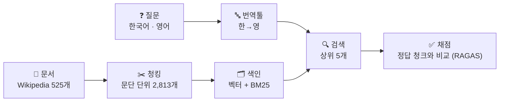

# Cineverse 검색 성능 평가 — 회의 보고

> 2026-11-25 팀 회의 보고 · 기준 코드 `dev @ fcffcd4`
> 연습용 시험(dry-run)이라 정식 기록(`results/`)은 아님
> 원본 시각화: Claude 아티팩트 "Cineverse 검색 성능 평가" (같은 데이터로 이 문서를 다시 썼음)

---

## 한눈에 보기

| | 결과 | 한 줄 해석 |
|---|---|---|
| 🏁 **기준선 후보** | **B 하이브리드** | 문서를 보지 않고 만든 질문의 **97%**에서 정답이 5위 안에 들어옴 |
| 🇰🇷 **한국어 질문** | **93.9%** | 번역툴을 거치면 영어 질문(97.0%)과 거의 같음 |
| ⚠️ **가장 큰 약점** | **21.8%** | 작품 이름표(머리말)가 붙은 청크 비율. 에피소드·캐릭터 문서는 **0%** |
| 🚫 **검색만으로는 못 하는 일** | **근거 부족 판단** | 답이 없는 질문도 유사도가 비슷하게 나와 걸러지지 않음. 답변 단계에서 판단해야 함 |

### 💡 핵심 인사이트 (요약)

1. **검색 자체는 생각보다 잘 된다.** 하이브리드(벡터+BM25)가 세 방식 중 5위 안 적중률이 가장 높아 기준선으로 적당하다.
2. **한국어는 번역툴로 해결된다.** 한국어를 그대로 넣으면 9~13%밖에 못 찾지만, 번역툴을 거치면 93~94%로 영어와 거의 같다.
3. **다음 개선은 청크에 작품 이름표를 붙이는 일이다.** 에피소드·캐릭터 청크는 `work_id`가 비어 있어 이름표가 하나도 없고, 그 결과 단어 검색(BM25)이 에피소드에서 58%로 떨어진다.
4. **1위 정확도는 재정렬(C)로 끌어올릴 여지가 있다.** 5위 안에는 들지만 1위가 아닌 질문이 많다.
5. **근거 부족 판단은 검색이 아니라 답변 단계의 과제다.** 따로 평가 지표(Faithfulness 등)가 필요하다.

> 🎤 **발표 포인트** "검색 자체는 생각보다 잘 됩니다. 하이브리드 검색이 기준선으로 적당하고, 한국어도 번역툴로 해결됩니다. 다음 개선은 청크에 작품 이름표를 붙이는 일이고, 근거 부족 판단은 답변 단계 과제입니다."

---

## 1. 무엇을 어떻게 쟀나



텍스트로 보면: 📄 문서 525개 → ✂️ 청크 2,813개 → 🗂️ 벡터+BM25 색인 → ❓ 질문(→ 🔤 번역툴) → 🔍 상위 5개 → ✅ 정답 청크와 비교

### 질문 세트 두 개

| 세트 | 만든 방법 | 문항 | 특징 |
|---|---|---|---|
| **blind** | 문서를 보지 않고 쓴 질문 | 40개 (답 있는 33 + 답 없는 7) | 실제 사용자에 가까워 **보수적인 점수** |
| **chunk** | 청크를 보고 쓴 질문 (튜터 가이드 방식) | 60개 | 만들기 쉽지만 **점수가 높게 나오는 경향** |

### 검색 방식 세 개

| 방식 | 하는 일 |
|---|---|
| **A 벡터** | 뜻이 비슷한 문단을 찾음 (text-embedding-3-small, 코사인 유사도) |
| **BM25** | 같은 단어가 많은 문단을 찾음 |
| **B 하이브리드** | 두 순위를 섞음 (RRF, k=60) |
| C 재정렬 | 아직 시험하지 않음 |

### 청킹 결과 숫자

| 항목 | 값 |
|---|---|
| 청크 / 문서 | 2,813개 / 525개 |
| 청크 길이 | 중앙값 529자, 최대 1,830자 |
| 짧은 문단 합침 | 155번 합침, 150자 미만으로 남은 것 7개 (문단 1개짜리 섹션) |
| 청크 ID 중복 | 수정 전 26개 → 번호 이어 세기로 **0개** |
| 머리말 있는 청크 | 614개 (21.8%) |

---

## 2. 질문 하나하나가 몇 위에서 잡혔나

칸 하나가 질문 하나입니다 (B 하이브리드, 질문 번호 순).

🟩 1위 🟦 2~5위 🟧 6~10위 🟥 10위 안에 없음

**blind 질문 (영어, 33문항)** — 🟩 18 · 🟦 14 · 🟥 1

```
🟩🟦🟩🟩🟩🟦🟦🟦🟦🟦🟦🟩🟩🟩🟩🟦🟩🟦🟦🟩
🟩🟦🟩🟦🟩🟩🟦🟩🟦🟩🟩🟩🟥
```

**chunk 질문 (영어, 60문항)** — 🟩 43 · 🟦 13 · 🟧 1 · 🟥 3

```
🟩🟩🟩🟦🟦🟩🟩🟩🟩🟩🟩🟩🟩🟩🟦🟥🟧🟩🟩🟩
🟦🟩🟩🟦🟥🟦🟦🟩🟦🟩🟩🟩🟦🟩🟦🟩🟩🟦🟦🟩
🟩🟩🟩🟩🟥🟦🟩🟩🟩🟩🟩🟩🟩🟩🟩🟩🟩🟩🟩🟩
```

### 검색 방식 비교

**정답이 5위 안에 든 비율 (hit@5)**

| 세트 | 방식 | 그래프 | 값 |
|---|---|---|---|
| blind | A 벡터 | `███████████████████░` | 93.9% |
| blind | BM25 | `██████████████████░░` | 87.9% |
| blind | **B 하이브리드** | `███████████████████░` | **97.0%** |
| chunk | A 벡터 | `██████████████████░░` | 91.7% |
| chunk | BM25 | `█████████████████░░░` | 85.0% |
| chunk | **B 하이브리드** | `███████████████████░` | **93.3%** |

**1위 정확도 (MRR@10, 1위면 1점)**

| 세트 | 방식 | 그래프 | 값 |
|---|---|---|---|
| blind | A 벡터 | `█████████████░░░░░░░` | 0.656 |
| blind | BM25 | `██████████████░░░░░░` | 0.680 |
| blind | **B 하이브리드** | `██████████████░░░░░░` | **0.712** |
| chunk | **A 벡터** | `█████████████████░░░` | **0.852** |
| chunk | BM25 | `█████████████░░░░░░░` | 0.674 |
| chunk | B 하이브리드 | `████████████████░░░░` | 0.801 |

<details>
<summary>숫자 표 전체</summary>

| 세트 | 구성 | Precision@5 | Recall@5 | hit@5 | MRR@10 |
|---|---|---|---|---|---|
| blind (33) | A 벡터 | 0.285 | 0.727 | 0.939 | 0.656 |
| blind (33) | BM25 단독 | 0.255 | 0.606 | 0.879 | 0.680 |
| blind (33) | B 하이브리드 | 0.303 | 0.742 | 0.970 | 0.712 |
| chunk (60) | A 벡터 | 0.220 | 0.917 | 0.917 | 0.852 |
| chunk (60) | BM25 단독 | 0.203 | 0.833 | 0.850 | 0.674 |
| chunk (60) | B 하이브리드 | 0.223 | 0.933 | 0.933 | 0.801 |

Precision@5는 정답이 1개인 질문에서 최대 0.2라 비교에 쓰지 않습니다.
</details>

> 🎤 **발표 포인트** "거의 모든 칸이 초록·파랑입니다. 세 방식 중 하이브리드가 5위 안 적중률이 가장 높아 기준선으로 제안합니다. 1위 정확도는 벡터가 더 높은 경우가 있어서, 재정렬(C 구성)로 1위를 끌어올리는 게 다음 단계입니다. chunk 질문이 점수가 더 높은 건 청크를 보고 만든 질문이라 그렇고, 실제 성능은 blind 쪽에 가깝습니다."

---

## 3. 한국어로 물어도 찾을까 — 번역툴 효과

한국어 질문을 넣는 방법별, 정답이 5위 안에 든 비율 (B 하이브리드)

| 경로 | blind | | chunk | |
|---|---|---|---|---|
| 영어 원문 (참고) | `███████████████████░` | 97.0% | `███████████████████░` | 93.3% |
| 한국어 그대로 | `██░░░░░░░░░░░░░░░░░░` | 9.1% | `███░░░░░░░░░░░░░░░░░` | 13.3% |
| 별칭만 (작품명 영어 덧붙임) | `███████░░░░░░░░░░░░░` | 36.4% | `██████░░░░░░░░░░░░░░` | 28.3% |
| **번역툴** | `███████████████████░` | **93.9%** | `███████████████████░` | **93.3%** |

**한국어 → 번역툴, 질문별 순위**

blind (33문항) — 🟩 15 · 🟦 16 · 🟧 1 · 🟥 1

```
🟩🟦🟩🟦🟩🟦🟩🟦🟦🟦🟦🟩🟩🟩🟩🟧🟦🟦🟦🟦
🟩🟦🟩🟦🟩🟩🟦🟩🟦🟦🟩🟩🟥
```

chunk (60문항) — 🟩 40 · 🟦 16 · 🟧 1 · 🟥 3

```
🟩🟩🟩🟩🟦🟩🟩🟩🟩🟩🟦🟦🟩🟩🟦🟥🟥🟩🟦🟩
🟦🟩🟩🟩🟥🟦🟦🟩🟦🟩🟦🟩🟦🟩🟩🟧🟦🟩🟩🟩
🟩🟦🟩🟩🟦🟩🟩🟩🟩🟩🟩🟩🟩🟦🟩🟦🟩🟩🟩🟩
```

<details>
<summary>숫자 표 전체</summary>

| 세트 | 경로 | hit@5 | Recall@5 | MRR@10 |
|---|---|---|---|---|
| blind | 영어 원문 (참고) | 0.970 | 0.742 | 0.712 |
| blind | 한국어 그대로 | 0.091 | 0.030 | 0.077 |
| blind | 별칭만 | 0.364 | 0.288 | 0.272 |
| blind | 번역툴 | 0.939 | 0.788 | 0.678 |
| chunk | 영어 원문 (참고) | 0.933 | 0.933 | 0.801 |
| chunk | 한국어 그대로 | 0.133 | 0.117 | 0.093 |
| chunk | 별칭만 | 0.283 | 0.267 | 0.203 |
| chunk | 번역툴 | 0.933 | 0.933 | 0.784 |

번역툴 = `tools.translation.rewrite_movie_query` (서비스 경로와 같음). 별칭만 = `normalize_query` (LLM 없이 별칭 사전으로 영어 작품명만 덧붙임).
</details>

> 🎤 **발표 포인트** "문서가 영어라 한국어를 그대로 넣으면 거의 못 찾습니다. 작품명만 영어로 붙여도 부족합니다. 우리 번역툴을 거치면 영어로 물었을 때와 거의 같습니다. 다만 'S.H.I.E.L.D.'가 'SHIELD'로 바뀌는 식의 표기 차이로 순위가 떨어진 사례가 있어 별칭에 표기를 고정하면 좋겠습니다."

---

## 4. 약점 — 작품 이름표가 없는 청크

청크 앞에 `[작품명 · 연도 · Phase]` 이름표(머리말)를 붙여야 "어느 작품 이야기인지" 검색이 알 수 있습니다. 그런데 이름표가 붙은 청크가 일부뿐입니다.

**청크 100개 중 이름표가 있는 수 — 22개** (🟩 있음 ⬜ 없음)

```
🟩🟩🟩🟩🟩🟩🟩🟩🟩🟩
🟩🟩🟩🟩🟩🟩🟩🟩🟩🟩
🟩🟩⬜⬜⬜⬜⬜⬜⬜⬜
⬜⬜⬜⬜⬜⬜⬜⬜⬜⬜
⬜⬜⬜⬜⬜⬜⬜⬜⬜⬜
⬜⬜⬜⬜⬜⬜⬜⬜⬜⬜
⬜⬜⬜⬜⬜⬜⬜⬜⬜⬜
⬜⬜⬜⬜⬜⬜⬜⬜⬜⬜
⬜⬜⬜⬜⬜⬜⬜⬜⬜⬜
⬜⬜⬜⬜⬜⬜⬜⬜⬜⬜
```

**문서 종류별 이름표 비율**

| 종류 | 청크 수 | 이름표 있음 | 그래프 | 비율 |
|---|---|---|---|---|
| episode | 1,163 | 0 | `░░░░░░░░░░░░░░░░░░░░` | **0%** |
| film | 841 | 373 | `█████████░░░░░░░░░░░` | 44.4% |
| series | 430 | 154 | `███████░░░░░░░░░░░░░` | 35.8% |
| character | 215 | 0 | `░░░░░░░░░░░░░░░░░░░░` | **0%** |
| season | 103 | 56 | `███████████░░░░░░░░░` | 54.4% |
| short | 40 | 12 | `██████░░░░░░░░░░░░░░` | 30.0% |
| special | 21 | 19 | `██████████████████░░` | 90.5% |

**그 결과: 문서 종류별 BM25(단어 검색)의 5위 안 적중률 (chunk 질문)**

| 종류 | 문항 | 그래프 | BM25 hit@5 |
|---|---|---|---|
| film | 24 | `██████████████████░░` | 87.5% |
| **episode** | 12 | `████████████░░░░░░░░` | **58.3%** ⬅ |
| character | 8 | `████████████████████` | 100% |
| season | 5 | `████████████████░░░░` | 80.0% |
| series | 5 | `████████████████████` | 100% |
| short | 3 | `████████████████████` | 100% |
| special | 3 | `████████████████████` | 100% |

에피소드는 이름표가 없어 질문 속 시리즈명과 맞출 단어가 없습니다. 문항이 3~8개인 종류는 1문항이 12~33%p라 참고만 하세요.

<details>
<summary>숫자 표 전체</summary>

| 종류 | 문항 | 벡터 | BM25 | 하이브리드 | 하이브리드 MRR |
|---|---|---|---|---|---|
| film | 24 | 0.875 | 0.875 | 0.917 | 0.788 |
| episode | 12 | 0.917 | 0.583 | 0.917 | 0.708 |
| character | 8 | 1.000 | 1.000 | 1.000 | 1.000 |
| season | 5 | 0.800 | 0.800 | 0.800 | 0.667 |
| series | 5 | 1.000 | 1.000 | 1.000 | 0.667 |
| short | 3 | 1.000 | 1.000 | 1.000 | 1.000 |
| special | 3 | 1.000 | 1.000 | 1.000 | 1.000 |
</details>

> 🎤 **발표 포인트** "에피소드 청크와 캐릭터 청크에는 작품 정보가 연결되어 있지 않아 이름표가 하나도 없습니다. 그래서 단어 검색이 에피소드에서 특히 약합니다. 작품 연결(`work_id`)을 채워 이름표를 붙이는 게 첫 번째 개선 과제입니다."

---

## 5. 놓친 질문은 왜 놓쳤나

| | 원인 | 사례 | 개선안 |
|---|---|---|---|
| 🎭 | **비슷한 장면 혼동** | "T'Challa를 이긴 사람?" → Killmonger 결투 대신 M'Baku 결투 문단이 1위 | 재정렬(C) 시험, 긴 문단 나누기 |
| 🧩 | **문단이 맥락을 잃음** | 정답 문단이 "Pietro dies…"로 시작해 Sokovia라는 단어가 없음 / 에피소드에 시리즈명 없음 | 이름표 보강, 앞 문단 문장 겹치기 |
| 🗣️ | **표현이 다름** | "누가 연기하나" 질문 ↔ 출연진 나열 "stars as…" | 질문 확장, 출연진 문단에 이름표 |
| 📝 | **정답 표시 누락** | 3위 문단에도 같은 답이 있었음. 검색은 맞았고 채점표가 부족 | 평가셋 정답 넓히기 |

<details>
<summary>놓친 질문 목록</summary>

| ID | 세트 | 질문 | 정답 순위 | 원인 | 근거 | 개선안 |
|---|---|---|---|---|---|---|
| c016 | chunk | Who defeats T'Challa in the challenge for Wakanda's throne? | 10위 밖 | 비슷한 장면 혼동 | M'Baku 결투 청크가 1위. Killmonger 결투는 긴 정답 청크 중간에 묻힘 | 재정렬(C) · 긴 문단 분할 |
| c017 | chunk | Which speedster dies protecting Clint Barton during the battle in Sokovia? | 8 | 문단만 떼면 맥락 없음 | 정답 문단이 "Pietro dies…"로 시작, Sokovia·speedster 없음 | 앞 문단 문장 겹치기(overlap) |
| c045 | chunk | Who works to restore S.H.I.E.L.D. following Coulson's death? | 10위 밖 | 머리말 없음 | 에피소드 청크에 시리즈·시즌 정보가 없고 질문도 모호 | 에피소드 머리말 보강 |
| q034 | blind | Which actor plays the title character in She-Hulk: Attorney at Law? | 10위 밖 | 표현 차이 | "who plays" 질문 ↔ 출연진 나열 "stars as…" | 쿼리 확장 · 출연진 청크 머리말 |
| c025 | chunk | What mission does the TVA give Loki after he takes the Tesseract? | 10위 밖 | 정답 표시 누락 | 3위 청크에도 같은 답. 검색은 맞음 | 평가셋 gold 확장 |

</details>

> 🎤 **발표 포인트** "놓친 질문은 몇 개뿐이고, 원인은 네 가지로 나뉩니다. 대부분 청킹과 이름표 쪽에서 고칠 수 있고, 하나는 검색이 아니라 채점표 문제였습니다."

---

## 6. "근거 부족"은 검색 점수로 못 거른다

1위 문단과의 유사도 분포입니다 (blind 질문, 영어). 🔵 답이 있는 질문 · 🔴 문서에 답이 없는 질문

```
유사도        답 있음(33)                    답 없음(7)
0.40~0.45 │ 🔵                           │
0.45~0.50 │                              │
0.50~0.55 │                              │ 🔴
0.55~0.60 │ 🔵🔵🔵🔵                     │
0.60~0.65 │ 🔵🔵🔵🔵🔵🔵🔵🔵🔵           │ 🔴🔴🔴🔴🔴
0.65~0.70 │ 🔵🔵🔵🔵🔵🔵🔵🔵🔵           │ 🔴
0.70~0.75 │ 🔵🔵🔵🔵🔵🔵🔵🔵🔵🔵         │
```

| 그룹 | 문항 | 평균 유사도 | 경계값 |
|---|---|---|---|
| 답이 있는 질문 | 33 | 0.655 | 최소 0.411 |
| 문서에 답이 없는 질문 | 7 | 0.615 | **최대 0.668** |

답이 없는 질문(🔴)도 답이 있는 질문과 같은 구간(0.60~0.70)에 섞여 있어, **기준선 하나로 나눌 수 없습니다.** 0.668보다 높게 기준을 잡으면 답이 있는 질문 중 절반 가까이를 버리게 됩니다.

> 🎤 **발표 포인트** "'Wanda가 소울 스톤을 파괴한 이유'처럼 전제가 틀린 질문도 관련 문단은 실제로 있어서 검색은 정상적으로 가져옵니다. 그래서 근거가 부족하다거나 전제가 틀렸다는 판단은 답변을 만드는 단계에서 해야 하고, 따로 평가해야 합니다."

---

## 7. 이 결과를 읽을 때 주의할 점

- ⚗️ **연습용 시험입니다.** pgvector 대신 메모리 검색으로 돌렸고, 재정렬(C)은 아직 하지 않았습니다.
- 🔢 **질문 수가 적습니다.** blind는 1문항이 약 3%p라 3~5%p 차이는 우연일 수 있습니다.
- 🤖 **질문과 채점표는 Codex가 만들었습니다.** chunk 세트는 정답이 1개뿐인 질문이 많아 점수가 낮게 잡힐 수 있습니다.
- 🔧 **새로 만든 blind 질문 6개(q035~q040)는 한국어 문장이 깨져 있어 수정 중입니다.**
- 📐 **설계서와 데이터가 다른 점:** 문서 ID 형식 두 가지, 출처가 Wikipedia뿐, 정식 작품 필터용 칸 없음.

---

## 8. 회의에서 정할 것

| # | 안건 | 제안 | 결정 |
|---|---|---|---|
| 1 | 기준선을 B 하이브리드로 확정할까? | 이후 모든 개선은 이 점수와 비교 | |
| 2 | 평가 질문 세트를 언제 고정할까? | 한글 깨짐 · 정답 넓히기 수정 후 고정, 100문항 이상으로 확장, dev / test 분리 | |
| 3 | 합격선(임계치)은? | 잠정안: 5위 안 적중률 90% 이상, 문서 종류별 MRR 0.75 이상 | |
| 4 | 개선 담당과 순서 | ① 이름표 보강 (문서·색인) ② 재정렬 C 시험 (검색·재정렬) ③ 번역 표기 고정 (응답·최적화) | |
| 5 | 설계서 고칠 곳 | 청크 ID 번호 규칙, 문서 ID 형식, synopsis 정의 | |
| 6 | 근거 부족 판단은 어떻게 평가할까? | 답변 단계의 판단을 RAGAS 응답 지표(Faithfulness 등)로 | |

---

## 지표와 용어 설명

| 용어 | 뜻 |
|---|---|
| **5위 안 적중률 (hit@5)** | 상위 5개 결과 안에 정답 문단이 하나라도 있는 질문의 비율 |
| **MRR@10** | 첫 정답의 순위를 점수로 바꾼 평균. 1위면 1점, 2위면 0.5점, 10위 밖이면 0점 |
| **Recall@5** | 대표 정답 문단(`primary_gold`) 중 상위 5개에 들어온 비율 (RAGAS `IDBasedContextRecall`) |
| **Precision@5** | 상위 5개 중 정답 문단의 비율 (RAGAS `IDBasedContextPrecision`) |
| **blind / chunk** | 문서를 보지 않고 만든 질문 / 문단을 보고 만든 질문 |
| **머리말 (이름표)** | 청크 앞에 붙이는 `[작품명 · 연도 · 형식 · Phase]`. 검색에만 쓰고 인용 본문에는 넣지 않음 |

### 재현 방법

```powershell
uv run python scripts/chunk_dryrun.py
$env:PYTHONPATH = "src"
uv run python scripts/eval_retrieval.py --questions tmp/questions_blind_v2.jsonl --lang en
uv run python scripts/eval_retrieval.py --questions tmp/questions_blind_v2.jsonl --lang ko_tr
uv run python scripts/eval_retrieval.py --questions tmp/questions_from_chunks.jsonl --lang en
uv run python scripts/eval_retrieval.py --questions tmp/questions_from_chunks.jsonl --lang ko_tr
```

자세한 분석은 [retrieval_eval_2026-11-25.md](retrieval_eval_2026-11-25.md), 청킹 1차 시험은 [chunk_dryrun_2026-11-25.md](chunk_dryrun_2026-11-25.md) 참고.
